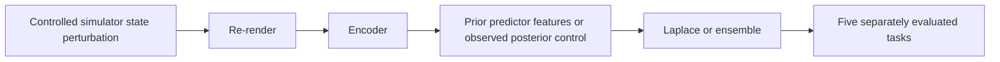
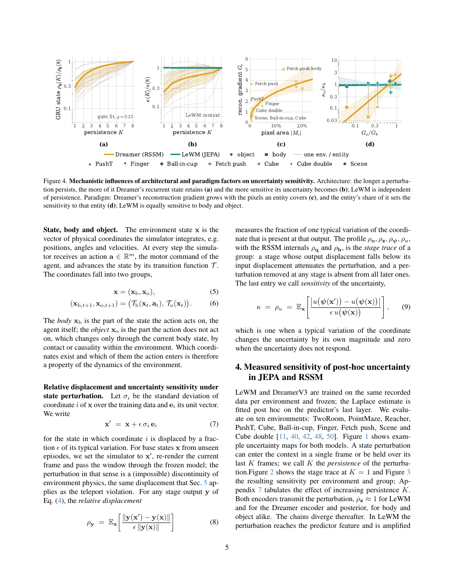

# Not all world models can doubt: how training objective and architecture shape epistemic uncertainty in JEPA and RSSM world models

[English](README-en.md)

## 论文信息

| 字段 | 内容 |
| --- | --- |
| 论文链接 | [固定 v1](https://arxiv.org/abs/2611.34830v1)；[原文 PDF](https://arxiv.org/pdf/2611.34830v1) |
| 公司 / 作者机构 | Fraunhofer Heinrich-Hertz-Institut, Berlin, Germany；一作 Simon Baur：Fraunhofer Heinrich-Hertz-Institut |
| 首次公开日期 | `2026-11-25T18:11:49Z`（arXiv v1）；本轮发现/审查日 2026-11-26，不混作首发时间 |
| arXiv 公告日期 | `2026-11-26`；已核本轮官方 cs.LG new / cs.AI cross-list 公告，不改写 v1 首发时间 |
| 原作者开源代码 | 未找到 / 尚未发布。固定 v1 PDF/HTML/摘要未找到专属作者实现链接；有界精确标题/作者入口搜索未找到可核实公开源码，未找到/尚未发布。引用的LeWorldModel与Dreamer代码不等于本文实验实现。 |
| 本地 adapter / 稳定键 | `jepa-eu`；`adapter: null`；不接入 Evolve |
| 本地复现代码目录 | 无；高成本 review-only，不提供本地实现 |
| 实现状态 | review-only / deferred_high_cost；没有CUDA承诺或能力提升声明 |

## 原始论文总结

### 背景与主要改动

冻结LeWM与DreamerV3后，在预测头最后线性层前的特征上拟合last-layer Laplace，并用五头ensemble对照。对物理状态做标准差尺度扰动再由模拟器重渲染，追踪各层相对位移；延长扰动持续K帧可分离GRU平均效应，按实体重建梯度与像素面积分析小物体效应。此处是实证诊断，不是已完成移除重建项/改变gate的因果消融，也不证明所有RSSM或JEPA都如此。

<!-- paper-figure:start -->
### 原论文关键图

图片来自[原论文](https://arxiv.org/pdf/2611.34830v1#page=5)；未经科学内容编辑的整页栅格，含 Figure 4 完整图注，2026-11-26 已目视核对。版权归原作者所有；图中方法/结果不是本地测量。[来源与 SHA256](assets/provenance.json)。
<!-- paper-figure:end -->

### 核心公式

For frozen predictor feature $\psi$:

$$
\Lambda=\sigma^{-2}\sum_n\psi_n\psi_n^\top+\tau^{-2}I,\qquad s^2(\psi)=\psi^\top\Lambda^{-1}\psi.
$$

$$
x'=x+\epsilon\sigma_i e_i,\qquad
\rho_y=\mathbb E_x\frac{\|y(x')-y(x)\|}{\epsilon\|y(x)\|},\quad \kappa=\rho_{s^2}.
$$

Laplace只依赖输入特征：若扰动在前面被消掉，换最后读出也看不见。RSSM GRU把单帧扰动按gate缩放，持续扰动才累积；重建目标按像素贡献优化。posterior需观察帧，不可当作规划时可用的prior特征。

### 论文离线与线上效果

作者Table1中PushT的unfamiliar-state AUROC，body为LeWM .96 / Dreamer .73、object为.98 / .80；Finger等部分格子Dreamer更高。物理shift并非始终JEPA领先，Scene/Cube double也有失败。只比较一种LeWM和一种Dreamer类RSSM，bootstrap是固定模型的评测波动，不是多模型训练seed收益。生产线上 A/B：未报告。

### 同主题比较与边界

JEPA EU沿模拟器状态到像素、encoder、预测特征及post-hoc uncertainty逐层追踪扰动，区分RSSM的GRU时间平均与重建目标实体像素权重。 [已审读的对照：jepa-prediction-planning](../2610.19375-jepa-prediction-planning/README.md)。预测—规划评测拆表示误差、预测误差和环境成功；JEPA EU分析不确定性在何层丢失。低一步误差、敏感uncertainty及更好规划是不同证据。观测posterior head可恢复当前帧异常信号，但不能用于没有未来观察的imagined rollout。 对照README的SHA256记录于本轮deep-dive提案。

## 本地复现

### 数据协议与代码映射

没有本地模型实现、adapter、operator、运行命令、metrics或GPU回执。没有以通用Laplace公式或手工异常数组冒充本文多环境比较。这里只交付固定v1原文审查、图源与教学问答。

无运行命令。

### 结果与负控

本地未执行训练、五项任务或控制成功率测量。阅读时保留negative cells、prior/posterior区别，以及论文将来才建议开展的因果消融；不把相关性回归当作已实施架构干预。

### 高成本完整实验

两模型在10视觉控制环境分别训练/冻结；LeWM ViT-Tiny224输入、6层预测器、特征2048，未有官方checkpoint时100 epochs；Dreamer small为64输入、GRU512、32×32分类状态，100 epochs。CEM每次300候选×30迭代，每格200episodes×3seeds、多个lambda与两种困难场景；另有五头ensemble。作者只给post-hoc head计时用单H200，未报全训练GPU小时或完整数据规模。按多环境训练与长rollout矩阵判断明显超本轮单A100/A30或Mac边界，不下载模型/数据，不以昂贵探跑估价。

**成本过高，不复现（审查 DONE）**，指完整论文实验矩阵；局部CPU组件与完整矩阵分开。终态 `not_reproduced_high_cost`，不下载大资源、不试训估价、不自动重试、不进入自动实现队列或Evolve；不让完整实验延期阻塞本轮审查闭环。
