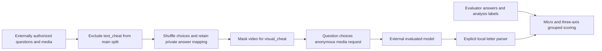
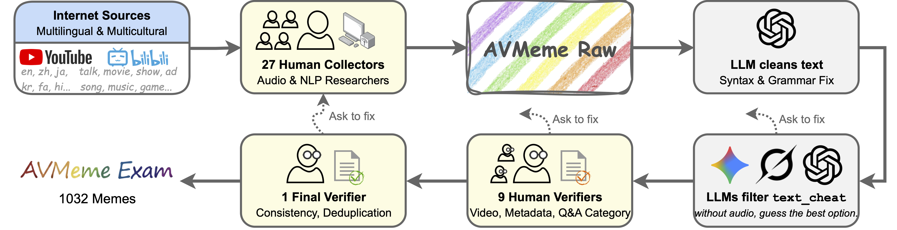

<!-- source-sha256: b15117171e859acb5417e58dd8447c9895ef7a210dda4bc20422fe86201c59bc -->
# AVMeme Exam: multilingual, multicultural audiovisual meme evaluation

[简体中文](README.md)

> **L0 evaluation-protocol interface, not a reproduction of multimodal capability.** The local code implements option shuffling, text-shortcut exclusion, visual-shortcut masking and grouped scoring. It neither downloads access-controlled media nor calls an evaluated model.

## Paper information

| Field | Value |
| --- | --- |
| Paper | [arXiv:2601.17645v1](https://arxiv.org/abs/2601.17645v1), [fixed text](https://arxiv.org/html/2601.17645v1) |
| Institution / company / university | First author Xilin Jiang: Columbia University. Coauthors Cong Han and Yinghao Aaron Li are affiliated with Google and Meta respectively; these are not substituted for the first author's affiliation |
| Original publication | **2026-01-25 01:40:15 UTC**; a historical backfill, not a new release |
| Authors' code | The [official project](https://avmemeexam.github.io/public/) and [data/loading instructions](https://huggingface.co/datasets/naplab/AVMeme-Exam) are public. A complete model-evaluation framework was not confirmed released. The dataset requires acceptance of access conditions |
| Local adapter / key | `avmeme-exam`; `adapter=null`; not integrated with Evolve |
| Local code | `src/auto_research/multimodal/avmeme_exam.py` |

## Paper summary

### Background and main changes

Speech benchmarks often emphasize transcription and acoustic events rather than culturally situated humor, connotations or uses. AVMeme Exam uses multiple-choice questions over multilingual, multicultural short clips to examine audio, language, context, emotion, popularity, application and world knowledge. `meme-full` contains 1,032 examples; the text-shortcut-filtered `meme-main` contains 846.

Three text-only LLMs identify `text_cheat` examples answerable without hearing the clip; the main split excludes them. If video reveals the answer, `visual_cheat` requires removing video even from audiovisual evaluation. Options are shuffled. Audio uses 16 kHz mono; video uses 1 fps and 360p with preserved aspect ratio; clips are at most 30 seconds.

### Architecture and flow



Only the protocol and scoring are local. Transcoding, upload, inference and shortcut annotation remain external.

<!-- paper-figure:start -->
### Key original figure

[](https://arxiv.org/html/2601.17645v1/figure/data_pipeline.png)

Original Figure 3 shows 27 collectors, text cleaning, LLM shortcut detection and human verification. This is the unchanged original HTML PNG, not a redrawing or crop. Source: [fixed paper](https://arxiv.org/html/2601.17645v1#S1.F3); copyright remains with the authors. Local fixtures do not reproduce collection or human annotation.
<!-- paper-figure:end -->

### Core equations

For option permutation π, the private correct letter must change accordingly:

$$
S_{main}=\{i:\neg text\_cheat_i\},\qquad
Acc(S)=\frac{1}{|S|}\sum_{i\in S}\mathbf1[\hat y_i=\pi_i(y_i)].
$$

The interface reports micro accuracy, counts and scores by question type, sound category and language. The fixed-v1 overall AVG is not reproduced by simply averaging seven displayed question-type percentages, so no guessed seven-type macro AVG is claimed. The strict local parser accepts only `A` or `(A)`; free text, multiple letters and out-of-range responses count incorrect. This explicit convention is not claimed to match every upstream backend.

### Reported results

The paper reports main-split Gemini 3 Pro accuracy of 76.6% for audio and 80.0% for audiovisual input; Qwen3-Omni obtains 55.4% and 57.4%. These are paper-reported offline scores, not local measurements or online A/B results. Cultural coverage, annotator demographics and temporal drift limit the conclusions; correct multiple-choice answers do not establish reliable real-world cultural judgment.

## Local implementation

### Data protocol and code mapping

`Item` holds evaluator answers and shortcut labels. `prepare` separates `ActorRequest` from `ScoringKey`. The evaluated callback receives questions, shuffled choices and an anonymous-media format contract, not identities, original titles, source URLs, summaries, transcriptions, analysis labels or answers. This typed boundary is not a security sandbox; callers must still isolate permissions and inspect question text for leakage.

`evaluate` makes one fixed pass, retains invalid responses and group denominators, and performs neither retries nor result-based model selection. Media fields are contracts, not evidence of media processing or inference.

```bash
PYTHONPATH=src python -c 'from auto_research.multimodal.avmeme_exam import diagnostic; print(diagnostic(42))'
PYTHONPATH=src python -m pytest tests/test_avmeme_exam.py -q
```

### Checks and negative controls

Tests cover shuffled-answer mapping, split differences, video masking, invalid-response handling, group denominators and empty-set rejection. The fixture callback always returns `A` and never reads answers. Diagnostics publish protocol counts, not fixture “model accuracy.” See the [three-seed CPU protocol receipt](metrics/component-cpu-seeds42-44.json). There is no CUDA model path and no fabricated GPU receipt.

### Boundaries and full experiment

The dataset requires access-condition acceptance. Annotations use CC BY 4.0, while source-media licenses differ. This round neither bypasses access controls nor downloads approximately 774 MB of media. The full 19-model matrix, human verification and multi-backend inference exceed the bounded single-card scope: **high cost; not reproduced (review DONE)**. No unsupported total single-GPU runtime is invented. This L0 interface is not a complete benchmark integration, capability comparison or Evolve promotion signal.
