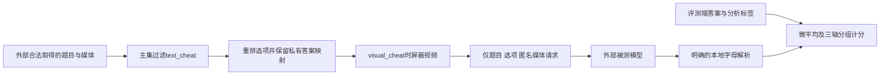
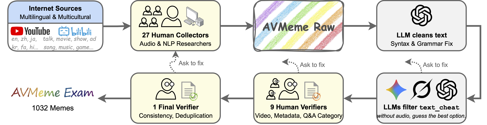

# AVMeme Exam：多语言、多文化音视频梗理解评测

[English](README-en.md)

> **L0 评测协议接口，不是多模态模型能力复现。** 本地实现选项重排、文本捷径过滤、视觉捷径屏蔽与分组计分；没有下载受访问条件约束的媒体数据，也没有调用被测模型。

## 论文信息

| 字段 | 内容 |
| --- | --- |
| 论文 | [arXiv:2601.17645v1](https://arxiv.org/abs/2601.17645v1)，[固定原文](https://arxiv.org/html/2601.17645v1) |
| 公司 / 机构 / 学校 | 一作 Xilin Jiang：Columbia University；合作者 Cong Han 属 Google、Yinghao Aaron Li 属 Meta，不把合作机构误写成一作机构 |
| 原始发布日期 | **2026-01-25 01:40:15 UTC**；本轮是历史补漏，不是新首发 |
| 原作者开源代码 | [官方项目](https://avmemeexam.github.io/public/)与[数据及加载说明](https://huggingface.co/datasets/naplab/AVMeme-Exam)公开；完整模型评测框架源码未确认发布。数据页要求接受访问条件，不等于无条件可下载的媒体 |
| 本地 adapter / key | `avmeme-exam`；`adapter=null`；未接入 Evolve |
| 本地代码 | `src/auto_research/multimodal/avmeme_exam.py` |

## 原始论文总结

### 背景与主要改动

常见语音基准偏向转写与声学事件，难以判断模型是否理解声音在特定社区中的隐喻、幽默和使用场景。AVMeme Exam 收集多语言、多文化短音视频，以选择题同时考察音频、语言、情境、情绪、流行原因、应用方式和世界知识。完整集 `meme-full` 有 1,032 条，移除文本捷径后的主集 `meme-main` 有 846 条。

关键并不只是新增选择题。作者用三个纯文本模型检测无需听音频即可答对的 `text_cheat` 样本；主集过滤这些样本。若视频直接暴露答案，`visual_cheat` 标记要求在音视频实验中移除视频。选项随机重排，音频统一为 16 kHz 单声道，视频 1 fps、360p 并保持宽高比，片段最长 30 秒，以降低接口差异和非目标捷径。

### 架构与流程



本地只有协议与计分部分；媒体转码、上传、模型推理和捷径标注生成均由外部提供。

<!-- paper-figure:start -->
### 原论文关键图

[](https://arxiv.org/html/2601.17645v1/figure/data_pipeline.png)

原文 Figure 3 展示 27 位采集者、文本清理、LLM 捷径检测与人工复核。直接保存官方 HTML 原始 PNG，无重画或裁剪；图片来自[固定原文](https://arxiv.org/html/2601.17645v1#S1.F3)，版权归原作者。本地没有重做数据采集或用夹具代替人工标注。
<!-- paper-figure:end -->

### 核心公式

令重排排列为 π，私有正确字母必须随之更新，而不是仍使用原始字母。主集选择和正确率为：

$$
S_{main}=\{i:\neg text\_cheat_i\},\qquad
Acc(S)=\frac{1}{|S|}\sum_{i\in S}\mathbf1[\hat y_i=\pi_i(y_i)].
$$

本地明确报告微平均、样本数及按题型、声音类别、语言划分的准确率。固定 v1 的总 AVG 不能简单从七个题型百分数的算术平均复算，因此不猜测一个“七题型宏平均”冒充原表。字母解析严格接受 `A` 或 `(A)`；自由文本、多字母和越界回答计错，这是公开说明的本地约定，不声称等同所有原作者后端解析器。

### 论文离线与线上效果

作者报告主集 Gemini 3 Pro 音频准确率 76.6%、音视频 80.0%，Qwen3-Omni 对应 55.4% 和 57.4%。这些是论文离线多选评测，不是本地测量或线上 A/B。文化覆盖、标注者年龄分布和梗的时间漂移限制结论；选择题正确也不证明真实交互中的文化判断可靠。

## 本地复现

### 数据协议与代码映射

`Item` 保留评测端答案与捷径标签；`prepare` 返回分离的 `ActorRequest` 与 `ScoringKey`。被测回调只能收到题目、重排选项及匿名媒体格式合同，不收到身份、原始标题、来源 URL、摘要、转写、分析标签或答案。这个类型边界不是安全沙箱；调用方仍须隔离进程权限并审核问题文本是否泄漏。

`evaluate` 固定一次评测，不重试、不按结果选模型，保留无效回答和每组分母。媒体字段仅是合同，不意味着已读取、转码或推理。

```bash
PYTHONPATH=src python -c 'from auto_research.multimodal.avmeme_exam import diagnostic; print(diagnostic(42))'
PYTHONPATH=src python -m pytest tests/test_avmeme_exam.py -q
```

### 结果与负控

专测覆盖重排后的答案映射、主集/完整集区别、视频屏蔽、非法输出计错、三轴分母和空集拒绝。夹具的回调固定返回 `A`，不读取答案；诊断只记录过滤、屏蔽、非法输出等协议计数，不发布其“模型准确率”。CPU 三种子产物见 [协议诊断](metrics/component-cpu-seeds42-44.json)。没有 CUDA 模型路径，无需伪造 GPU 验证。

### 复现边界与完整实验

官方数据需接受访问条件，标注采用 CC BY 4.0，媒体另有来源许可；本轮未绕过访问门槛，也未下载约 774 MB 媒体。完整 19 模型矩阵、人工复核和多后端多模态推理不在本轮单卡预算内：**成本过高，不复现（审查 DONE）**。原文未给可直接套用的总单卡耗时，不编造卡时。本地 L0 不能称为完整基准接入、模型比较或文化理解能力复现，也不用于 Evolve 晋级。
