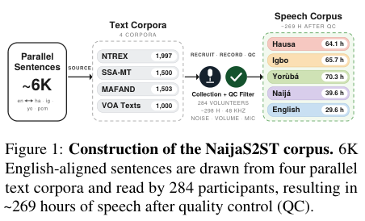

<!-- source-sha256: d0752a40d4b526bf212002291aa1da2c7ef0ff4de4554648b0b73d9a9fd12771 -->

[简体中文](README.md) · English

# NaijaS2ST: A Multi-Accent Benchmark for Speech-to-Speech Translation in Low-Resource Nigerian Languages

The benchmark builds multi-accent parallel speech between English and Hausa, Igbo, Naijá, and Yorùbá. It compares cascaded ASR→MT→TTS, end-to-end Seamless, and AudioLLMs. Full training and speech/human evaluation are too costly, so review is DONE without reproduction. A generic field validator is not integration with the official benchmark.

## Paper information

| Field | Details |
| --- | --- |
| Paper | [arXiv 2604.16287 v1](https://arxiv.org/abs/2604.16287v1); [pinned v3 review version](https://arxiv.org/html/2604.16287v3) |
| Institution | First author Marie Maltais: Mila - Quebec AI Institute. Min Ma lists Google DeepMind in the pinned v3 author block. |
| First public release | 2026-04-17 17:49:46 UTC (arXiv v1) |
| Reviewed version | Methods and resources were checked against pinned v3. Canonical identity and first release remain v1; no line-by-line equivalence between v1 and v3 is claimed. |
| Author code | [Released resources](https://github.com/McGill-NLP/naijas2st), pinned commit `02b60538e621d1afe33178a9ea60a86ed7e8f674`. The authors release speech training and evaluation scripts. Repository license is recorded separately from the paper's CC-BY resource statement, without assigning an unverified source SPDX identifier. Appendix C calls resources CC-BY, but the pinned repository has no clear license file and GitHub license=null. |
| Local adapter or method key | `naijas2st`; `adapter: null`; `deferred_high_cost`; literature only |
| Local reproduction code | No local model, training, or benchmark implementation; no metric artifacts or GPU receipts. |
| Full experiment | **Too costly; not reproduced (review DONE)**. Not queued for automatic retries or implementation. |

## Original paper summary

### Background and main changes

Pinned v3 §§3–4 and Appendix C report 284 speakers, around 6K parallel sentences, and about 269 hours after quality control. 5-shot examples come from DEV, with translation directions kept separate. Mapping unsupported Hausa to Arabic and Naijá to French in Seamless is a fine-tuned extension only. S2TT uses SSA-COMET/ChrF++; S2ST transcribes with OmnilingualASR before SSA-COMET. Text exact match is not a substitute.

<!-- paper-figure:start -->
### Key figure from the paper

**Figure 1**, page 1 of pinned v3. From the [paper](https://arxiv.org/html/2604.16287v3), copyright the authors. Scientific content and annotations are preserved; the figure is not redrawn. See [source, crop, and SHA256](assets/provenance.json).
<!-- paper-figure:end -->

### Core equations

The contribution is a data and evaluation protocol, not a new model loss. The S2ST ASR-COMET path can be expressed as:

$$
\operatorname{ASR\!-\!COMET}(\hat y_{\rm speech},y_{\rm text})
=\operatorname{SSA\!-\!COMET}(\operatorname{ASR}(\hat y_{\rm speech}),y_{\rm text}).
$$

SSA-COMET needs a real multilingual semantic model; text exact match, random embeddings, and generic field checks cannot substitute. Few-shot examples come from DEV and the formal test set remains isolated. Hausa and Naijá use proxy language tokens in some Seamless training, not native language support.

### Offline and online results

The paper's conclusions come from its actual models, data, and protocol. This page does not run the full matrix or present the paper's metrics as local results. No production online A/B is reported.

## Local reproduction

This batch verifies paper identity, affiliations, methods, resources, licenses, and cost, and records the paper and original figure. It does not wrap a generic aggregator or field check as the official benchmark interface, call models, train, or produce formal metrics.

## Scope

Each language has over 40 hours of speech. The full matrix includes Omnilingual-ASR1B, NLLB3.3B/TinyAya3B, Seamless2.3B mono/multi, 3–10 epochs across several directions, Gemini/GPT-Audio inference, TTS, and human review. This exceeds a short single-GPU budget. No audio/models are downloaded or paid APIs called.

**Too costly; not reproduced (review DONE).** This judgment follows paper configurations and resources, not a complete trial to measure cost. There are no local metrics or GPU receipts, and no implemented component is claimed.

This is a historical discovery from the official Google EMNLP conference page, not a first publication today. That page alone does not establish a Google author affiliation; individual evidence is recorded in the metadata above.
