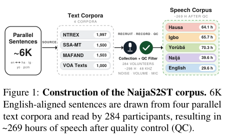

# NaijaS2ST: A Multi-Accent Benchmark for Speech-to-Speech Translation in Low-Resource Nigerian Languages

构建Hausa、Igbo、Naijá、Yorùbá与英语平行、多口音语音，比较级联ASR→MT→TTS、Seamless端到端及AudioLLM。完整训练/语音与人工评测高成本，审查DONE不复现；不另造通用字段校验器冒充已接入官方benchmark。

## 论文信息

| 字段 | 内容 |
| --- | --- |
| 论文链接 | [arXiv 2604.16287 v1](https://arxiv.org/abs/2604.16287v1)；[固定核对版本 v3](https://arxiv.org/html/2604.16287v3) |
| 公司 / 机构 / 学校 | 一作 Marie Maltais：Mila - Quebec AI Institute。固定v3作者栏Min Ma署名Google DeepMind。 |
| 首次公开日期 | 2026-04-17 17:49:46 UTC（arXiv v1） |
| 本轮版本 | 本轮方法/资源按固定v3核对，规范身份与首发时间仍为v1；未逐行声称v3与v1相同。 |
| 原作者代码 | [作者公开资源](https://github.com/McGill-NLP/naijas2st)；固定commit `02b60538e621d1afe33178a9ea60a86ed7e8f674`；作者公开语音训练/评估脚本，固定commit；仓库授权与论文CC-BY资源说明分开记录，不擅自指定源码SPDX；论文AppendixC声称资源CC-BY；固定仓库未找到明确许可证文件，GitHub license=null |
| 本地 adapter / 稳定键 | `naijas2st`；`adapter: null`；`deferred_high_cost`，仅资料收录 |
| 本地复现代码目录 | 不提供本地模型/训练/benchmark实现；无指标产物、无GPU收据 |
| 完整实验 | **成本过高，不复现（审查 DONE）**，不进入自动重试或实现队列 |

## 原始论文总结

### 背景与主要改动

核固定v3 Sections3–4及AppendixC：284说话人、约6K平行句、质控后约269h；5shot来自DEV，方向分开；Seamless不支持的Hausa映射Arabic、Naijá映射French仅为fine-tuned extension。S2TT SSA-COMET/ChrF++，S2ST先OmnilingualASR转写再SSA-COMET，不能用文本exactmatch替代。

<!-- paper-figure:start -->
### 原论文关键图

**Figure 1**，固定v3第1页。图片来自[原论文](https://arxiv.org/html/2604.16287v3)，版权归原作者所有；保留原图科学内容与标注，未重绘。[来源、裁切与SHA256](assets/provenance.json)。
<!-- paper-figure:end -->

### 核心公式

这里的“方法”是数据与评测协议，不提出新模型loss。S2ST的ASR-COMET路径可写为：
$$
\operatorname{ASR\!-\!COMET}(\hat y_{\rm speech},y_{\rm text})
=\operatorname{SSA\!-\!COMET}(\operatorname{ASR}(\hat y_{\rm speech}),y_{\rm text}).
$$
SSA-COMET依赖真实多语言语义模型；不能拿文本exact-match、随机embedding或通用字段检查代替。few-shot例子来自DEV，正式test保持隔离。Hausa/Naijá在部分Seamless训练中使用代理语言token，不代表原模型原生支持这些语言。

### 论文离线与线上效果

原文结论来自其真实模型、数据与协议；本页未运行完整矩阵，不将原文指标抄成“本地实测”。未报告生产线上 A/B。

## 本地复现

本轮仅核查论文身份、合作机构、方法/资源/许可证与成本，收录资料和原图。没有把通用聚合器或字段检查包装为官方benchmark接口；没有模型调用、训练或正式指标。

## 复现边界

每语言40余小时语音，Omnilingual-ASR1B、NLLB3.3B/TinyAya3B、Seamless2.3B mono/multi多个方向3–10epochs，另有Gemini/GPT-Audio推理、TTS和人工评审。整套明显超单卡短时预算，不下载音频/模型、不调用付费API。

**成本过高，不复现（审查 DONE）**。以上为论文配置/资源判断，未为了测成本而启动完整试跑。本页不挂本地metrics或GPU receipt，不标为组件已实现。

本轮来自Google EMNLP官方会议页的历史线索补漏，不是今天新首发，也不单凭会议页就认定作者具有Google署名；机构证据在信息块逐条注明。
