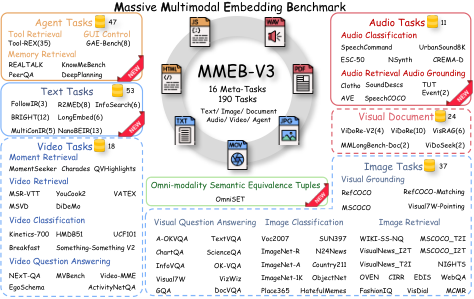

<!-- source-sha256: 9526ee3d295f108b3696153a2fe57c5d0c826bd5e3281d4b1989e69f5880989d -->
# MMEB-V3: omni-modality embedding evaluation and OmniSET diagnostics

[简体中文](README.md)

> **L0 ranking/scoring protocol, not an omni-modality encoder or a complete 190-task integration.** Rankings, full candidate pools and relevance are external inputs. No fake embeddings are generated, and OmniSET is not mixed into leaderboard scores.

## Paper information

| Field | Value |
| --- | --- |
| Paper | [arXiv:2604.23321v1](https://arxiv.org/abs/2604.23321v1), [fixed text](https://arxiv.org/html/2604.23321v1) |
| Institution / company / university | First author Haohang Huang: Eastern Institute of Technology, Ningbo. Collaborators including Tomas Pfister and Rui Meng are affiliated with Google AI Research |
| Original publication | **2026-04-25 14:15:05 UTC**; a historical backfill |
| Authors' code | [VLM2Vec `olm2vec` branch](https://github.com/TIGER-AI-Lab/VLM2Vec/tree/olm2vec), with `src/utils/eval_utils/metrics.py` checked at commit `643150de53fea9133e9d646872228feace906498`; [official data](https://huggingface.co/datasets/VLM2Vec/MMEB-V3) |
| Local adapter / key | `mmeb-v3`; `adapter=null`; not integrated with Evolve |
| Local code | `src/auto_research/multimodal/mmeb_v3.py` |

## Paper summary

### Background and main changes

Image–text retrieval alone does not establish suitability for audio, documents, agent-tool retrieval or mixed-modality pools. MMEB-V3 spans six categories, 16 meta-tasks and 190 tasks, including 111 additions: 11 audio, 53 text and 47 agent tasks. It examines both semantic matching and adherence to the requested output modality.

The separate **OmniSET diagnostic** represents equivalent content as text, image, video and audio. Twelve directed cross-modality tasks share one mixed candidate pool. The original query instance remains a distractor; retrieving equivalent semantics in the wrong modality is incorrect. OmniSET does not contribute to the main leaderboard aggregate.

### Architecture and flow

```mermaid
flowchart LR
  E[External encoder and real data] --> R[Full-pool rankings]
  R --> H[Hit@1 for audio image video agent]
  R --> N[NDCG@5 for text and visual documents]
  H --> T[Equal task weights]
  N --> T
  O[Equivalent T I V A and shared mixed pool] --> D[Twelve directions]
  D --> S[Both semantic and modality correctness]
  S --> X[Separate OmniSET diagnostic]
```

Encoders, official-data materialization and large-scale retrieval remain outside the local interface.

<!-- paper-figure:start -->
### Key original figure

[](https://arxiv.org/html/2604.23321v1/introduction.png)

Original Figure 1 relates the six categories, 190 tasks and OmniSET. This is the unchanged original HTML PNG, not a redrawing or crop. Source: [fixed text](https://arxiv.org/html/2604.23321v1#S3.F1); copyright remains with the authors. The figure's scale is not a locally executed task count.
<!-- paper-figure:end -->

### Core equations

Audio, image, video and agent categories use Hit@1; text and visual documents use NDCG@5. The fixed upstream emits both linear- and exponential-gain variants. The local API requires an explicit choice rather than guessing a default for an unqualified paper column:

$$
DCG@5=\sum_{r=1}^{5}\frac{g(rel_r)}{\log_2(r+1)},\quad
g(x)\in\{x,2^x-1\},\quad NDCG@5=DCG@5/IDCG@5.
$$

No positive relevance yields zero. Category aggregation weights tasks equally rather than by query count. An exact expected-task manifest is required; a partial suite cannot be called a complete category result. OmniSET requires:

$$
Hit_{omni}@1=\mathbf1[semantic(top_1)=semantic(q)\land modality(top_1)=target].
$$

Filtering the pool to the requested modality first would hide modality collapse. All T/I/V/A queries share the full pool, including the query itself.

### Reported results

The paper examines seven 2B–8B omni-modality models and modality/task gaps. OmniSET uses approximately 1.2K queries and 8.2K candidates to diagnose representation bias. Consult fixed-v1 tables for model scores; missing unsupported modalities must not be blindly averaged against models with complete coverage. These are offline experiments, not online A/B or local encoder leaderboard results.

## Local implementation

### Data protocol and code mapping

`RankingCase` validates query, ranking, full candidate pool and evaluator relevance. `score_task` selects the category metric; `task_macro_average` enforces exact coverage. `OmniCandidate` semantic IDs are evaluator metadata, not encoder input. `score_all_directions` requires all twelve directions, a shared pool and complete T/I/V/A semantic groups. It generates no rankings, so fixed-ID fixtures establish no cross-modal capability.

```bash
PYTHONPATH=src python -c 'from auto_research.multimodal.mmeb_v3 import diagnostic; print(diagnostic(42))'
PYTHONPATH=src python -m pytest tests/test_mmeb_v3.py -q
```

### Checks and negative controls

Tests cover gain variants, discounts, no-positive cases, equal task weights, missing-task rejection, wrong modalities, self distractors, twelve directions and the full mixed pool. Equivalent semantics in the wrong modality deliberately score zero. The [three-seed CPU receipt](metrics/component-cpu-seeds42-44.json) records fixed-ranking arithmetic only. Seeds shuffle input-pool order; there is no training, embedding inference or real public-dataset score.

### Boundaries and full experiment

The complete 190-task matrix requires multimodal datasets under different licenses, multiple 2B–8B encoders and large pools; some retrieval tasks have million-scale candidates. OmniSET construction additionally uses Veo 3.1 video and Gemini 2.5 Flash TTS. These campaigns exceed the bounded single-A100/A30 or Mac scope: **high cost; not reproduced (review DONE)**. No weights, full media or generation API calls are used. Pure CPU scoring has no CUDA path, fabricated GPU receipt, complete-benchmark claim or Evolve integration.
