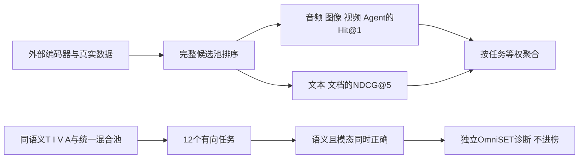
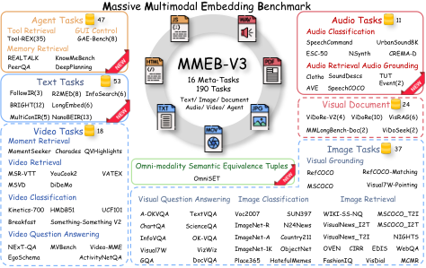

# MMEB-V3：全模态嵌入评测与 OmniSET 诊断

[English](README-en.md)

> **L0 排序计分与协议接口，不是全模态编码器或完整 190 任务接入。** 外部提供真实排序、候选全集和相关性；本地不生成伪嵌入，也不把 OmniSET 诊断混入排行榜。

## 论文信息

| 字段 | 内容 |
| --- | --- |
| 论文 | [arXiv:2604.23321v1](https://arxiv.org/abs/2604.23321v1)，[固定原文](https://arxiv.org/html/2604.23321v1) |
| 公司 / 机构 / 学校 | 一作 Haohang Huang：Eastern Institute of Technology, Ningbo；Tomas Pfister、Rui Meng 等合作作者属 Google AI Research |
| 原始发布日期 | **2026-04-25 14:15:05 UTC**；本轮为历史补漏 |
| 原作者开源代码 | [VLM2Vec 的 `olm2vec` 分支](https://github.com/TIGER-AI-Lab/VLM2Vec/tree/olm2vec)，本地核对提交 `643150de53fea9133e9d646872228feace906498` 的 `src/utils/eval_utils/metrics.py`；[官方数据](https://huggingface.co/datasets/VLM2Vec/MMEB-V3) |
| 本地 adapter / key | `mmeb-v3`；`adapter=null`；未接入 Evolve |
| 本地代码 | `src/auto_research/multimodal/mmeb_v3.py` |

## 原始论文总结

### 背景与主要改动

单一图文检索成绩不足以判断统一嵌入模型是否适合音频、文档、Agent 工具检索或跨模态混合候选。MMEB-V3 将评测扩展为六类、16 个元任务、190 个任务，其中新增 111 个任务：11 个音频、53 个文本和 47 个 Agent 任务。它不仅比较语义匹配，还检查请求的输出模态是否被遵循。

论文另设 **OmniSET 诊断集**：同一语义内容具有文本、图像、视频和音频版本，在同一个混合候选池上评估 12 个有向跨模态任务。原始查询实例也留在候选池作为干扰项；检索到同语义但错误模态并不算正确。OmniSET 不参与主排行榜总分。

### 架构与流程



图中编码器、官方数据物化和大规模检索不在本地接口内。

<!-- paper-figure:start -->
### 原论文关键图

[](https://arxiv.org/html/2604.23321v1/introduction.png)

原文 Figure 1 展示六类、190 任务及 OmniSET 的关系。直接保存官方 HTML 原始 PNG，无重画或裁剪；来自[固定原文](https://arxiv.org/html/2604.23321v1#S3.F1)，版权归原作者。原图数据规模不代表本地已执行的任务数。
<!-- paper-figure:end -->

### 核心公式

音频、图像、视频和 Agent 类使用 Hit@1；文本和视觉文档使用 NDCG@5。固定上游实现同时输出线性与指数 gain，本地要求调用方显式选择，不对论文未限定的总列猜测默认形式：

$$
DCG@5=\sum_{r=1}^{5}\frac{g(rel_r)}{\log_2(r+1)},\quad
g(x)\in\{x,2^x-1\},\quad NDCG@5=DCG@5/IDCG@5.
$$

无正相关项时返回 0。类别分数是任务等权均值，不按每任务查询数加权；调用方必须给出精确预期任务清单，少报一项不能称完整类别结果。OmniSET 的正确条件是：

$$
Hit_{omni}@1=\mathbf1[semantic(top_1)=semantic(q)\land modality(top_1)=target].
$$

不能先按目标模态过滤候选池，否则会掩盖模态坍缩。T/I/V/A 四种查询共用同一个完整池，包括查询本身。

### 论文离线与线上效果

作者在七个 2B–8B 全模态模型上分析不同任务和模态缺口；OmniSET 包含约 1.2K 查询与 8.2K 候选，用于观察同语义表示是否偏向某一模态。具体模型分数应读固定原文表格，不能将不支持某类输入的缺项与同覆盖模型盲目平均。这里没有线上 A/B，也没有本地编码器排行榜成绩。

## 本地复现

### 数据协议与代码映射

`RankingCase` 校验查询、排序、候选全集和评测端相关性；`score_task` 按六类协议计分；`task_macro_average` 检查精确任务覆盖。`OmniCandidate` 的语义 ID 仅用于评测，不是交给编码器的输入；`score_all_directions` 强制完整 12 个方向，共用同一候选池且各语义组包含 T/I/V/A。它不生成排序，因此固定 ID 夹具不能证明模型有跨模态能力。

```bash
PYTHONPATH=src python -c 'from auto_research.multimodal.mmeb_v3 import diagnostic; print(diagnostic(42))'
PYTHONPATH=src python -m pytest tests/test_mmeb_v3.py -q
```

### 结果与负控

专测覆盖两种 gain、排序折扣、空相关项、任务等权、缺失任务拒绝、错误模态和查询自身干扰项、12 方向与完整混合池。诊断刻意让“同语义但错误模态”得 0，避免仅凭语义命中误报成功；[CPU 三种子产物](metrics/component-cpu-seeds42-44.json)只记录固定排序算术。seed 仅扰动输入池顺序，没有训练、嵌入或真实公开集成绩。

### 复现边界与完整实验

完整 190 任务需物化不同许可的多模态数据、跑多种 2B–8B 编码器和大候选库；OmniSET 构建还涉及 Veo 3.1 视频与 Gemini 2.5 Flash TTS 音频生成。原文部分检索任务候选达到百万级。相对于单张 A100/A30 或 Mac，本轮不跑这些矩阵：**成本过高，不复现（审查 DONE）**；不下载模型权重、完整媒体或调用生成 API。纯 CPU 计分核没有 CUDA 路径，不伪造 GPU receipt，不宣称完整 benchmark 或 Evolve 接入。
