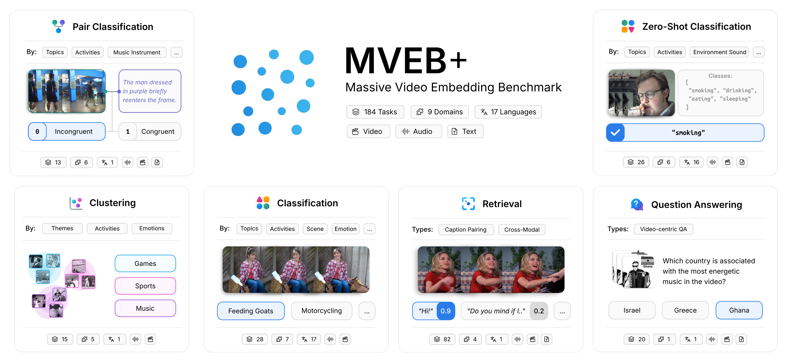

# MVEB: Massive Video Embedding Benchmark

<!-- source-sha256: 737e70ed9c7132c0719ea36d30fb85e7c3997d3b019a5ab324df65e20bfb9d46 -->

[简体中文](README.md)

The benchmark combines classification, zero-shot classification, clustering, pair classification, eight-direction cross-modal retrieval, and video QA. It follows each model's frame and audio budget, and compares video-only and audio-plus-video inputs in pairs. The full 33-model / 184-task matrix is too costly and is marked not reproduced (review DONE), not an executed local integration.

## Paper information

| Field | Value |
| --- | --- |
| Paper | [arXiv 2606.14958 v1](https://arxiv.org/abs/2606.14958v1); [pinned full text](https://arxiv.org/html/2606.14958v1) |
| Organization | First author Adnan El Assadi: Harvard University. Deep Shah is affiliated with Google LLC in the pinned v1 author list. |
| First published | 2026-06-12 21:06:12 UTC (arXiv v1) |
| Reviewed version | Methods checked against pinned v1. |
| Original author code | [Public author resources](https://github.com/embeddings-benchmark/mteb), pinned to `acbcb191eb24ad1929f1bbcf23b90e982e9da62e`. The authors publish video tasks in the MTEB ecosystem, verified at that commit. Apache-2.0; each upstream dataset has its own license. Config or field checks are not a run of the official evaluation. |
| Local adapter / stable key | `mveb`; `adapter: null`; `deferred_high_cost`; reference only |
| Local reproduction code | No local model, training, or benchmark implementation; no local metrics or GPU receipt. |
| Full experiment | **Not reproduced due to cost (review DONE)**; excluded from automatic retries and the implementation queue. |

## Original paper summary

### Background and main changes

Pinned v1 §3 selects 23 MVEB tasks from a pool of 184. Variable-length models use 2 fps with a 64-frame cap. Fixed-frame models follow their training configuration. Audio follows each model's sample rate and length. No per-task fine-tuning. Classification uses an 8-shot frozen logistic probe, retrieval uses cosine and nDCG@10, and VCQA uses accuracy over candidate answers. Video and audio variants are paired and only supported modalities are run.

<!-- paper-figure:start -->
### Key figure from the paper

**Figure 1**, original PNG from pinned v1. Image from the [original paper](https://arxiv.org/html/2606.14958v1), with scientific content and labels unchanged. Copyright belongs to the authors. [Source, crop, and SHA256](assets/provenance.json).
<!-- paper-figure:end -->

### Evaluation protocol

The official task evaluator defines metrics and does not fine-tune the embedding model. Classification fits a frozen 8-shot-per-class logistic probe; zero-shot classification matches class text; clustering uses V-measure; retrieval uses cosine and nDCG@10; VCQA measures candidate-answer retrieval accuracy. The eight retrieval directions are $T\to V,A\to V,AT\to V,V\to T,VA\to T,V\to A,VT\to A,T\to VA$.

Variable-length models use 2 fps with a 64-frame cap; fixed-frame models follow training settings. Audio sample rate, mono conversion, and truncation follow model specifications. Pair video-only and audio-plus-video on the same clips with audio tracks. Do not mix samples or invent scores for models without audio support.

### Offline and online results in the paper

The paper reports actual models, data, and protocols. Its full matrix was not run here, and author scores are not local measurements. No production A/B. Single-H100 times in Table 1 are author measurements, not local timings.

## Local reproduction

This entry verifies paper identity, collaborations, method, resources, licenses, and cost; it catalogs the source and original figure. No generic aggregator or schema check is presented as an official benchmark interface. No models, training, or formal metrics were run.

## Reproduction limits

The full matrix includes 33 public checkpoints from roughly 200M to 10.7B, 23 main tasks and 184 in the pool, audio and video, and eight retrieval directions. Table 1 reports LCO7B on one H100 at 31.9h for MVEB and 302.7h for MVEB+. This exceeds a short single-A100/A30 budget; no models or videos are downloaded and no generic proxy metrics are invented.

**Not reproduced due to cost (review DONE).** This follows from the documented configuration, not a full trial. No local metrics, GPU receipt, or implemented-component status is attached.

This is a historical lead from Google's official EMNLP page, not a new release. A conference listing alone is not proof of author affiliation; see the attribution above.
