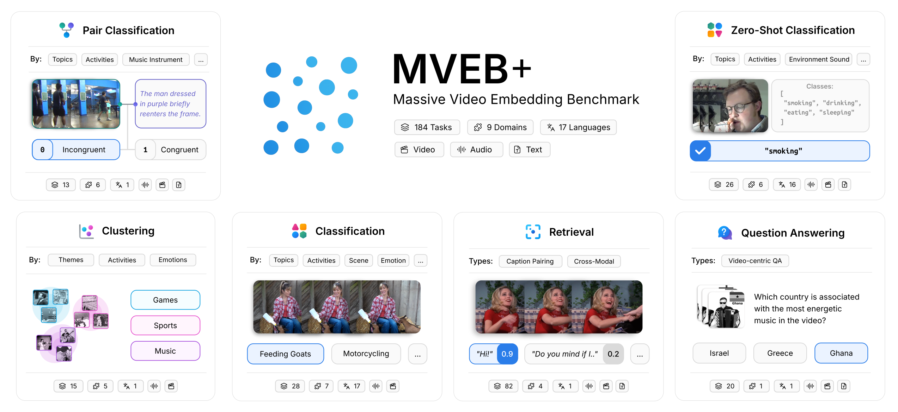

# MVEB: Massive Video Embedding Benchmark

将分类、零样本分类、聚类、配对分类、八方向跨模态检索及视频QA纳入统一视频嵌入评测，按model声明的帧/音频预算运行并成对比较video-only与audio+video。33模型/184任务完整矩阵高成本，审查DONE不复现，不伪造已接入结果。

## 论文信息

| 字段 | 内容 |
| --- | --- |
| 论文链接 | [arXiv 2606.14958 v1](https://arxiv.org/abs/2606.14958v1)；[固定核对版本 v1](https://arxiv.org/html/2606.14958v1) |
| 公司 / 机构 / 学校 | 一作 Adnan El Assadi：Harvard University。固定v1作者栏Deep Shah署名Google LLC。 |
| 首次公开日期 | 2026-06-12 21:06:12 UTC（arXiv v1） |
| 本轮版本 | 本轮方法核对固定v1。 |
| 原作者代码 | [作者公开资源](https://github.com/embeddings-benchmark/mteb)；固定commit `acbcb191eb24ad1929f1bbcf23b90e982e9da62e`；作者在MTEB生态公开视频任务实现，固定commit核验；不把仅配置/字段校验标记成已跑官方评测；Apache-2.0；各上游数据集许可证独立 |
| 本地 adapter / 稳定键 | `mveb`；`adapter: null`；`deferred_high_cost`，仅资料收录 |
| 本地复现代码目录 | 不提供本地模型/训练/benchmark实现；无指标产物、无GPU收据 |
| 完整实验 | **成本过高，不复现（审查 DONE）**，不进入自动重试或实现队列 |

## 原始论文总结

### 背景与主要改动

固定v1 Section3：MVEB23任务从184任务池缩减；var-length fps2/cap64frames，固定帧模型遵循其训练配置，音频按model采样率/长度；无per-task finetune。分类8shot frozen logistic probe，retrieval cosine/nDCG10，VCQA候选池accuracy，视频/音频版本配对且只跑模型支持modality。

<!-- paper-figure:start -->
### 原论文关键图

**Figure 1**，固定v1原始PNG。图片来自[原论文](https://arxiv.org/html/2606.14958v1)，版权归原作者所有；保留原图科学内容与标注，未重绘。[来源、裁切与SHA256](assets/provenance.json)。
<!-- paper-figure:end -->

### 核心公式

评测不微调embedding模型；任务指标由官方task evaluator决定。分类使用每类8shot frozen logistic probe，零样本分类匹配class text，聚类V-measure，检索cosine/nDCG@10，VCQA为候选回答池检索accuracy。检索支持 $T\to V,A\to V,AT\to V,V\to T,VA\to T,V\to A,VT\to A,T\to VA$ 八方向。
可变长模型采用2fps/cap64帧，固定帧模型必须遵循自身训练配置；音频采样率、mono和截断也按model声明。对有音轨数据用相同clip配对video-only与audio+video，不能混用不同样本或给不支持audio的模型虚构分数。

### 论文离线与线上效果

原文结论来自其真实模型、数据与协议；本页未运行完整矩阵，不将原文指标抄成“本地实测”。未报告生产线上 A/B。Table1单H100耗时为原作者测量，不是本机计时。

## 本地复现

本轮仅核查论文身份、合作机构、方法/资源/许可证与成本，收录资料和原图。没有把通用聚合器或字段检查包装为官方benchmark接口；没有模型调用、训练或正式指标。

## 复现边界

33个公开checkpoint约200M–10.7B，23主任务及184池，多模型视频+音频/8方向矩阵；Table1单H100测LCO7B：MVEB31.9h、MVEB+302.7h。远超单A100/A30短时预算，不下载模型或视频、不构造假的通用指标代理。

**成本过高，不复现（审查 DONE）**。以上为论文配置/资源判断，未为了测成本而启动完整试跑。本页不挂本地metrics或GPU receipt，不标为组件已实现。

本轮来自Google EMNLP官方会议页的历史线索补漏，不是今天新首发，也不单凭会议页就认定作者具有Google署名；机构证据在信息块逐条注明。
