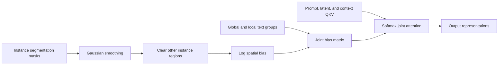
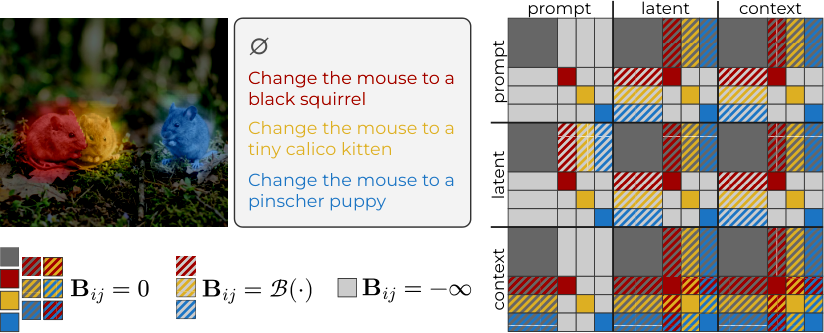

<!-- source-sha256: d0aa758204b8782951762c6b752b28d485cf6020cc3a5baa9288a1a17c21ef41 -->

[简体中文](README.md) · English

# MICE: Smoothly isolated attention for multi-instance editing

## Paper information

| Field | Details |
| --- | --- |
| Paper | [arXiv 2606.31278 v1](https://arxiv.org/abs/2606.31278v1); [pinned original PDF](https://arxiv.org/pdf/2606.31278v1) |
| Original title | Editing Everything Everywhere All at Once |
| Institution | First author Fabio Quattrini and co-first author Carmine Zaccagnino: University of Modena and Reggio Emilia. Coauthors Marta Tintoré Gazulla and Alessio Tonioni are at Google. Cataloged under the first author's university, not as a Google first-author paper. |
| First public release | 2026-06-30 07:52:46 UTC (arXiv v1). This is a rediscovered older paper, not an October first release. |
| Author code | [Official repository](https://github.com/Blowing-Up-Groundhogs/mice), reviewed at pinned commit `43b289de84dfd184c0ee1b551b0e1bea02f6e92d`. No top-level license file found at that revision. The local formula implementation is independent and does not copy FLUX source. |
| Local adapter or method key | `mice`; `adapter: null`, `component_only`; not a runnable full FLUX editor |
| Local reproduction code | `src/auto_research/multimodal/mice.py`; `tests/test_mice.py` |
| Full experiment | Too costly; not reproduced (review DONE). No large-model downloads or full editing matrix. |

## Original paper summary

### Background and main changes

Editing several regions at once can leak attributes from one instruction into another region. MICE isolates text groups in joint attention and uses a smooth spatial bias from instance masks to control visual interactions. This balances local binding and blending with the surrounding region without training a new editing model.



<!-- paper-figure:start -->
### Key figure from the paper

[](https://arxiv.org/html/2606.31278v1#S3.F3)

**Figure 3** shows interactions between text groups, visual tokens to generate, and reference-image tokens. Image from the [original paper](https://arxiv.org/html/2606.31278v1#S3.F3), copyright the authors. The original PNG is unedited; see [source and SHA-256](assets/provenance.json). See the version comparison below for differences between the figure and the block formulas. The illustration alone does not establish implementation equivalence.
<!-- paper-figure:end -->

### Core equations

The input consists of binary instance masks $m_n$ already mapped to a common latent raster. Smooth them with a normalized Gaussian kernel, then zero pixels that belong to another instance but not to the current one, yielding $s_n$. Bias inside the current instance is zero; outside it is:

$$
b_n(j)=\tau^{-1}\log(s_n(j)+\epsilon),\qquad \epsilon=10^{-30}.
$$

The sequence order for text, generated image, and reference image is $Z=[P,L,C]$. The local implementation assembles $B$ using the block rules from §3.2: text directly attends only within its own group; global text remains visually connected to background latents; local text to instance latents uses spatial bias; latent to local text uses the same raster bias; and context to matching local text uses hard binding. Case 5 defines context attention to the entire visual domain without bias.

$$
\mathrm{Attention}(Q,K,V;B)=\mathrm{softmax}(QK^\top/\sqrt d+B)V.
$$

Here $\log(0+\epsilon)$ is still finite and negative; the paper's $\epsilon$ is not silently replaced by a hard mask. Unrelated text groups explicitly use $-\infty$. For low-precision inputs, bias, softmax, and accumulation use at least float32 so $10^{-30}$ does not underflow in float16.

### Differences between the paper and code versions

The local execution mode is fixed to `paper_v1`. It does not reproduce the authors' current default parameters:

| Item | Paper v1 | Pinned author code | Local choice |
| --- | --- | --- | --- |
| Kernel and temperature | §5: $k=3$; LoMOE temperature 1, MICE-Bench temperature 8 | Script defaults $k=11,\tau=3$ | Defaults $k=3,\tau=8$, explicitly configurable; not selected by local tuning |
| Numerical epsilon | $10^{-30}$ | Attention code uses $10^{-6}$ and replaces some other-instance positions with $-\infty$ | Paper's $10^{-30}$ with at least float32 |
| Soft bias between local prompt and latent | Required by Cases 6/7 | Default `smooth_P_L=False` does not enable the same softening | Enabled according to the text |
| Context to visual domain | Case 5 and its explanation say no bias | Figure 3 and the authors' default processor still give some context rows spatial bias | Explicitly follows Case 5; does not claim all three are equivalent |
| Gaussian standard deviation | Not fixed explicitly in the paper | Sigma determined by kernel size | Uses the pinned implementation's rule only to fill this unspecified detail |

These are identifiable version differences, not behaviors to mix while claiming full fidelity. Tests cover the **declared paper-text operator contract** and do not establish that either variant edits images better.

### Offline and online results

The paper compares multi-instance editing on LoMOE-Bench and MICE-Bench. It reports local instruction alignment and visual fidelity and notes that pixel-change metrics can misjudge edit quality. Full results cover different FLUX sizes, other open and commercial models, and human or model judges. Those are paper results, distinct from the random QKV diagnostics below. No production online A/B test is reported.

## Local reproduction

### Component and data protocol

Implements `instance_aware_masks`, `instance_log_bias`, `mice_joint_bias`, `mice_joint_attention`, and `diagnostic(seed, device)`. Importing the module does not load PyTorch; calling it does. Inputs must be nonempty, nonoverlapping binary masks on the same grid. The component does not infer VAE downsampling or token ownership in overlapping regions and does not include SAM, a text encoder, VAE, or a FLUX denoising loop.

```bash
PYTHONPATH=src python -c 'from auto_research.multimodal.mice import diagnostic; print(diagnostic(42, "cpu"))'
```

The diagnostic uses 2 generated masks, a 6×8 raster, and random Q/K/V, and executes attention and backpropagation. The shared batch runner uses the same function on an NVIDIA GPU across three seeds. If CUDA is requested and unavailable, the run fails instead of falling back to CPU. See:

- [Three-seed component metrics](metrics/component-cuda-seeds42-44.json)
- [Real GPU verification receipt](../../gpu-validations/mice-a100-20261021-late.json)

### Verification and interpretation

Unit tests check the block matrix, independent scalar convolution, instance isolation, temperature/epsilon, context asymmetry, hard text binding, gradients, and low-precision stability. Negative controls that remove the entire mask or finite log-bias must change output. Overlapping masks, missing instance text groups, and fully masked attention rows fail closed.

Output mean squares and gradient norms show only that the operator executes and behaves numerically as expected. Without images, real checkpoints, or edit labels, this is **not an editing success rate or a reproduction of paper results**. Evidence remains `L1`, `diagnostic_only=true`, `promotion_eligible=false`, and `evolve_integrated=false`. Three seeds do not upgrade it to a capability comparison.

### Cost and unreproduced scope

The paper uses 4B/9B/12B/32B backbones, two editing benchmarks, multiple high-resolution comparisons, more sampling steps, a segmentation model, and 900 commercial-judge comparisons. Large weights, long generation, and external services exceed this project's single-A100/A30 or Mac budget. **Full experiment too costly; not reproduced (review DONE).** This is based on the paper's configuration, not a measured end-to-end local runtime. No trial downloads or automatic retries are made, and this is not queued for Evolve promotion. GPU verification of one small attention operator does not complete the full matrix.
