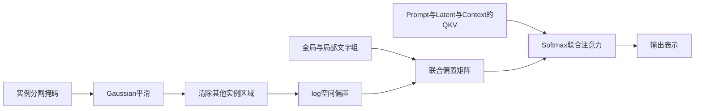
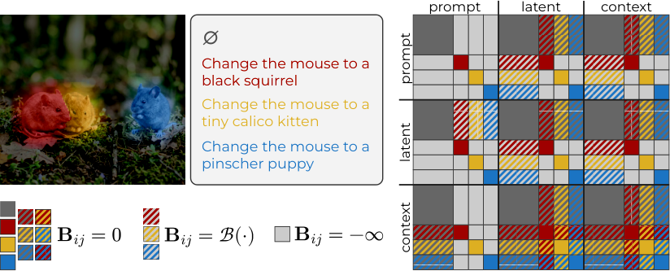

# MICE：多实例编辑的平滑隔离注意力

## 论文信息

| 字段 | 内容 |
| --- | --- |
| 论文链接 | [arXiv 2606.31278 v1](https://arxiv.org/abs/2606.31278v1)；[固定原文 PDF](https://arxiv.org/pdf/2606.31278v1) |
| 原文标题 | Editing Everything Everywhere All at Once |
| 公司 / 机构 / 学校 | 一作 Fabio Quattrini、共同一作 Carmine Zaccagnino：University of Modena and Reggio Emilia；共同作者 Marta Tintoré Gazulla、Alessio Tonioni 属于 Google。按一作学校聚合，不把整篇归为 Google 一作 |
| 首次公开日期 | 2026-06-30 07:52:46 UTC（arXiv v1）；本轮是旧论文补发现，不是 10 月新首发 |
| 原作者代码 | [官方仓库](https://github.com/Blowing-Up-Groundhogs/mice)，核对固定 commit `43b289de84dfd184c0ee1b551b0e1bea02f6e92d`。该版本未发现顶层许可证文件；本地为独立公式实现，不复制 FLUX 源码 |
| 本地 adapter / 稳定键 | `mice`；`adapter: null`、`component_only`，不是可运行的完整 FLUX 图像编辑器 |
| 本地复现代码目录 | `src/auto_research/multimodal/mice.py`；`tests/test_mice.py` |
| 完整实验 | 成本过高，不复现（审查 DONE）；不下载大模型、不跑全量编辑矩阵 |

## 原始论文总结

### 背景与主要改动

多区域同时编辑容易把一处指令的属性传到另一处。MICE 在联合注意力中隔离不同文字组，并用实例掩码的平滑空间偏置控制视觉交互，以兼顾局部绑定与周围区域融合。方法不训练新的编辑模型。



<!-- paper-figure:start -->
### 原论文关键图

[](https://arxiv.org/html/2606.31278v1#S3.F3)

**Figure 3**：不同文字组、待生成视觉 token 与参考图像 token 的交互示意。图片来自[原论文](https://arxiv.org/html/2606.31278v1#S3.F3)，版权归原作者所有；本地保存未经编辑的原始 PNG，[来源和 SHA-256](assets/provenance.json)。图与正文分块公式的差别见下方“原文与代码版本边界”，不能仅凭示意图推定实现一致。
<!-- paper-figure:end -->

### 核心公式

输入已经落到共同 latent raster 的二值实例掩码 $m_n$。先用归一化 Gaussian 核平滑，再把属于其他实例而不属于自身的像素清零，得到 $s_n$。自身区域的偏置固定为零；区域外为：

$$
b_n(j)=\tau^{-1}\log(s_n(j)+\epsilon),\qquad \epsilon=10^{-30}.
$$

文字、生成图像与参考图像的序列顺序是 $Z=[P,L,C]$。本地按正文 §3.2 的分块规则组装 $B$：文字只在同组内直接互读；全局文字与背景 latent 保持视觉连通；局部文字和实例 latent 使用空间偏置；latent 到局部文字使用同一 raster 偏置；context 到匹配的局部文字保留硬绑定。正文 Case 5 定义 context 到整个视觉域无偏置。

$$
\mathrm{Attention}(Q,K,V;B)=\mathrm{softmax}(QK^\top/\sqrt d+B)V.
$$

这里 $\log(0+\epsilon)$ 仍是有限负数，不会悄悄把正文的 $\epsilon$ 改成 hard mask。无关文字组则明确使用 $-\infty$。低精度输入的偏置、softmax 和累加至少用 float32 计算，避免 $10^{-30}$ 在 float16 下溢。

### 原文与代码版本边界

本地执行策略固定为 `paper_v1`，不是“作者当前默认参数复刻”：

| 项目 | 原文 v1 | 固定作者代码 | 本地选择 |
| --- | --- | --- | --- |
| 核与温度 | §5：$k=3$；LoMOE 温度 1、MICE-Bench 温度 8 | 脚本默认 $k=11,\tau=3$ | 默认 $k=3,\tau=8$，参数显式可改；不是本地调优结论 |
| 数值 epsilon | $10^{-30}$ | attention 代码使用 $10^{-6}$，其他实例位置还会改为 $-\infty$ | 保留正文 $10^{-30}$，至少 float32 |
| local prompt 与 latent 的软偏置 | 正文 Case 6/7 要求 | 代码 `smooth_P_L=False` 默认不启用同样的软化 | 按正文启用 |
| context 到视觉域 | Case 5 及其文字解释：无偏置 | Figure 3 和作者默认 processor 的局部 context 行仍有空间偏置 | 明确采用正文 Case 5；不宣称三者逐项等价 |
| Gaussian 标准差 | 正文未固定写出 | 使用随 kernel size 确定的 sigma 规则 | 采用该固定代码规则，仅此处补齐未指定细节 |

这些是可以定位到的版本差异，不通过混合两套行为来声称“完全忠实”。本地对**已声明的正文算子合同**做测试，未证明任何一种变体具有更好的实际编辑效果。

### 论文离线与线上效果

论文在 LoMOE-Bench 和 MICE-Bench 上比较多实例编辑，报告局部指令对齐和视觉保真结果，并指出像素变化类指标可能误判编辑质量。完整效果涉及不同 FLUX 规模、其他开源/商业模型以及人工或模型裁判；它们都是原论文结果，不能与下方随机 QKV 诊断混为一谈。未报告生产线上 A/B。

## 本地复现

### 组件与数据协议

实现 `instance_aware_masks`、`instance_log_bias`、`mice_joint_bias`、`mice_joint_attention` 和统一 `diagnostic(seed, device)`。模块导入不加载 PyTorch，实际调用时才需要。输入必须是已经在同一网格上的、非空、互不重叠的二值 mask；本组件不替用户推定 VAE 下采样或重叠区域 token 归属，也不包含 SAM、文字编码器、VAE 或 FLUX denoising loop。

```bash
PYTHONPATH=src python -c 'from auto_research.multimodal.mice import diagnostic; print(diagnostic(42, "cpu"))'
```

诊断使用 2 个生成掩码、6×8 raster 和随机 Q/K/V，真实执行 attention 与反向传播。统一批次 runner 用相同函数在 NVIDIA GPU 执行三 seed；CUDA 请求不可用时明确失败，不回退 CPU。验证文件：

- [三 seed 组件指标](metrics/component-cuda-seeds42-44.json)
- [真实 GPU 验证凭据](../../gpu-validations/mice-a100-20261021-late.json)

### 验证与结果解释

单测逐块核对正文矩阵、独立标量卷积、实例防串扰、温度/epsilon、context 非对称性、硬文字绑定、梯度及低精度稳定性；移除整个 mask 或移除有限 log-bias 的负控必须改变输出。重叠 mask、丢失实例文字组和全遮蔽 attention 行均 fail closed。

输出均方值和梯度范数只证明生成算子的执行与数值行为。没有图像、真实 checkpoint 或编辑标签，因而**不是编辑成功率、不是论文效果复现**。固定 `L1`、`diagnostic_only=true`、`promotion_eligible=false`、`evolve_integrated=false`；三 seed 不把该证据升级为能力对比。

### 成本与未复现范围

原论文涉及 4B/9B/12B/32B backbone、两个编辑 benchmark、多种高分辨率对照、更多采样步、分割模型与 900 次商业裁判比较。以单张 A100/A30 或 Mac 的资源限制评估，完整矩阵需要大权重、长时间生成和外部服务，标注**成本过高，不复现（审查 DONE）**。该判断根据论文配置作出，不是本地完整运行耗时实测；不下载试跑、不自动重试、不进入 Evolve 晋级队列。单个小 attention 算子的 GPU 验证不代表整个矩阵已经完成。
