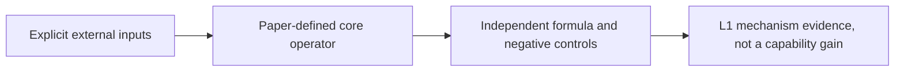
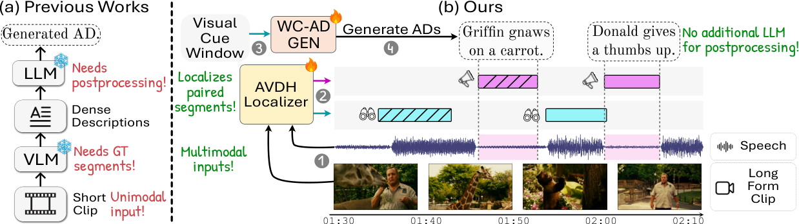

# From Visual Cues to Spoken Narration: Rethinking Audio Description

<!-- source-sha256: 56e766ad3abf12a42086dced76ef2a18fc25d93530015dd72ba094f3995ae54d -->

[简体中文](README.md)

## Paper information

| Field | Details |
|---|---|
| Paper | [arXiv 2609.01725 v1](https://arxiv.org/abs/2609.01725v1); [pinned v1 text](https://arxiv.org/html/2609.01725v1) |
| Organization | First author Akshita Gupta: TU Darmstadt and hessian.AI. Pinned v1 lists Federico Tombari with Google Research and TU Munich. |
| First public release | 2026-09-01 18:00:50 UTC (arXiv v1) |
| Authors' code | [Author repository](https://github.com/multimodal-ai-lab/Cue2Narrate), pinned at `08c89ea63281b819a0fd73c060d8c954f9e696ef`, contains only .gitignore, LICENSE, and a two-line README. No method source is released there; repository existence does not establish an open implementation. Placeholder repository: MIT; paper: CC BY-NC-SA 4.0. |
| Adapter / method | `cue2narrate-drl`; `adapter: null`; `component_only`. |
| Local reproduction code | `src/auto_research/multimodal/cue2narrate_drl.py` |
| Version | Method checked against pinned v1. |
| Full experiment | Not reproduced due to cost (review complete); excluded from automatic retry and implementation queues. |

The paper locates visual cues and spoken narration in separate time windows, then uses the current model's length-normalized likelihoods to compare concise audio description (AD) and ordinary captions of the same evidence. DRL suppresses the bias toward verbose captions. Only the masked stage-2 SFT+DRL objective is implemented; the local work does not run the localizer, a VLM, or LongLSMDC evaluation.

## Original paper

### Motivation and method

Pinned v1 Section 4.3, Eqs. 5–8: SFT sums target AD token losses. Both positive and negative scores are target-token mean log probabilities under the same current model and prompt, excluding prompt and padding. DRL applies negative log-sigmoid to the score difference divided by 0.5 and enters the full loss with weight 0.2. The offline negative-caption generator is frozen, but the current model's likelihood of the generated caption still backpropagates.



<!-- paper-figure:start -->
### Key figure from the paper

[](https://arxiv.org/html/2609.01725v1/teaser_fig.png)

> **Figure 1:** Original PNG from pinned v1, with scientific content and annotations preserved. From the [original paper](assets/provenance.json); copyright remains with the authors.
<!-- paper-figure:end -->

[Source, crop, and SHA-256](assets/provenance.json).

### Core equations

For the same visual cue and task prompt, let $y^+$ be target AD and $y^-$ the cached negative caption. Mask prompt and padding first:

$$
s^\pm=\frac{1}{|y^\pm|}\sum_t\log p_\theta(y^\pm_t\mid y^\pm_{<t},V,\mathcal P),\qquad
\mathcal L_{\rm DRL}=-\log\sigma((s^+-s^-)/0.5).
$$

$$
\mathcal L_{\rm Stage2}=-\sum_t\log p_\theta(y_t^+\mid\cdot)+0.2\mathcal L_{\rm DRL}.
$$

SFT sums valid target tokens per example and then averages across the batch. DRL averages over each response separately before comparing; temperature is not a margin. Freezing the negative-caption generator does not detach negative-caption log probabilities from the trainable model.

### Paper results

Reported results use the authors' models, data, and protocol. The full matrix was not run here, and original figures are not local measurements. No production online A/B is reported.

## Local reproduction

Inputs are teacher-forced logits and labels for target AD and a cached negative caption under the current model. Align them correctly and use -100 to exclude prompt and padding. Stage 1, visual cue extraction, character bank, and negative-caption generation are excluded.

```bash
PYTHONPATH=src python -c 'from auto_research.multimodal.cue2narrate_drl import diagnostic; print(diagnostic(42))'
python -m pytest tests/test_google_emnlp25_foundation.py
```

`diagnostic(seed, device='cpu')` tests formulas and negative controls on generated tensors only. CUDA requires a real A100/A30 with no silent CPU fallback. Acceptance is based on committed three-seed results from frozen source and the GPU receipt. Metrics measure operator error, gradients/updates, or scorer comparisons, not model accuracy, writing quality, cross-lingual capability, or Evolve promotion.

## Limits and cost

The full work uses a 6.64M dual-head localizer, LoRA on Qwen2.5-VL-7B/Qwen3-VL-8B, 32 frames for training and 64 for inference, and multistage long-movie training. LSMDC is research-restricted and MAD-Eval under NDA. Data, localization, and VLM training exceed the single-GPU short-run budget. No videos or weights are downloaded; the paper does not give total GPU-hours.

**Full experiment not reproduced due to cost (review complete)**; no full trial was launched to measure cost. A small-tensor or CPU protocol check is not full pipeline or benchmark integration. Flags: `diagnostic_only=true`, `promotion_eligible=false`, `evolve_integrated=false`.

This historical catch-up came from Google's official EMNLP conference page. It is not a new release; affiliations are supported by the paper, not the conference page alone.
