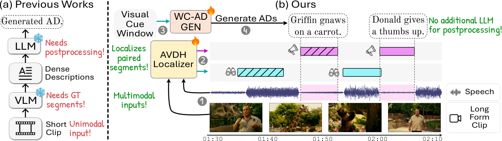

# From Visual Cues to Spoken Narration: Rethinking Audio Description

先定位视觉线索与 spoken narration 两种不同时间窗，再对同一视觉证据的简洁AD和普通caption计算当前模型长度平均likelihood，以DRL抑制冗长caption先验。本地仅保留Stage2 masked SFT+DRL；不运行定位器、VLM或LongLSMDC能力评测。

## 论文信息

| 字段 | 内容 |
| --- | --- |
| 论文链接 | [arXiv 2609.01725 v1](https://arxiv.org/abs/2609.01725v1)；[固定核对版本 v1](https://arxiv.org/html/2609.01725v1) |
| 公司 / 机构 / 学校 | 一作 Akshita Gupta：TU Darmstadt & hessian.AI。固定v1作者栏Federico Tombari署名Google Research / TU Munich。 |
| 首次公开日期 | 2026-09-01 18:00:50 UTC（arXiv v1） |
| 本轮版本 | 本轮方法核对固定v1。 |
| 原作者代码 | [作者公开资源](https://github.com/multimodal-ai-lab/Cue2Narrate)；固定commit `08c89ea63281b819a0fd73c060d8c954f9e696ef`；作者公开仓库固定commit仅含.gitignore、LICENSE和两行README，未发布方法源码；不把仓库存在当作完整实现已开源；MIT（占位仓库）；论文CC BY-NC-SA 4.0 |
| 本地 adapter / 稳定键 | `cue2narrate-drl`；`adapter: null`；`component_only` |
| 本地复现代码目录 | `src/auto_research/multimodal/cue2narrate_drl.py` |
| 完整实验 | **成本过高，不复现（审查 DONE）**，不进入自动重试或实现队列 |

## 原始论文总结

### 背景与主要改动

固定v1 Section4.3 Eqs5–8：SFT按每个AD目标token求和；positive/negative评分均为同一当前模型和prompt上的token-mean logp，prompt/padding排除；DRL=-logsigmoid((s+−s−)/0.5)，全loss加0.2DRL。离线负caption生成冻结，但其当前模型likelihood仍反传。


<!-- paper-figure:start -->
### 原论文关键图

[](https://arxiv.org/html/2609.01725v1/teaser_fig.png)

**Figure 1**，固定v1原始PNG。图片来自[原论文](https://arxiv.org/html/2609.01725v1)，版权归原作者所有；保留原图科学内容与标注，未重绘。[来源、裁切与SHA256](assets/provenance.json)。
<!-- paper-figure:end -->

### 核心公式

对同一视觉线索与同一任务prompt，目标AD为 $y^+$，离线负caption为 $y^-$。先排除prompt与padding：
$$
s^\pm=\frac{1}{|y^\pm|}\sum_t\log p_\theta(y^\pm_t\mid y^\pm_{<t},V,\mathcal P),\qquad
\mathcal L_{\rm DRL}=-\log\sigma((s^+-s^-)/0.5).
$$
$$
\mathcal L_{\rm Stage2}=-\sum_t\log p_\theta(y_t^+\mid\cdot)+0.2\mathcal L_{\rm DRL}.
$$
SFT按每个样本的有效目标token求和再batch平均；DRL先各自按长度平均再比较，不把温度当作加减margin。负caption的**生成器**冻结，并不表示负caption在当前可训练模型下的logp要detach。

### 论文离线与线上效果

原文结论来自其真实模型、数据与协议；本页未运行完整矩阵，不将原文指标抄成“本地实测”。未报告生产线上 A/B。

## 本地复现

输入是当前模型对AD与缓存negative caption的teacher-forced logits/labels，必须正确对齐并以-100排除prompt/padding；不包含Stage1、visual cue提取、character bank或负caption生成。

```bash
PYTHONPATH=src python -c 'from auto_research.multimodal.cue2narrate_drl import diagnostic; print(diagnostic(42))'
python -m pytest tests/test_google_emnlp25_foundation.py
```

`diagnostic(seed, device='cpu')`只执行生成数据上的独立公式/负控。CUDA路径必须由真实A100/A30执行，CUDA不可用时失败、不回退CPU；本轮验收以提交的冻结源码三种子原始结果和GPU收据为准。 指标是算子误差、梯度/参数更新或scorer对照，不是正式模型accuracy、写作质量、跨语言能力或Evolve晋级证据。

## 复现边界

6.64M双头定位器，Qwen2.5-VL-7B/Qwen3-VL-8B LoRA，训练32帧/推理64帧，多阶段长电影训练；LSMDC研究限制授权、MAD-Eval NDA。完整数据/定位+VLM训练超单卡短时预算，不下载视频或权重；本文未给总GPU小时，不编造。

**成本过高，不复现（审查 DONE）**。以上为论文配置/资源判断，未为了测成本而启动完整试跑。本地小张量或CPU协议通过不等于完整方法/数据管线或benchmark已接入；`diagnostic_only=true`、`promotion_eligible=false`、`evolve_integrated=false`。

本轮来自Google EMNLP官方会议页的历史线索补漏，不是今天新首发，也不单凭会议页就认定作者具有Google署名；机构证据在信息块逐条注明。
