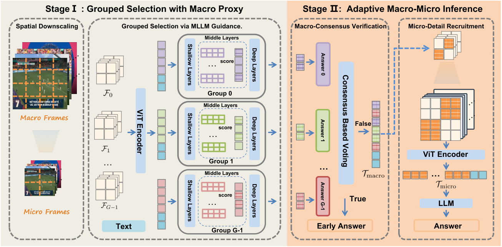

# VideoMM: Adaptive Macro-Micro Inference for Efficient Video MLLMs

<!-- source-sha256: c1c3018e8f2d1f1d21c50ea64c5e820aef137e52937dca5fe3b21218fe3af5d1 -->

[简体中文](README.md)

> **L1 core-mechanism diagnostic.** Executes macro selection and micro activation without loading a full video MLLM or extrapolating LongVideoBench performance.

## Paper information

| Field | Details |
|---|---|
| Paper | [VideoMM: Adaptive Macro-Micro Inference for Efficient Video MLLMs](https://arxiv.org/abs/2609.16722) |
| Organization | First-author affiliation: University of Science and Technology of China |
| First public release | 2026-09-15 (arXiv v1) |
| Authors' code | [Public implementation](https://github.com/adfh917k/VideoMM) |
| Adapter / method | `videomm` |
| Local reproduction code | [`src/auto_research/foundation_latest_20260916_followup.py`](https://github.com/daiwk/auto-research/blob/main/src/auto_research/foundation_latest_20260916_followup.py) |

## Original paper

### Motivation and method

Locate relevant regions on a low-resolution Macro Proxy, then activate high-fidelity Micro Tokens only if macro-level consensus is insufficient.

~~~mermaid
flowchart LR
  I[Public input and current state] --> M[VideoMM mechanism]
  M --> A[Auditable intermediates]
  A --> O[Output or state update]
~~~

<!-- paper-figure:start -->
### Key figure from the paper

> **Figure 2:** Core architecture and module connections. From the [original paper](https://arxiv.org/abs/2609.16722); copyright remains with the authors.
<!-- paper-figure:end -->

### Core computation and code mapping

The reference kernel preserves the decisive ranking, gating, preference direction, credit weighting, or state transitions and reports auditable statistics. Three-seed fixtures test invariants and edge cases; randomized mini-suite scores are not paper capability results.

### Paper results

Paper accuracy, speed, training loss, and benchmarks are cited as original results only. Local scores are not directly compared or extrapolated to online gains.

## Local reproduction

See the [three-seed results](metrics/mechanism-seeds42-44.json). The common receipt marks `diagnostic_only=true`, ineligible for formal capability ranking.

CUDA ran on an NVIDIA A100; see the [sanitized GPU receipt](../../gpu-validations/videomm-a100-20260916.json). It omits hostnames, SSH aliases, and driver/build strings.

## Reproduction boundaries

Local execution covers macro selection and micro activation, not a full video MLLM or LongVideoBench outcomes.
