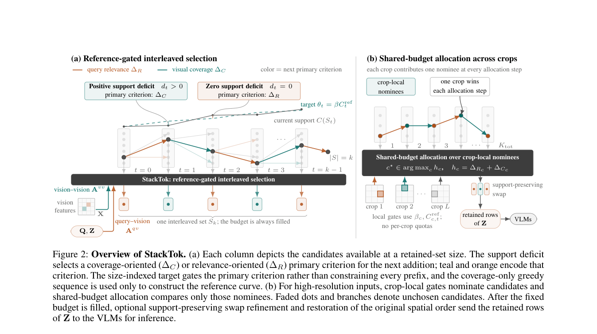

# StackTok: Accelerating VLMs Inference with Budget-Adaptive Visual Token Selection

<!-- source-sha256: e72db89e1dd8d098b8adba1e19114ac7fe86e298dc21d43daac0eff7da3c4b91 -->

[简体中文](README.md)

> **L1 core-mechanism diagnostic.** Runs a reference-gated selector on one crop without loading the paper's five VLMs.

## Paper information

| Field | Details |
|---|---|
| Paper | [StackTok: Accelerating VLMs Inference with Budget-Adaptive Visual Token Selection](https://arxiv.org/abs/2609.16841) |
| Organization | First-author affiliation: Sichuan University |
| First public release | 2026-09-15 (arXiv v1) |
| Authors' code | [wongzbb/StackToK](https://github.com/wongzbb/StackToK) is public. |
| Adapter / method | `stacktok` |
| Local reproduction code | [`src/auto_research/foundation_latest_20260916_followup.py`](https://github.com/daiwk/auto-research/blob/main/src/auto_research/foundation_latest_20260916_followup.py) |

## Original paper

### Motivation and method

Use query relevance as the objective and coverage as a budget-dependent support constraint, progressively switching between the two selection criteria.

~~~mermaid
flowchart LR
  I[Public input and current state] --> M[stacktok mechanism]
  M --> A[Auditable intermediates]
  A --> O[Output or state update]
~~~

<!-- paper-figure:start -->
### Key figure from the paper

> **Figure 2:** Training pipeline and key optimization steps. From the [original paper](https://arxiv.org/abs/2609.16841); copyright remains with the authors. Click the image for the source.
<!-- paper-figure:end -->

### Core computation and code mapping

The local reference kernel preserves the decisive ranking, gates, preference direction, credit weights, or state transitions and outputs auditable statistics. Three-seed fixtures test invariants and edge cases rather than interpreting randomized mini-suite scores as paper-level capability.

### Paper results

Accuracy, speed, training loss, or benchmark findings belong to the paper. Local results are not directly compared with them or extrapolated to online gains.

## Local reproduction

See the [three-seed results](metrics/mechanism-seeds42-44.json). The common receipt marks `diagnostic_only=true`, ineligible for formal capability ranking.

## Reproduction boundaries

The local implementation executes a single-crop reference-gated selector. It does not load the five VLMs in the paper.
