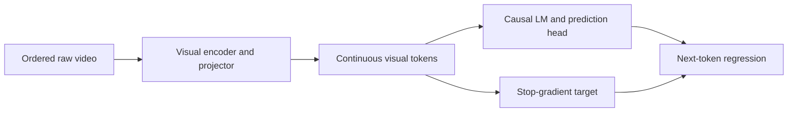
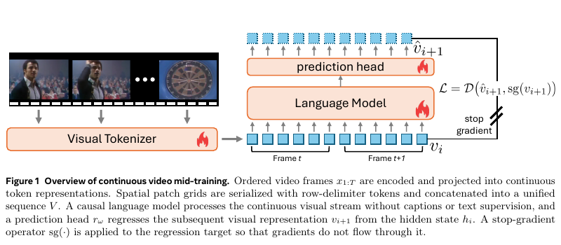

# Raw Video Mid-Training: Continuous visual-token learning without captions

<!-- source-sha256: aef77e8365f9a9c9aa56b934dddf055c86ff2015ee9c83d249db14739c3fc59b -->

[简体中文](README.md)

> High-priority Meta backfill, not reproduced due to cost; review complete.

## Paper information

| Field | Details |
|---|---|
| Paper | [Paper](https://arxiv.org/abs/2610.11019); [author project](https://jd730.github.io/projects/RawVideoMidTraining/) |
| Institution | Jaedong Hwang, Meta AI / Massachusetts Institute of Technology; work done at Meta. |
| First public release | 2026-10-08 00:03:39 UTC (arXiv v1; PDF dated October 7) |
| Author code | No training source release found in the paper or checked project page; a project description is not code. |
| Local adapter or method key | `raw-video-midtraining` (literature only); `adapter: null`. |
| Local reproduction code | None; this document and `src/auto_research/paper_specs/catalog/multimodal-models/raw-video-midtraining.json`. |

## Paper method and evidence

Encode patches of ordered frames as continuous visual tokens serialized in spatial order. A causal LM predicts the next visual token with a stopped-gradient target. Mid-training uses no captions or text loss, and subsequent vision–language instruction tuning is matched with the control. [Sections 3–4](https://arxiv.org/html/2610.11019v1)

<!-- paper-figure:start -->
### Original paper figure

Figure 1, v1 PDF page 3, shows continuous tokens, the prediction head, and stop-gradient on targets. From the [original paper](https://arxiv.org/abs/2610.11019); copyright remains with the authors.
<!-- paper-figure:end -->

### Core equation

`prediction_i = head(LM(v_1…v_i))`; regress to `stop_gradient(v_(i+1))`. Visual tokenizer, LM, and prediction head update end-to-end.

### Reported results

Paper reports +2.9 points averaged over four video benchmarks and +5.1 over ten image benchmarks. Text preservation applies to the matched instruction-tuning comparison, not all video training. Not local or production A/B.

## Local reproduction

[Section 4.1.4](https://arxiv.org/html/2610.11019v1#S4.SS1.SSS4) uses 128 H100s, 27,300 steps, batch 256, 16K context, then instruction tuning. Too costly for a single A100/A30 or Mac. No video/model download, training, metrics, receipt, runnable adapter, Evolve mapping or auto-retry. An isolated MSE example would not be this mid-training.
