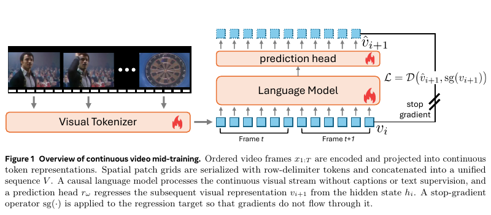

# Raw Video Mid-Training：无需字幕的连续视觉token学习

> Google/Meta优先补漏。**成本过高，不复现（审查 DONE）**；不以MSE演示冒充视频中期训练。

## 论文信息

| 字段 | 内容 |
| --- | --- |
| 论文链接 | [Mid-Training Language Models on Raw Video](https://arxiv.org/abs/2610.11019)；[作者项目页](https://jd730.github.io/projects/RawVideoMidTraining/) |
| 公司 / 机构 | 一作Jaedong Hwang，Meta AI / Massachusetts Institute of Technology；工作在Meta完成 |
| 首次公开日期 | 2026-10-08 00:03:39 UTC（arXiv v1）；PDF落款10-07与首发分开 |
| 原作者代码 | 在原文及已核项目页未找到训练源码发布链接；项目介绍不等于代码开源 |
| 本地 adapter / 稳定键 | 无可执行adapter（`adapter: null`）；资料键`raw-video-midtraining` |
| 本地复现代码 | 无；仅本文和`src/auto_research/paper_specs/catalog/multimodal-models/raw-video-midtraining.json` |

## 原始论文总结

### 背景与主要改动

将有序帧的patch编码为连续视觉token并按空间顺序序列化；因果LM预测下一视觉token，目标侧stop-gradient。中期训练没有字幕或文本损失；随后与对照使用相同图文指令调优，隔离视频阶段贡献。[原文§3–4](https://arxiv.org/html/2610.11019v1)

<!-- paper-figure:start -->
### 原论文关键图

> 原文Figure1，PDF第3页，展示连续token、预测头和目标stop-gradient。图片来自[原论文](https://arxiv.org/abs/2610.11019)，版权归原作者所有；不是本地训练图。
<!-- paper-figure:end -->

### 核心公式与原文效果

`prediction_i = head(LM(v_1…v_i))`，回归目标为`stop_gradient(v_(i+1))`；关键是视觉tokenizer、LM与预测头实际端到端更新。作者报告四个视频benchmark平均+2.9点、十个图像benchmark平均+5.1点；文本保真结论只对匹配指令调优成立，不延伸为任意视频训练都不遗忘。不是本地结果，未报告生产线上A/B。

## 本地复现与成本决策

原文§4.1.4使用128张H100训练27300步，batch256、16K上下文，之后还有指令调优。[原始资源配置](https://arxiv.org/html/2610.11019v1#S4.SS1.SSS4)

单A100/A30或Mac下，**成本过高，不复现（审查 DONE）**。不下载视频或模型、不训练，无本地分数、GPU回执、可执行adapter或evolve映射，不自动重试。
