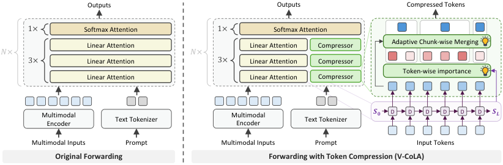

# V-CoLA: Visual Token Compression from Actual Linear-Attention State

<!-- source-sha256: c372ad23e30ef3f09e0b38c14e8fb65eee73f4582ef965efbeb40885166fe9ca -->

[简体中文](README.md)

> **L1 core-mechanism diagnostic, not a reproduction of the full benchmark.** The original Qwen3.5-9B vision encoder and all language layers ran on a real A100. Importance comes from actual states, not random scores, pixel similarity, or hidden answers. Four public training-holdout images do not establish VLM quality.

## Paper information

| Field | Value |
| --- | --- |
| Paper | [arXiv 2610.11251v1](https://arxiv.org/abs/2610.11251v1); [full text](https://arxiv.org/html/2610.11251v1) |
| Affiliations | Alibaba Cloud Computing / Alibaba Group; first author Hao Jiang |
| First public release | 2026-10-08 (arXiv v1) |
| Authors' code | No repository linked in the official text as of 2026-10-11; the arXiv GitHub issue button is not an author release. |
| Adapter | `vcola` |
| Local code | `vcola.py` and `vcola_checkpoint.py` in [multimodal](https://github.com/daiwk/auto-research/tree/main/src/auto_research/multimodal/); `scripts/run_vcola_checkpoint.py` |
| Public checkpoint | [Qwen/Qwen3.5-9B](https://huggingface.co/Qwen/Qwen3.5-9B/tree/c202236235762e1c871ad0ccb60c8ee5ba337b9a), pinned to `c202236235762e1c871ad0ccb60c8ee5ba337b9a` |

## Original paper

### Background and contribution

Softmax attention or feature similarity does not transfer directly to hybrid VLMs with Gated DeltaNet. V-CoLA estimates long-term retention by reading back the final linear-attention state, and short-term uniqueness from how a state update changes responses to a window of queries. Partition contiguous tokens by cumulative importance and merge them by weight; remove visual tokens at a deeper layer. See [Section 3 and Figure 5](https://arxiv.org/html/2610.11251v1#S3).

```mermaid
flowchart LR
 I[Image and question without answer] --> V[Original Qwen vision encoder]
 V --> L[Actual layer-1 Gated DeltaNet]
 L --> S[Actual Q, K, V, decay, beta, and recurrence]
 S --> R[Long-term retention and short-term uniqueness]
 R --> M[Contiguous partition and weighted merge]
 M --> H[Original hybrid language layers]
 H --> X[Remove visual tokens after layer 24]
 X --> O[Original head answer distribution]
```



<!-- paper-figure:start -->
### Key figure from the paper

[](https://arxiv.org/html/2610.11251v1/260521_v1.png)

**Original Figure 5:** Original versus compressed forward paths and module connections. From the [paper](https://arxiv.org/abs/2610.11251v1); copyright belongs to the authors.
<!-- paper-figure:end -->

### Equations and implementation choices

The paper uses value × key state; the local reference follows Transformers' transposed key × value convention. With $\widetilde S_t=\alpha_tS_{t-1}$, the recurrence is

$$
S_t=\widetilde S_t+\beta_t k_t\left(v_t-k_t^\top\widetilde S_t\right)^\top.
$$

Long-term score is $R_t^{imp}=(1+\cos(k_t^\top S_L,v_t))/2$. Short-term score is the mean normalized cosine distance of responses to $Q_t^*$ before and after the state update. Combined $R_t=0.9R_t^{imp}+0.1R_t^{uni}$, with block weights $\operatorname{softmax}(R/1.0)$.

The implementation explicitly uses the main-text Equation 7 query probe with window `[t, t+4)`. Appendix A instead describes shifted keys; these are not silently treated as identical. Compare per-state outputs to the official Transformers recurrent kernel. Require ≤1% relative logits error against the official uncompressed forward and ≤3% relative error between replayed captured state and original layer-kernel output. These gates reject inequivalent state paths; they are not quality metrics. FP32 replay is an auditable reference, not the authors' parallel kernel.

### Paper results

Across public VLM benchmarks, retaining 50% of visual tokens preserved 99.5% of original performance on average; retaining 12.5% preserved more than 88%. The optimized implementation reports prefill acceleration. The [paper experiments](https://arxiv.org/html/2610.11251v1#S4) are not comparable with the local CIFAR object diagnostic or its speed. No production A/B evidence was found.

## Local reproduction

> Use the same frozen Qwen3.5-9B for dense, 50%-retention, and 25%-retention forwards, merging after layer 1 and exiting visuals after layer 24. Fixed CIFAR-10 official-training tail holdout; no official test, training, or tuning.

The question lists classes A–J without the correct category. An external scorer reads only the restricted first-letter distribution. `restricted_first_token_accuracy` is neither free-generation accuracy nor full VLM capability. Report total ten-letter mass and KL against dense so a low-probability argmax is not overinterpreted. `sampling_seed` selects images, not training seeds.

```bash
# CUDA; verified on Transformers 5.14.1 / 5.19.0 with pinned official weights and processor
PYTHONPATH=src python scripts/run_vcola_checkpoint.py \
  --checkpoint checkpoints/qwen3.5-9b \
  --data data/cifar10 \
  --examples 4 --seeds 42 \
  --output runs/vcola-cifar.json
```

Every image/recipe records actual layer `sequence_tokens` and `visual_tokens`: physical shortening after layer 1 and no visual tokens starting at layer 25. Text counts and original mRoPE coordinates stay unchanged. Merged blocks take the highest-scoring original member's position, a stated local backend convention rather than an unspecified author choice. Restore the original kernel on errors so later dense runs stay clean.

New Transformers moves the kernel from an instance attribute to a module function. Compatibility uses private forward globals for only the target instance, preserving decorators and dispatch without mutating module/class globals. Exceptions restore exactly; other instances and threads do not share capture. Both 5.14 and 5.19 passed 29 regressions covering values, visual lengths, isolation, and failure recovery. The latest A100 artifact records `transformers_version=5.19.0` and actual `delta_capture_api=private_forward_globals`, not a CPU smoke test of attribute names.

### Real GPU diagnostic

All three paired forwards executed on four training-holdout images at sampling seed 42.

| Recipe | Restricted first-letter correct | Layer-2 visual tokens | Layer-25 visual tokens | Mean letter KL vs. dense |
| --- | --- | --- | --- | --- |
| Original dense | 4 / 4 | 49 | 49 | 0 |
| V-CoLA 50% + exit24 | 4 / 4 | 24 | 0 | 0.001439 |
| V-CoLA 25% + exit24 | 4 / 4 | 12 | 0 | 0.030911 |

The 5.19 uncompressed backend had zero relative logits error against its official forward; replay's maximum state error was about 0.001648. Mean ten-letter mass was about 0.99901 / 0.99912 / 0.99902. The earlier 5.14 run also passed: state error 0.002743 and KL 0.001490 / 0.029877. Keep dependency versions and runs separate; error changes are not quality gains.

**4 / 4 does not establish 100% capability or lossless compression.** The run verifies the original 9B, real images/states, token merging, visual exit, and isolated scoring, not benchmark generalization, significance, full generation quality, or speed. `scripts/curate_vcola_evidence.py` rejects incomplete pairs, excessive state/baseline error, unchanged physical lengths, answer leakage, and nonfinite values. Preserve per-image records with execution source commits.

## Reproduction boundaries and Evolve

The reference supports batch=1 and one contiguous visual block. It replays the prompt without KV cache to avoid cache-position drift across lengths. An actual greedy method exists, but was not used as a full generation metric here. The eight original benchmarks, video, multi-image, high-resolution, chunk-parallel optimization, and TensorRT deployment were not reproduced. Fewer tokens do not demonstrate lower measured latency. A future compression operator counts as integrated only after the controller executes and evaluates it and registers the verified path.
