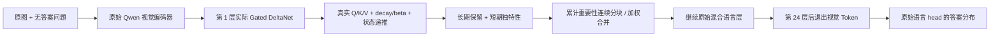
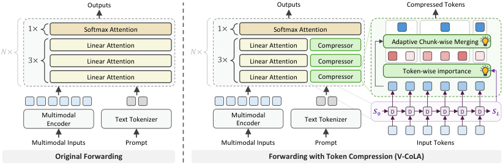

# V-CoLA：由真实线性注意力状态驱动的视觉 Token 压缩

> **本地定位：L1 核心机制诊断，非论文完整 benchmark 复现。** 原始 Qwen3.5-9B checkpoint 的视觉编码器和全部语言层已在真实 A100 执行；重要性不是随机分数、像素相似度或隐藏答案。仅 4 张公开训练留出图片，不代表完整 VLM 质量结论。

## 论文信息

| 项目 | 内容 |
| --- | --- |
| 论文链接 | [arXiv 2610.11251v1](https://arxiv.org/abs/2610.11251v1)；[官方全文](https://arxiv.org/html/2610.11251v1) |
| 公司/机构 | Alibaba Cloud Computing / Alibaba Group；一作 Hao Jiang |
| 首次公开日期 | 2026-10-08（arXiv v1） |
| 原文开源代码 | 否：截至 2026-10-11，官方全文未找到作者源码仓库链接；不将 arXiv 页面的 GitHub issue 按钮当作论文代码 |
| Adapter | `vcola` |
| 本地复现代码 | [`src/auto_research/multimodal/`](https://github.com/daiwk/auto-research/tree/main/src/auto_research/multimodal/) 中的 `vcola.py`、`vcola_checkpoint.py`；运行入口 `scripts/run_vcola_checkpoint.py` |
| 公开 checkpoint | [Qwen/Qwen3.5-9B](https://huggingface.co/Qwen/Qwen3.5-9B/tree/c202236235762e1c871ad0ccb60c8ee5ba337b9a)，固定 revision `c202236235762e1c871ad0ccb60c8ee5ba337b9a` |

## 原始论文总结

### 背景与主要改动

传统视觉 Token 筛选依赖 softmax attention 或特征相似度，不能直接迁移到包含 Gated DeltaNet 的混合 VLM。V-CoLA 用线性注意力最终状态的可回读程度衡量长期保留，再用更新前后状态对短窗口 query 的响应变化衡量独特性；按累计重要性划分连续块并加权合并，深层再退出视觉 Token。[方法见官方正文第 3 节](https://arxiv.org/html/2610.11251v1#S3)。



原论文架构图为[Figure 5](https://arxiv.org/html/2610.11251v1#S3)，比较原始混合模型与压缩后的前向路径；图像及版权属于原作者。

<!-- paper-figure:start -->
### 原论文关键图

[](https://arxiv.org/html/2610.11251v1/260521_v1.png)

> **原论文 Figure 5（关键图）**：展示原论文提出的核心架构、主要模块及其连接关系。图片来自[原论文](https://arxiv.org/abs/2610.11251v1)，版权归原作者所有；点击图片可查看来源。
<!-- paper-figure:end -->

### 核心公式与实现选择

论文状态是 value×key 约定；本地沿用官方 Transformers 的 key×value 转置约定。令 $\widetilde S_t=\alpha_tS_{t-1}$，实际递推为：

$$
S_t=\widetilde S_t+\beta_t k_t\left(v_t-k_t^\top\widetilde S_t\right)^\top.
$$

长期分数为 $R_t^{imp}=(1+\cos(k_t^\top S_L,v_t))/2$；短期分数是前后状态对 $Q_t^*$ 响应的平均归一化余弦距离。合并分数 $R_t=0.9R_t^{imp}+0.1R_t^{uni}$。块内按 $\operatorname{softmax}(R/1.0)$ 加权。

本地明确采用**正文 Equation 7 的 query probe**，窗口 `[t, t+4)`；附录 A 的实现说明写成 shifted keys，二者并不完全一致，不能悄悄当成同一算法。逐状态输出与 Transformers 官方 recurrent kernel 对照，真实 checkpoint 前向还必须通过以下两道数值门槛：

- 未压缩手工前向与官方原始完整前向 logits 相对误差 ≤ 1%；
- 捕获的实际 delta state 重放与原层 kernel 输出相对误差 ≤ 3%。

上述门槛用于拒绝不等价状态路径，不是质量指标。FP32 逐步重放只用于可审计参考，不声称复刻作者的并行优化 kernel。

### 论文离线与线上效果

原文在多种公开 VLM benchmark 上报告：保留 50% 视觉 Token 时平均保留原效果 99.5%，保留 12.5% 时超过 88%；优化实现报告 prefill 加速。本地不拿 CIFAR 对象诊断与这些结果直接比较，也不复用作者加速数值作为本地结果；未发现生产线上 A/B 证据。[原文实验](https://arxiv.org/html/2610.11251v1#S4)。

## 本地复现

> **本地对照口径：** 同一个冻结原始 Qwen3.5-9B，比较 dense、第一层保留 50% / 25% 且第 24 层后退出视觉的三条真实前向。固定公共 CIFAR-10 官方训练集尾部留出图像；不读取官方 test，不训练、不择优调参。

问题始终列出十个对象类别选项 A–J，不包含该图片的正确类别。外部 scorer 仅检查第一个答案字母的受限分布；`restricted_first_token_accuracy` **不是自由生成答案正确率，也不是完整 VLM 能力评测**。报告同时保留十字母总概率质量与相对 dense 的 KL，避免把极低概率的字母 argmax 当作强能力证据。`sampling_seed` 只用于选择图片，不是独立训练随机种子。

```bash
# CUDA、Transformers 5.14.1，以及已下载的固定官方权重和 processor 文件
PYTHONPATH=src python scripts/run_vcola_checkpoint.py \
  --checkpoint checkpoints/qwen3.5-9b \
  --data data/cifar10 \
  --examples 4 --seeds 42 \
  --output runs/vcola-cifar.json
```

每个图片/recipe 都保存每层实际 `sequence_tokens`、`visual_tokens`：第一层后应物理缩短，第 25 层开始应没有视觉 Token，文本数量与原始文本 mRoPE 坐标不变。合并视觉位置选择块内最高分的**原始成员位置**，这是本地明确公开的 backend 约定，而非作者未说明的位置策略。异常时恢复原 kernel，不污染后续 dense 基线。

### 真实 GPU 小样本结果

固定 sampling seed 42 的 4 张训练留出图片，三条配对前向都实际执行：

| 配方 | 首字母受限正确数 | 第 2 层视觉 Token | 第 25 层视觉 Token | 相对 dense 字母 KL 均值 |
| --- | --- | --- | --- | --- |
| 原始 dense | 4 / 4 | 49 | 49 | 0 |
| V-CoLA 50% + exit24 | 4 / 4 | 24 | 0 | 0.001490 |
| V-CoLA 25% + exit24 | 4 / 4 | 12 | 0 | 0.029877 |

未压缩 backend 与官方完整前向 logits 相对误差为 0；实际 delta state 重放最大相对误差约 0.002743。十字母总概率质量均值约 0.99894 / 0.99895 / 0.99904，说明这几张样本中原模型确实遵从了字母格式。

**4 / 4 不是“模型能力达到 100%”，也不能证明压缩无损。** 此实验确认原始 9B、真实图像、实际状态/Token 合并/早退路径和评分隔离能运行，暂不支持 benchmark 泛化、显著性、完整生成质量或速度提升。

`scripts/curate_vcola_evidence.py` 只接受配对完整、状态/基线误差合格、真实长度改变、无答案输入和有限数值的实跑产物；未满足条件时拒绝生成 GPU 回执。原始逐图数据须与执行 source commit 共同固化，不将本段小样本结果提升为正式能力比较。

## 复现边界与 Evolve

当前支持 batch=1、单个连续视觉块。无 KV cache 的参考 backend 逐次重放原始 prompt，避免不同层长度的 cache-position 漂移；不是可直接宣布部署加速的实现。虽然提供真实 greedy generate 方法，本轮评测没有用它伪装完整生成正确率。

尚未复刻八个原 benchmark、视频、多图、高分辨率、作者 chunk-parallel 优化和 TensorRT 部署。不能用缩减 Token 的数量推导“已实测延迟更低”。可作为后续压缩 operator 的机制基础，但只有控制器真实执行、评估并通过登记后才算 Evolve 接入。
