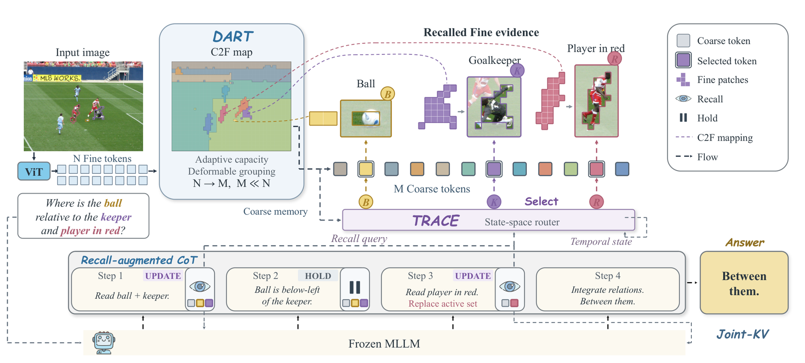

# ViMoD: recoverable visual memory and dynamic evidence access

<!-- source-sha256: bc6d1c67e26524c64b7aaf5b12d3e6ab643bfb82ff2d38571d61c914fefc1309 -->

[简体中文](README.md)

## Paper information

| Field | Details |
|---|---|
| Paper | [Look Back, Think Ahead: Visual Memory on Demand for Efficient Multimodal Reasoning](https://arxiv.org/abs/2610.12060) |
| First author and affiliations | Yicheng Xue; City University of Hong Kong / Zhejiang University |
| First public release | 2026-10-08 (arXiv v1) |
| Authors' code | No author-released code was found. |
| Adapter | `vimod` |
| Local reproduction code | `src/auto_research/multimodal/vimod.py` and `vimod_checkpoint.py` |
| Runner | `scripts/run_vimod_checkpoint.py` |

## Original paper

### Motivation and method

Compressing an image once can discard details needed later in reasoning. DART learns variable region sizes and membership and produces always-resident Coarse KV; the original Fine KV is retained. TRACE uses causal hidden states from already-generated text to hold or replace the working set. Joint-KV restores original details on demand.

~~~mermaid
flowchart LR
    I[Image Fine tokens and original KV] --> D[DART fixed total capacity and deformable grouping]
    D --> C[Resident Coarse KV]
    D --> P[C2F membership mapping]
    H[Observed decoder hidden states] --> T[TRACE multi-timescale SSM]
    T --> G[HOLD or UPDATE to replace whole groups]
    P --> G --> F[Restore original Fine KV on demand]
    C --> J[Joint-KV and text KV]
    F --> J --> N[Frozen decoder predicts next token]
~~~

<!-- paper-figure:start -->
### Key figure from the paper

> **Figure 4:** Overall method and key components. From the [original paper](https://arxiv.org/abs/2610.12060); copyright remains with the authors. Click the image for the source.
<!-- paper-figure:end -->

### Core equations

Capacity is $\tilde c_j=1+(U-1)\sigma(b_j+a_j+\mu)$, with a shared bias imposing $\sum_j\tilde c_j=N$. Its implicit Jacobian is $\operatorname{diag}(d)-dd^\top/\sum d$. After confidence-based assignment, Sinkhorn's continuous capacities supply cross-group gradients, while the forward grouping stays hard.

Training pooling weights are $W=W^{hard}+W^{soft}-sg(W^{soft})$, preserving the hard within-group softmax gradient. Each TRACE branch runs $s_t=\rho_t s_{t-1}+(1-\rho_t)f(u_t)$. UPDATE replaces the old working set rather than merging it.

### Paper results

On eight visual reasoning evaluations with Qwen3-VL-4B, the paper reports a 39.0% increase in normalized mean score over its best one-shot compression control at a 20% target visual budget. It reports no online A/B test. Its own Full setup defines the normalization; official model-card scores are not interchangeable with it.

## Local reproduction

DART includes the capacity constraint and implicit gradients, total-preserving integer rounding, confidence-based hard grouping, eight Sinkhorn rounds, and shared residual Value encoding. TRACE includes layer fusion, a four-timescale SSM, region boundaries, HOLD/UPDATE, and real Fine KV restoration. The checkpoint backend supports SmolVLM/Idefics3, not Qwen3-VL multimodal RoPE.

Four training phases are available: `--phase dart`, `trace-set`, `trace-joint`, and `trace-rl`. Later phases require explicit preceding-phase weights. SFT requires real Fine-index labels in `evidence_by_segment`; RL needs an actual online teacher command. The teacher receives image, question, and generated prefix only, never reference answers or future text. Missing labels or teacher cause an error instead of synthetic fallback labels.

~~~bash
python scripts/prepare_scienceqa_vimod.py --output-directory data/vimod-scienceqa-train
PYTHONPATH=src python scripts/run_vimod_checkpoint.py \
  --checkpoint checkpoints/smolvlm2-256m \
  --checkpoint-id HuggingFaceTB/SmolVLM2-256M-Video-Instruct \
  --checkpoint-revision 067788b187b95ebe7b2e040b3e4299e342e5b8fd \
  --train-jsonl data/vimod-scienceqa-train/train.jsonl \
  --dataset-id derek-thomas/ScienceQA \
  --dataset-revision f18b0a70359ebfb41f658fd564208d0355b013f4 \
  --phase dart --steps 2 --seed 42 --device cuda --output runs/vimod-42.json
~~~

### Data protocol and results

One public supervised example from ScienceQA **train** checks runtime behavior. Its label is used only in the supervised loss, never in the inference question. On an A100 the real SmolVLM checkpoint completed two DART backward passes and dynamic Joint-KV decoding, with losses 13.7315 and 13.7025. There is no isolated test capability score and no accuracy improvement claim.

`scripts/validate_vimod_cuda_runtime.py` also runs CUDA gradient diagnostics for all three TRACE phases on the same real checkpoint. It uses **explicitly declared synthetic auxiliary region annotations and an all-failure reward fixture** without reading answers. The VLM, causal cache, recurrent policy, and loss actually execute. This validates training interfaces and gradients, not the official teacher or model capability.

| Phase | Gradient norm | Parameter-update norm |
|---|---:|---:|
| TRACE Set | 21.8409 | 0.02586 |
| TRACE Joint | 56.3908 | 0.02142 |
| TRACE RL | 7.8128 | 0.02586 |

### Code mapping and limits

`vimod.py` implements the formula operators. `vimod_checkpoint.py` implements real per-layer cache separation and stepwise generation, DART distillation, TRACE SFT, and on-policy RL. The fixed-total gradient passes numerical gradcheck.

Controlled CUDA updates for DART and the three TRACE phases and dynamic decoding are validated. A full run with authentic upstream evidence labels and an actual online teacher is still pending. Gradient diagnostics are not a full paper reproduction. Qwen3-VL, the 57K/80K/4.8K training recipe, 16 evaluations, and budget calibration have not been reproduced. The local implementation reconstructs each crop's 2D patch grid from SmolVLM's actual pixel-shuffle configuration, initializes 2×2 regions, and never merges across crops. This is not Qwen's multimodal coordinate adaptation. Random or fixture TRACE results do not support capability claims or evolve promotion.
