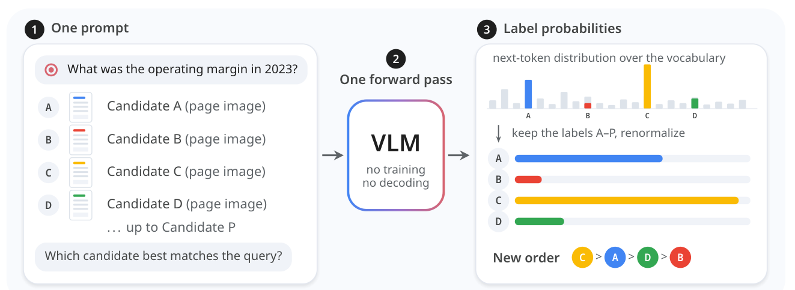

# System One multimodal reranking: Reading candidate probabilities in one forward pass

<!-- source-sha256: 2540a111fd8bb9ed5a79346d60470b71f76b81759e3a6012e6e5e1f2a7c22efc -->

[简体中文](README.md)

> **Local scope: L1 choice-readout diagnostic using a real vision-language model (VLM).** This is not a benchmark reproduction, a trained System One model, or a capability comparison. The full experiment was reviewed and not reproduced because of cost.

## Paper information

| Field | Details |
| --- | --- |
| Paper | [Multimodal Reranking Is a System One Decision](https://arxiv.org/abs/2610.28435v1); [reviewed v1 PDF](https://arxiv.org/pdf/2610.28435v1) |
| First author and affiliation | Zhuchenyang Liu, Aalto University; coauthors Yao Zhang and Yu Xiao are also at Aalto. This is neither a Google/Meta paper nor an official TypeSafe implementation. |
| First public release | 2026-10-20 16:00:45 UTC, arXiv v1; announced October 21. Added in an overlap review, not newly published between scans. |
| Author code | [Public Apache-2.0 repository](https://github.com/Ryenhails/rerank-as-decision), reviewed at [commit f7c9a5a](https://github.com/Ryenhails/rerank-as-decision/tree/f7c9a5a110dc9e1e4c7c1550c8938212e5ae3f27) (2026-10-21 05:36:29 UTC). |
| Local key | <code>system-one-rerank</code>; component only, no benchmark adapter |
| Local implementation | <code>src/auto_research/multimodal/system_one_rerank.py</code> |
| Local tests | <code>tests/test_system_one_rerank.py</code> |

## What the paper proposes

The paper treats reranking as a choice. It places a query and its first-stage candidates in the same multimodal prompt so a general-purpose VLM can compare them jointly. Instead of generating a ranked list or training a separate pointwise reranker, the model scores each candidate by reading the probability of its letter label at the first answer position. The readout follows setwise and FIRST-style methods; the paper tests how this approach works zero-shot on images and visual documents, and whether text-only decision tuning transfers to visual reranking.

### Original paper figure

[Figure 1, PDF page 2](https://arxiv.org/pdf/2610.28435v1#page=2) depicts one shared prompt and a single VLM forward pass. The probability bars are illustrative, not a measured query. Copyright remains with the authors; see the [crop and digest provenance](assets/provenance.json).

### Core equation

Let $c_1,\ldots,c_K$ be the candidates to rerank, with $K\leq16$. Assign each candidate a unique one-token letter label $\ell_j$. Given first-answer vocabulary logits $z$, compute

$$
p_j=\frac{\exp z_{\ell_j}}{\sum_{k=1}^{K}\exp z_{\ell_k}}.
$$

The denominator includes only candidate labels. The local implementation separately reports their total mass under the full-vocabulary softmax; candidate-normalized probabilities are not the model's absolute confidence in the task. Rerank in descending order, preserve the first-stage order on ties, and leave the tail outside the reranking depth unchanged. Labels must map to distinct single tokens under the active tokenizer; hard-coding Qwen token IDs or silently taking the last piece of a multi-token label is incorrect.

The paper also compares pointwise yes/no scoring that combines probability for capitalized and lowercase variants. Neither that baseline nor decision-head training is reproduced locally.

### What the paper reports

On MMEB-V2 visual documents, Table 3 reports 84.79 nDCG@5 for Qwen3.8-27B choice, 84.78 for the supervised Qwen3-VL-Reranker-8B, and 85.42 for JEV-27B-VL on the same backbone as the 27B choice model. The authors note that models differ in size and generation; these results are not a controlled same-size architecture comparison. The paper does not report a production traffic A/B test. These are paper-reported numbers, not local results.

## Local reproduction and validation

<code>ForwardVLMReranker</code> accepts a trusted, already-loaded processor and model. It does not download weights, call autoregressive generation, or accept precomputed candidate scores.

1. Pack the query and each candidate with images before text. Keep candidate order, label the reranking prefix A–P, and omit external document IDs from the prompt.
2. Convert images to RGB, resize proportionally with bicubic interpolation above <code>1800 * 32 * 32</code> pixels, and encode/decode at JPEG quality 90. Record image digests without retaining the originals.
3. Use the chat template with <code>add_generation_prompt=True</code> and <code>enable_thinking=False</code>. Check that all labels are distinct single tokens under the current tokenizer.
4. Run <code>model(**batch, use_cache=False)</code> exactly once and read the last position's logits. Use inference mode and temporary evaluation mode, then restore the caller's original training mode.
5. Rerank only the requested depth. Errors raise by default. Explicit <code>keep_first_stage</code> fallback preserves the initial order and reports the failure type with <code>probabilities=None</code>; it never fabricates a probability.

With a compatible processor, model, and public images already loaded:

~~~python
from auto_research.multimodal.system_one_rerank import (
    ForwardVLMReranker, MultimodalInput, RerankCandidate,
)

ranker = ForwardVLMReranker(processor, model, device="cuda")
candidates = tuple(
    RerankCandidate(str(i), MultimodalInput(images=(image,)))
    for i, image in enumerate(public_images[:4])
)
result = ranker.rank(
    MultimodalInput("Find the document image that answers this question."),
    candidates,
    instruction="Retrieve an image relevant to the query.",
)
print(result.ranked_ids, result.probabilities, result.forward_passes)
~~~

Do not pass answers or relevance labels. For the checkpoint path, <code>run_checkpoint_cases</code> accepts at most 16 explicit public cases with real image input and requires one successful forward pass per case. It does not calculate retrieval accuracy. Callers provide pinned public resource revisions, split information, and the implementation commit for the sanitized GPU evidence record.

The [local metrics](metrics/component-cuda-seeds42-44.json) and [A100 receipt](../../gpu-validations/system-one-rerank-a100-20261021-late.json) record a real forward pass with a pinned SmolVLM-256M-Instruct checkpoint and four synthetic 96×96 RGB images. They verify image input, selected logits and label tokens, normalized probabilities, ranking, and an unchanged two-item tail. The synthetic inputs are not a retrieval benchmark, and three seeds on a frozen checkpoint are not three independent training runs.

To run the download-free L0 tests from the repository root:

~~~bash
PYTHONPATH=src python -m pytest tests/test_system_one_rerank.py -q
~~~

These tests check the forward path and final answer position, image handling, token constraints, normalization, stable ties, tail preservation, failure handling, and state restoration. The instrumented model in the tests is a spy, not pretrained-model evidence.

### Full experiment: reviewed, not reproduced

The full study includes the 27B VLM, long multimodal prompts with up to 16 reranked candidates, and the complete MMEB-V2 and ViDoRe V3 retrieval and reranking matrix. It uses a single H200, context up to 65,536, up to 80 images, and 14,419 choice requests. That exceeded the project's short single-A100/A30 budget. No full download, trial run, or automatic retry was performed. This implementation does not reproduce TypeSafe's unpublished Jev core algorithm, train or tune a model, read gold relevance, or establish a performance advantage over a first-stage or supervised reranker. It is diagnostic-only and is not an Evolve promotion candidate.
