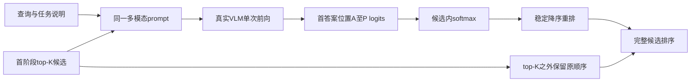
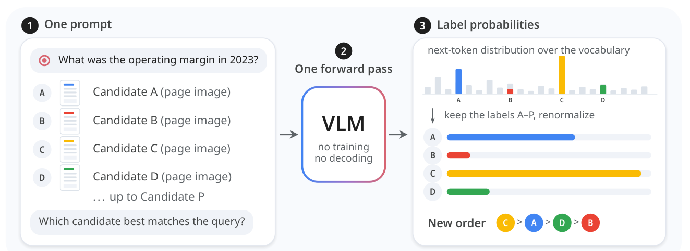

# System One 多模态重排：一次前向读取候选概率

## 论文信息

| 字段 | 内容 |
| --- | --- |
| 论文链接 | [arXiv 2610.28435 v1](https://arxiv.org/abs/2610.28435v1)；[固定原文 PDF](https://arxiv.org/pdf/2610.28435v1) |
| 原文标题 | Multimodal Reranking Is a System One Decision |
| 公司 / 机构 | 一作 Zhuchenyang Liu，Aalto University；作者 Yao Zhang、Yu Xiao 同属该校。不是 Google / Meta 机构稿，也不是 TypeSafe 官方实现 |
| 首次公开日期 | 2026-10-20 16:00:45 UTC（arXiv v1）；10月21日公告，本次属于同公告补发现，不是两次扫描之间新发表 |
| 原作者代码 | [官方 Apache-2.0 仓库](https://github.com/Ryenhails/rerank-as-decision)，核对固定 commit `f7c9a5a110dc9e1e4c7c1550c8938212e5ae3f27`（2026-10-21 05:36:29 UTC）；代码已公开 |
| 本地 adapter / 稳定键 | `system-one-rerank`；`adapter: null`、`component_only`，不是完整 benchmark adapter |
| 本地复现代码 | `src/auto_research/multimodal/system_one_rerank.py`；测试 `tests/test_system_one_rerank.py` |
| 完整实验 | 成本过高，不复现（审查 DONE）；只交付真实 VLM 单次前向的 L1 读出组件 |

## 原始论文总结

### 背景与主要改动

论文把重排视作一个选择决策：把 query 和首阶段候选放入同一多模态上下文，让通用视觉语言模型比较全部候选。它不生成排序文本，也不额外训练一个 pointwise reranker，而是在首个答案位置直接读取候选字母的概率。该读出继承 setwise / FIRST 的方法；论文的新论点与实验是通用 VLM 在图像、视觉文档上的零样本表现，以及纯文本 decision tuning 是否迁移到视觉重排。



<!-- paper-figure:start -->
### 原论文关键图

[](https://arxiv.org/pdf/2610.28435v1#page=2)

**Figure 1，第2页**：同一个 prompt 包含查询及候选，VLM 一次前向后只保留字母标签的概率。图中条长仅为示意，不是某条实测查询。图片来自[原论文](https://arxiv.org/pdf/2610.28435v1#page=2)，版权归原作者所有；[裁切及校验信息](assets/provenance.json)。
<!-- paper-figure:end -->

### 核心公式

首阶段提供 $c_1,\ldots,c_K$，$K\le16$。每个候选对应一个唯一的单 token 字母标签 $\ell_j$；从模型首个答案位置的词表 logits $z$ 计算：

$$
p_j=\frac{\exp z_{\ell_j}}{\sum_{k=1}^{K}\exp z_{\ell_k}}.
$$

分母只覆盖候选标签，不是整个词表；本地另外报告标签在全词表分布中的概率质量，避免把候选内归一化误解为模型对任务的绝对置信度。按 $p_j$ 降序重排；并列保留首阶段顺序，top-K 之外也保持原顺序。标签必须经当前 tokenizer 核对为不同的单 token，不能硬编码 Qwen 的 token id，不能悄悄取多 token 标签的最后一片。

原文另以逐候选 yes/no 作对照，合并 yes / Yes、no / No 的概率；本地此组件**没有复现这一对照**，也没有复现 decision head 的训练。

### 论文离线与线上效果

原文表3：Qwen3.8-27B choice 在 MMEB-V2 visual document 达到 84.79 nDCG@5，监督 Qwen3-VL-Reranker-8B 为84.78；同 backbone 的 JEV-27B-VL 为85.42。作者明确提示模型尺寸和代际不相同，因此不能将其解释为受控同规模架构胜出。未报告真实生产线上 A/B；本条归入多模态 / JEV 研究，不绕过工业搜广推线上证据门槛。以上均为论文报告，**不是本地结果**。

## 本地复现

### 已实现的真实模型路径

`ForwardVLMReranker` 接收调用方已加载的可信 `processor` 和视觉语言模型，不下载权重、不调用生成 API，也不接受预先给定的候选分数：

1. 查询及每个候选按“图片在前、文字在后”组织，候选顺序不改变，标为 A-P；外部文档 ID 不进入 prompt。
2. 图片转 RGB，超出原文上限 `1800 * 32 * 32` 像素时按比例 bicubic 缩小，按 JPEG quality90 编解码；记录输入图像摘要，不保存原图。
3. chat template 使用 `add_generation_prompt=True`、`enable_thinking=False`；当前 tokenizer 必须把所有标签映为不同的单 token。
4. 真实执行一次 `model(**batch, use_cache=False)`，读取最后位置 logits。使用 inference mode、临时 eval，并恢复调用方原训练模式。
5. 只重排指定深度；请求失败默认抛出异常。显式选择 `keep_first_stage` 时保留原排序，并返回 `probabilities=None` 和失败类型，不制造成功概率。

例子中 `processor`、`model` 和 `public_images` 均由调用方提前加载；选择与 checkpoint 兼容的公开图片，不把答案或相关性标签传入对象：

```python
from auto_research.multimodal.system_one_rerank import (
    ForwardVLMReranker, MultimodalInput, RerankCandidate,
)

ranker = ForwardVLMReranker(processor, model, device="cuda")
candidates = tuple(
    RerankCandidate(str(i), MultimodalInput(images=(image,)))
    for i, image in enumerate(public_images[:4])
)
result = ranker.rank(
    MultimodalInput("Find the document image that answers this question."),
    candidates,
    instruction="Retrieve an image relevant to the query.",
)
print(result.ranked_ids, result.probabilities, result.forward_passes)
```

### 数据协议与验证

独立入口 `run_checkpoint_cases` 接收已加载 CUDA checkpoint 和显式 `RerankCase`，每次最多16个公开案例；每个案例必须实际含图片，必须执行一次成功前向。它不下载模型/数据，也不计算相关性准确率。调用方须提供公开资源固定 revision、数据切分和源码 commit，并由统一 GPU 证据流程保存 sanitized receipt。

统一批次还可调用 `diagnostic(seed, device, model, processor)`：它用程序生成4张96×96几何 RGB 图，真实执行一次预训练 VLM 前向，记录输入 token、选中 logits 与 JPEG 摘要、实际标签 token、概率和排序，并检查两个未重排尾项保持原位。这里只验证图像输入与读出路径，不计算准确率；这些生成图不是公开检索 benchmark。小 checkpoint 的来源与固定 revision 由外层运行器如实记录，不限定或冒称原文 Qwen3.8-27B。

预训练小 VLM 的少样本执行属于 **L1 读出机制诊断**，不是27B论文结果，也不能证明它优于首阶段或监督 reranker。冻结模型上重复设置3个 seed 不等于3次独立训练，更不能自动获得 capability comparison / Evolve 晋级资格。

```bash
PYTHONPATH=src python -m pytest tests/test_system_one_rerank.py -q
```

该命令仅执行下载无关的 L0 单元测试：核对真实 `forward` 调用路径、最后答案位置、图片传递、归一化、单 token 门槛、稳定排序、尾部不变、异常回退与状态恢复。测试中的 instrumented model 是单测 spy，**不是预训练模型评测证据**；真实 checkpoint 的 CUDA 验收由主批次运行器另行执行。

## 复现边界

- 本地是可执行 choice-readout / 多模态输入组件，不是独立训练的“System One 模型”，没有复现 TypeSafe 未公开的 Jev 核心算法。
- 不执行原文27B VLM、top16长图文 prompt、MMEB-V2 / ViDoRe V3 全量检索与重排矩阵。原文单 H200、最长65536上下文、最多80图和14419条 choice 请求；完整矩阵明显超出单 A100/A30 短时任务预算。
- 全量实验决策为**成本过高，不复现（审查 DONE）**，不下载、不试跑、不进入自动重试或实现队列；这不等于模型能力已验证。
- 本组件无训练、无 validation 调参、无 test 选择，不读取 gold relevance。正式检索效果还需要隔离公开数据与公平首阶段/pointwise/listwise 对照，本轮不宣称完成。
- `diagnostic_only=true`、`promotion_eligible=false`、`evolve_integrated=false`；未接入可晋级 Evolve 算子。
