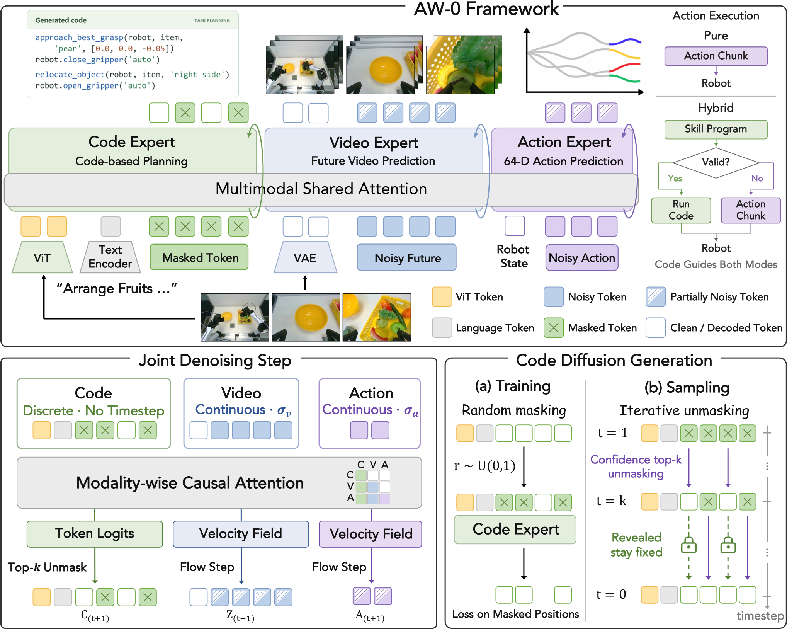

# AW-0: Jointly generating programs, video and continuous actions

<!-- source-sha256: 41630e37ba0dd9a951f79d8e80f3ebf93f8d0814449af07b5e5c0dcb4f6b0886 -->

[简体中文](README.md)

> **Reference entry only.** No local robot model, proxy or metrics; full experiment not reproduced due to cost.

## Paper information

| Field | Details |
| --- | --- |
| Paper | [Agentic World Action Models](https://arxiv.org/abs/2610.30136v1) |
| Affiliations | Co-first authors Zhuoyang Liu (UC Berkeley), Dantong Niu (UC Berkeley/NVIDIA), Botong Zhang (University of Pennsylvania) and Boning Shao (UC Berkeley). Gemini annotation does not establish Google authorship. |
| First public release | 2026-10-21 17:59:56 UTC |
| Author code | [Official agentic-wam repository](https://github.com/ZhuoyangLiu2005/agentic-wam), `7ad228bebb897bf01705cc10171e1d88cf5e9b22`, BSD-2-Clause at root; dependencies separate. [Project](https://agentic-wam.github.io/) and [checkpoint](https://huggingface.co/miniFranka/agentic-wam-pretrain-yamego3k-soup-e1), not the pretraining corpus. |
| Local key | `aw0`; no adapter |
| Local code | No executable local implementation. |
| Local evidence | No local experiment, metrics or GPU receipt. |

## What the paper changes

A mixture of code, video and action Transformers combines reusable programs, future dynamics and controls. Experts have separate projections, normalization and FFNs with per-layer joint attention: bidirectional within each expert and block-causal code→video→action across them. An annotation agent derives programs and a coordinator extracts reusable skills; freeze the library, relabel selected examples and cache programs. Previous fragments become learned memory. Code normally conditions control without execution; optional hybrid executes skills only after validity, precondition and progress checks, otherwise falls back to direct actions.

### Original paper figure

Original figure from the reviewed paper, reused without redrawing. See [figure provenance](assets/provenance.json).

### Core equations

$$
\mathcal C_t=\{\mathcal O_t,L,S_t,M_t\},\qquad
p_\theta(C_0,Z_0,A_0\mid\mathcal C_t).
$$

$$
X_{\sigma_m}^m=(1-\sigma_m)X_0^m+\sigma_m\epsilon_m,\quad
\sigma_m=\frac{\gamma_m u_m}{1+(\gamma_m-1)u_m},\quad \gamma_m=5.
$$

$$
\mathcal L=\mathbb E_{u_v\sim q}\left[
\lambda_v\bar w_v\ell_v+\bar w_g(\lambda_a\ell_a+\lambda_c\ell_c)\right],\quad
w_v=\frac{p_{pre}}q,\quad w_g=\frac{U(0,1)}q.
$$

$C_0,Z_0,A_0$ represent programs, future video VAE latents and action chunks. Train continuous modalities by flow-matching velocity $\epsilon_m-X_0^m$; code uses independent Bernoulli masks and only masked targets. For video, $u_v=0.999b$, $b\sim\mathrm{Beta}(7,1)$; mix pretraining noise and uniform to expose more informative low-noise video to action. Video and action/code have separate importance weights, capped at four then normalized to mean one. Loss weights $(v,c,a)=(1,0.5,1)$; action noise and code masks are independent.

### Results reported by the authors

RoboTwin 2.0: 50 tasks × 50 rollouts per setting. Default clean/random/mean 80.8%/20.6%/50.7%, random below $\pi_{0.5}$ at 27.7%. Hybrid 63.1%/29.2%/46.2%. Two real robot platforms, eight tasks, three seeds × 16 rollouts each give mean rubric 71.1%, not universal strict success. Real towel hybrid 90.6% versus 84.4% default is task-specific. Future vision, grasp/contact and executable preconditions remain limits. No production A/B or local result.

## Local reproduction and limits

No executable adapter, metrics, receipt, generated programs, upstream script or skill execution. Code availability is not reproduction and this entry is not Evolve-integrated.

### Full experiment: not reproduced

Three 28-layer experts (SDAR-1.7B, Cosmos-Predict2.5-2B and action DiT), plus frozen Qwen3-VL, Wan2.2 VAE and Cosmos-Reason1. Pretraining uses six nodes/48 H100s, BF16, ZeRO-1, effective batch 2,592 and one epoch; 248,642 episodes over 606 tasks, ~2,913.2 hours. RoboTwin adaptation takes two nodes/16 GPUs and 100,000 steps; real platforms need 100 demos/task and 20 epochs. No large resources, paid calls, training or automatic retry. Any later reduced study would need its own scope.

### Additional references

[Full paper](https://arxiv.org/html/2610.30136v1) · [Paper Figure 2](https://arxiv.org/html/2610.30136v1#S2.F2) · [Original figure resource](https://arxiv.org/html/2610.30136v1/method_v6_0926.png)
