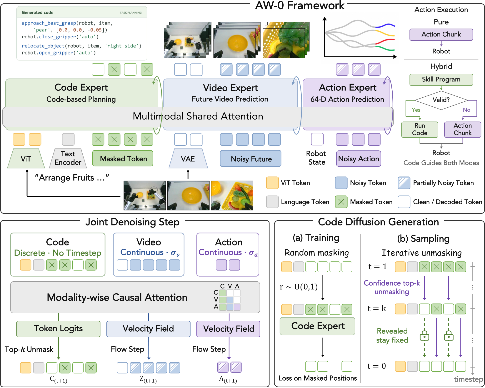

# AW-0：代码、视频与动作联合生成

## 论文信息

| 字段 | 内容 |
| --- | --- |
| 论文链接 | [arXiv 2610.30136 v1](https://arxiv.org/abs/2610.30136v1)；[固定 HTML 原文](https://arxiv.org/html/2610.30136v1)；[作者项目页](https://agentic-wam.github.io/) |
| 原文标题 | Agentic World Action Models |
| 公司 / 机构 / 学校 | 一作 Zhuoyang Liu：UC Berkeley；共同一作 Dantong Niu（UC Berkeley / NVIDIA）、Botong Zhang（University of Pennsylvania）、Boning Shao（UC Berkeley）。本文机构为 UC Berkeley、NVIDIA 和 UPenn，不因使用 Gemini 标注就归为 Google 论文 |
| 首次公开日期 | 2026-10-21 17:59:56 UTC（arXiv v1）；本轮新首发 |
| 原作者代码 | [官方 ZhuoyangLiu2005/agentic-wam](https://github.com/ZhuoyangLiu2005/agentic-wam)，由项目页 Code 链接核实；固定 `7ad228bebb897bf01705cc10171e1d88cf5e9b22`。顶层 BSD-2-Clause，依赖代码及模型需另遵各自许可；已提供训练/部署代码与[预训 checkpoint 页面](https://huggingface.co/miniFranka/agentic-wam-pretrain-yamego3k-soup-e1)，预训语料不随 release 提供 |
| 本地 adapter / 稳定键 | `aw0`；`adapter: null`，`deferred_high_cost`，没有可执行模型 |
| 本地复现代码目录 | **无运行实现**。本次仅收录文档 `docs/multimodal-models/2610.30136-aw0/` 与单篇 catalog，不创建替代模型、训练脚本或指标 |
| 完整实验 | **成本过高，不复现（审查 DONE）**；`not_reproduced_high_cost` 为终态，不阻塞审查水位，不自动重试 |

## 原始论文总结

### 背景与主要改动

世界动作模型能预测未来视觉和控制轨迹，但通常缺少可组合的技能结构；代码型机器人 Agent 能重用程序，却未必把计划与物理动态预测统一起来。AW-0 在 Mixture-of-Transformers 中组合三个专家：代码专家产生参数化程序片段，视频专家预测未来场景，动作专家产生连续控制。程序既能约束预测，也可在可选执行模式中调用技能库。

每个专家有独立投影、归一化与 FFN，通过每层联合注意力交换信息；**专家内部双向、专家之间按代码→视频→动作分块因果**。代码读取当前观察和指令，视频可读代码，动作可读代码与视频，不能把这一关系改成三种模态完全互读。

<!-- paper-figure:start -->
### 原论文关键图

**Figure 2** 展示三专家结构和联合去噪：代码使用离散 masked diffusion，视频和动作使用连续 flow matching。图片直接来自[论文 HTML 原图](https://arxiv.org/html/2610.30136v1/method_v6_0926.png)，未剪裁、重绘或修改科学内容；原文 CC BY 4.0，版权归原作者，详见[来源与哈希](assets/provenance.json)。
<!-- paper-figure:end -->

### 联合生成与训练目标

条件包括当前多视图观察、文字指令、机器人状态及之前程序片段的压缩记忆：

$$
\mathcal C_t=\{\mathcal O_t,L,S_t,M_t\},\qquad
p_\theta(C_0,Z_0,A_0\mid\mathcal C_t).
$$

其中 $C_0$ 是技能程序 token，$Z_0$ 是未来视频的 VAE latent，$A_0$ 是动作 chunk。连续模态 $m\in\{v,a\}$ 按下式加噪，并回归速度 $\epsilon_m-X_0^m$；代码则独立用 Bernoulli mask，仅监督被遮挡的程序 token：

$$
X_{\sigma_m}^m=(1-\sigma_m)X_0^m+\sigma_m\epsilon_m,\quad
\sigma_m=\frac{\gamma_m u_m}{1+(\gamma_m-1)u_m},\quad \gamma_m=5.
$$

视频原始噪声变量为 $u_v=0.999b$、$b\sim\mathrm{Beta}(7,1)$。为使动作专家也能读取更有信息的低噪声视频特征，论文从混合分布 $q=0.5p_{pre}+0.5U(0,1)$ 采样视频噪声；视频目标与动作/代码目标使用不同重要性权重：

$$
\mathcal L=\mathbb E_{u_v\sim q}\left[
\lambda_v\bar w_v\ell_v+\bar w_g(\lambda_a\ell_a+\lambda_c\ell_c)\right],\quad
w_v=\frac{p_{pre}}q,\quad w_g=\frac{U(0,1)}q.
$$

权重先截断、再归一化到 batch 均值 1；附录截断上限为 4，损失权重 $(v,c,a)=(1,0.5,1)$。代码 mask 比例和动作噪声独立采样，不由视频噪声或同一 mask 决定。只抄写 flow loss 或 attention mask，不能替代这套训练、生成与程序语义链路。

### 技能标注、记忆与执行

作者用标注 Agent 对示范生成程序，以协调 Agent 提炼跨任务重复技能；随后冻结技能库，重标选定样本并缓存可复用程序。模型的当前程序片段与指令一起进入代码流，只有程序目标被 mask；先前片段压缩成可学习记忆前缀。

默认部署时，**生成代码不直接执行**，它通过联合去噪给动作专家提供计划；最终由动作 chunk 驱动机器人。论文另提供 hybrid 模式：代码通过有效性、前提与进展检查时执行技能，否则回退直接动作。不能把默认模式写成始终运行任意 Python；本地本次不执行任何程序、上游脚本或仓库 skills。

### 原论文结果，不是本地结果

| 评测 | 原文口径与 AW-0 结果 | 需要注意的限制 |
| --- | --- | --- |
| RoboTwin 2.0 | 50 个任务，每任务每设置 50 rollouts；默认 clean 80.8%、random 20.6%、均值 50.7% | 随机化仍显著降低效果；random 低于原文 $\pi_{0.5}$ 的 27.7% |
| RoboTwin hybrid | clean 63.1%、random 29.2%、均值 46.2% | 更抗随机化，但 clean 和整体均值低于默认 AW-0，不是所有场景都更好 |
| 两种真实机器人、8 任务 | 每任务 3 个训练 seed × 16 rollouts，按 rubric 得分，平均 71.1% | **rubric score 不是所有任务严格成功率**；涉及真实双臂与灵巧手硬件 |
| 真实毛巾任务 hybrid | 原文 rubric 分数 90.6%，默认动作模式 84.4% | 是指定任务和协议下结果，不推广为通用 Agent 能力 |

表格只摘录原论文 Table 1/2 和 §3.2 的结果以说明评测口径；本地未验证、未生成预测，也没有生产搜广推线上 A/B 证据。未来视觉失败、接触/抓握失误和代码执行条件仍是方法局限。

## 本地收录与复现边界

### 当前交付

本页、原论文 Figure 2、完整作者/代码元数据、成本依据和终态 catalog 已收录。**没有运行 adapter、低成本 proxy、benchmark 指标或 GPU 验证收据**；也不把“找到开源代码”当作复现完成。`promotion_eligible=false`、`evolve_integrated=false`，不进入 Evolve 训练或自动选参。

### 为什么直接标为高成本不复现

| 原文配置 | 成本依据 |
| --- | --- |
| 三种 28 层专家 | SDAR-1.7B 代码专家、Cosmos-Predict2.5-2B 视频专家及动作 DiT，另需冻结的 Qwen3-VL、Wan2.2 VAE 和 Cosmos-Reason1 等组件 |
| 预训练 | Table 6：**6 节点、48 张 H100**，bf16、ZeRO Stage 1、effective batch 2,592、1 epoch |
| 示范数据 | Appendix B：248,642 条 episode、606 个任务、约 **2,913.2 小时**机器人及第一视角人类示范；标注还涉及商业模型，原始语料不随代码 release 提供 |
| RoboTwin 下游 | Appendix A：**两节点 16 GPU、100,000 optimizer steps**，再做多任务 rollouts |
| 真实评测 | 双臂夹爪与双灵巧手平台，100 示范/任务、20 epochs、多个训练 seed；不是单卡模拟诊断能替代的实验 |

现有资源按一张 A100 或 A30、或本地 Mac 计算，不能假定多机多卡。原始训练与完整对照矩阵明显超出低成本预算，且真实硬件和未随 release 提供的语料无法由合成 fixture 替代，因此**成本过高，不复现（审查 DONE）**。这是依据原文资源配置的判断，不是本地完整耗时实测；不下载约 44MB PDF、大权重或原始数据来“试试看”，不启动训练、商业 API 或长时 rollout，不设自动重试 TODO。

若后续用户在了解成本后单独批准一项新的缩限研究，应重新声明其数据、模型和保真度，不能回填为本次已验证。当前论文已完成资料与成本审查，但**没有声称方法已实现或模型效果已验证**。
