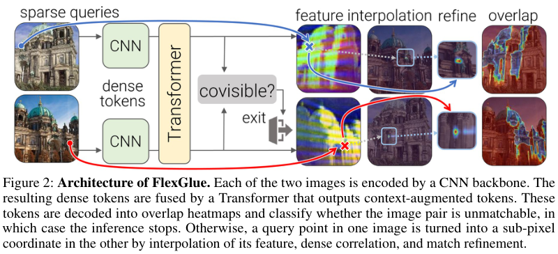

# FlexGlue: Sparse-to-dense matching with co-visibility rejection

<!-- source-sha256: beff09b467412079d54c8dd08e8feace7070054b2d2c750d96ca23ebc0618416 -->

[简体中文](README.md)

> **Reference entry only.** The complete experiment was not reproduced due to cost (review complete); no local operator or capability result.

## Paper information

| Field | Details |
| --- | --- |
| Paper | [FlexGlue: Sparse-to-Dense Feature Matching and Visual Disambiguation](https://arxiv.org/abs/2610.32976v1); [reviewed full text](https://arxiv.org/html/2610.32976v1) |
| Affiliations | First author Philipp Lindenberger: ETH Zurich; Paul-Edouard Sarlin: Google; Ondrej Miksik: Microsoft; Marc Pollefeys: ETH Zurich and Microsoft. |
| First public release | 2026-10-23 17:59:00 UTC (announced 2026-10-26) |
| Author code | [cvg/FlexGlue](https://github.com/cvg/FlexGlue), MIT at `37b5b95fed4c46c5e7103c3c909e22e5f40090c7`. Dataset and DINOv3 resource licenses are separate. |
| Local key | `flexglue`; no adapter |
| Local code | No executable local implementation. |
| Local evidence | No local experiment, metrics or GPU receipt. |

## What the paper changes

Sparse matching depends on detecting repeatable keypoints; dense matching is expensive. Training only on co-visible pairs can also produce confident false matches on symmetric or visually similar non-overlapping structures. FlexGlue uses frozen DINOv3 features at stride 8, self/cross attention over the two grids and interpolated features at specified sparse queries. It reads a local 3×3 neighborhood to avoid averaging distant modes, then refines subpixel locations with expected offsets from two axis-specific bins. A per-layer sigmoid co-visibility vote supports early rejection, trained with non-overlapping and flip-derived hard negatives rather than a gold-aware filter.

### Original paper figure

Original figure from the reviewed paper, reused without redrawing. See [figure provenance](assets/provenance.json).

### Core equations

$$
p_i=\frac{\sum_{j\in\mathcal N(j^*)}P_{ij}g_j}{\sum_{j\in\mathcal N(j^*)}P_{ij}},\qquad
c_i=m_i\sum_{j\in\mathcal N(j^*)}P_{ij}.
$$

$$
\mathcal L=10\mathcal L_{coarse}+\mathcal L_{fine}+\mathcal L_{match}+\mathcal L_{covis}.
$$

$$
\bar o=\frac1{2P}\sum_j(o^a_j+o^b_j),\qquad \bar o<t\gamma^{L-k}.
$$

The paper uses **1.5-entmax and a Fenchel–Young loss**, not the explanatory softmax and cross-entropy. The coarse target uses bilinear weights around the true subpixel coordinate, not a nearest-cell one-hot target. The refinement detaches the coarse coordinates and uses generalized Charbonnier supervision. Co-visibility loss is added after introducing negatives; the average token vote across both images is compared with the layer-dependent exit threshold.

### Results reported by the authors

The paper evaluates relative pose, seven two-view settings, LaMAR-DG, ETH3D SfM, IMC and InLoc. ETH3D AUC@5° goes from 83.5 to 92.3 with disambiguation, and the early-exit variant reaches 91.6 with higher throughput. These are author results. No production A/B was reported.

## Local reproduction and limits

No local executable, command, metrics or GPU receipt. The public repository remains a reference; there is no local feature matcher, SfM pipeline or entmax kernel, and ordinary softmax is not represented as FlexGlue.

### Full experiment: not reproduced

Page 7 specifies frozen DINOv3 ConvNeXt-B, a nine-layer width-512 Transformer, eight datasets, 512×512 images, 50 epochs at 150K examples per epoch, and about four GPU-days on four H200s. With checkpointing, the paper reports around 1.5 days on four RTX 4090s, plus a ten-epoch disambiguation fine-tune and multi-dataset reconstruction evaluation. These are reported configurations, not a derived single-GPU estimate. No large download, trial or retry.

### Additional references

[Paper PDF, p. 2](https://arxiv.org/pdf/2610.32976v1#page=2)
