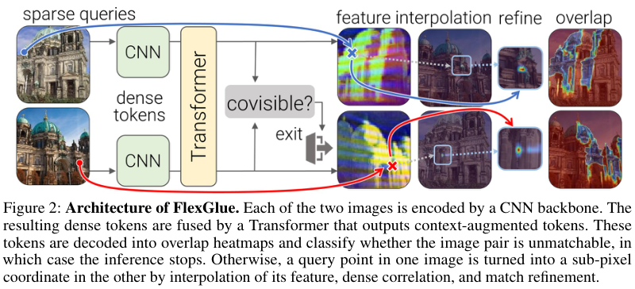

# FlexGlue：稀疏到密集特征匹配与视觉消歧

用冻结DINOv3骨干提取全图dense特征，再以Transformer融合双图上下文，对稀疏query估计亚像素坐标；同时预测共视性，提前拒绝外观相似但不重叠的图像对。实际使用1.5-entmax和Fenchel–Young目标，不是仅做softmax相似度。本轮Google合作优先收录，完整实验成本过高，不复现。

## 论文信息

| 字段 | 内容 |
| --- | --- |
| 论文链接 | [arXiv 2610.32976 v1](https://arxiv.org/abs/2610.32976v1)；[固定v1全文](https://arxiv.org/html/2610.32976v1) |
| 公司 / 机构 / 学校 | 一作 Philipp Lindenberger：ETH Zurich；PDF第一页 Paul-Edouard Sarlin 的上标2对应 **Google**；Ondrej Miksik为Microsoft，Marc Pollefeys为ETH Zurich / Microsoft。 |
| 首次公开日期 | 2026-10-23 17:59:00 UTC（arXiv v1）；2026-10-26 new公告，不把公告日当首投日。 |
| 原作者代码 | [作者公开仓库](https://github.com/cvg/FlexGlue)；固定commit `37b5b95fed4c46c5e7103c3c909e22e5f40090c7`，固定LICENSE核验MIT；数据与DINOv3资源许可独立。 |
| 本地 adapter / 稳定键 | `flexglue`；`adapter: null`；`deferred_high_cost` |
| 本地复现代码目录 | 无；仅收录审查资料，不声称模型已实现。 |
| 完整实验 | **成本过高，不复现（审查 DONE）**；不自动重试、不阻塞审查水位。 |

## 原始论文总结

### 背景与主要改动

稀疏matcher受两图keypoint重复检测能力限制，dense matcher则昂贵，而且两者常只在共视正样本训练，面对对称建筑等doppelganger会给出高置信假匹配。FlexGlue在stride8全图token网格上先做self/cross attention，再只对给定query插值读取特征并寻找另一图的坐标。局部3×3窗口读取避免全局期望在多个候选间平均；轻量MLP对两个方向的offset bins取期望做局部细化。

共视分支给每个token一个sigmoid vote，并在每层监督；双图vote均值低于随层数变化的阈值便提前退出。训练加入不共视与flip生成的hard negatives，使匹配与视觉消歧联合训练，而不是额外挂一个在测试时读取gold的过滤器。

<!-- paper-figure:start -->
### 原论文关键图

**Figure 2**，固定v1第2页架构图及caption。图片来自[原论文](https://arxiv.org/html/2610.32976v1)，版权归原作者所有；保持原图科学内容，未重绘。[来源、裁切和SHA256](assets/provenance.json)。
<!-- paper-figure:end -->

### 核心公式

正文先以softmax解释局部读取，但紧接着明确**实际用1.5-entmax代替softmax，以Fenchel–Young loss代替cross-entropy**。因此不能把一个普通相似度softmax命名为已复现FlexGlue。

$$
p_i=\frac{\sum_{j\in\mathcal N(j^*)}P_{ij}g_j}{\sum_{j\in\mathcal N(j^*)}P_{ij}},\qquad
c_i=m_i\sum_{j\in\mathcal N(j^*)}P_{ij}.
$$

粗匹配target是ground-truth亚像素坐标周围四cell的bilinear权重，不是最近cell one-hot；细化offset对粗坐标停止梯度，以generalized Charbonnier监督。每层训练目标为：

$$
\mathcal L=10\mathcal L_{coarse}+\mathcal L_{fine}+\mathcal L_{match}+\mathcal L_{covis}.
$$

Lcovis在引入negatives后加入。共视vote的双图token均值是pair score，层k在其小于阈值时退出：

$$
\bar o=\frac1{2P}\sum_j(o^a_j+o^b_j),\qquad \bar o<t\gamma^{L-k}.
$$

### 论文离线与线上效果

原文在相对姿态、七个two-view、LaMAR-DG、ETH3D SfM、IMC及InLoc定位上比较。ETH3D加入消歧后AUC@5°从83.5升到92.3，early版本91.6并增加吞吐；这些是作者实验，不是本地结果。未报告互联网生产线上A/B；本篇按通用多模态/几何基础方法收录，不套工业搜广推线上证据口径。

## 本地复现

本轮没有operator、local command、metrics或GPU收据，`gpu_validation_passed=false`。保留作者仓库作为可查来源；不下载DINOv3/训练图像、不编造匹配、SfM或entmax kernel实现，也不让一个通用softmax/字段检查冒充论文核心。

## 复现边界

原文第7页：冻结DINOv3 ConvNeXt-B、9层512维Transformer、8数据集、512×512图像，50epochs、每epoch150K样本，在4张H200上约**4 GPU-days**；gradient checkpointing后4张RTX4090约1.5天，另有10epoch消歧fine-tune与多数据集/重建评测。这里保持作者的GPU-days口径，不虚构单卡总时长。

**成本过高，不复现（审查 DONE）**。成本先行，不先试跑；不进入自动实现/重试队列，不作为capability或evolve晋级证据。`diagnostic_only=true`、`promotion_eligible=false`、`evolve_integrated=false`。
