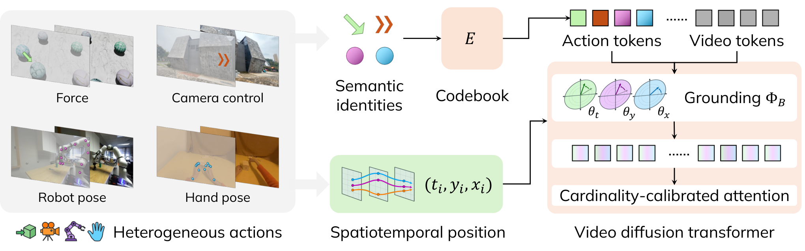

# UniAction: Unified Action Conditioning for World Models

<!-- source-sha256: 13375d6963a871291124f1de9f369626e87aa294c61754eb2a2d6e796171c029 -->

[简体中文](README.md)

> **L1 action-token and cardinality-corrected attention component; diagnostic only.** The full world-model study was not reproduced due to cost (review complete).

## Paper information

| Field | Details |
| --- | --- |
| Paper | [UniAction: Unified Action Conditioning for World Models](https://arxiv.org/abs/2610.32977v1); [reviewed full text](https://arxiv.org/html/2610.32977v1) |
| Affiliations | First author Bowen Xue: Stanford University |
| First public release | 2026-10-23 17:59:13 UTC (announced 2026-10-26) |
| Author code | The [project page](https://uniaction.github.io/) had placeholder Code/Model/Dataset buttons; no method source or source license was verified. Paper and backbone resources have separate terms. |
| Local key | `uniaction`; no adapter |
| Local code | `src/auto_research/multimodal/uniaction.py` |
| Local evidence | [Local mechanism metrics](metrics/component-cuda-seeds42-44.json); [A100 validation receipt](../../gpu-validations/uniaction-a100-20261026.json) |

## What the paper changes

Actions such as force, camera motion, hands and robot commands have different token densities. In a joint softmax, a group with more tokens can receive more attention merely because of its size. UniAction represents actions as sparse elements with discrete semantic IDs and continuous time/space coordinates, looks up a shared codebook and delegates position encoding to the video backbone. A group-wide log bias corrects action mass without changing the relative action logits.

### Original paper figure



Original figure from the reviewed paper, reused without redrawing. See [figure provenance](assets/provenance.json).

### Core equations

$$
A=\{(s_i,p_i)\}_{i=1}^{N_a},\quad a_i=E[s_i],\quad \tilde a_i=\Phi_{\mathcal B}(a_i,p_i).
$$

$$
L_v=Q_vK_v^\top/\sqrt{d_h},\quad L_a=Q_vK_a^\top/\sqrt{d_h},\quad
[A_v\mid A_a]=\mathrm{softmax}([L_v\mid L_a+\log(N_{ref}/N_a)]),\quad O_v=A_vV_v+A_aV_a.
$$

The video and action scores use **one joint softmax**, not separate normalizations. Corrected outputs are invariant if every action key/value and its position are duplicated the same number of times. Without the correction they generally change. Genuinely new actions can still change the output.

### Results reported by the authors

In the full video-intervention experiments, the unified model outperforms the corresponding specialist on ActionFollowing for each of the four action classes. The authors also compare VACE and cross-attention. These are not local attention errors or gradients. No production A/B was reported.

## Local reproduction and limits

`ActionTokens` supplies a trainable shared codebook and requires a caller-provided native-position callback. The diagnostic callback checks parameter passing, not Wan's RoPE. `cardinality_attention` computes actual joint Q/K/V attention and adjusts for each request's valid action count; padding is excluded from counts, zeroed before multiplication and gets zero weight. CPU and actual A100 runs on the same frozen version use seeds 42/43/44 and check formulas, interfaces, duplication, masking and gradients. CUDA fails rather than silently falling back. This PyTorch reference does not build the vocabulary, extract four types of actions, generate videos, evaluate generation or claim a custom-kernel speedup. No Evolve promotion.

```bash
PYTHONPATH=src python -c 'from auto_research.multimodal.uniaction import diagnostic; print(diagnostic(42))'
python -m pytest tests/test_oct26_foundation_components.py
```

### Full experiment: not reproduced

The full setup uses the Wan2.2-I2V-A14B high-noise expert with LoRA; GoalForce, SolarWM, EgoDex and DROID each provide 10K clips, totaling 40K clips of 81 frames at 480×832. It includes 410 counterfactual generations, motion/pose estimators, four specialists and a 100-person evaluation. No model/video download, training probe or automatic retry.

### Additional references

[Original figure resource](https://arxiv.org/html/2610.32977v1/method.png)
