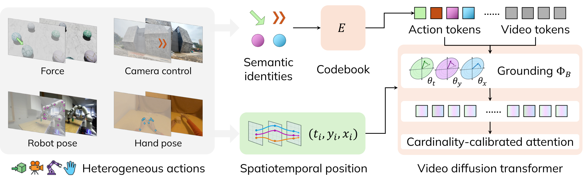

# UniAction: Unified Action Conditioning for World Models

把力、相机、手部及机器人动作统一成离散语义ID与连续时空坐标的稀疏元素，复用视频backbone原生位置系统；对action logits加log(Nref/Na)，消除动作token数量引入的总注意力偏置。本地保留共享codebook接口和联合softmax，不假造视频生成。

## 论文信息

| 字段 | 内容 |
| --- | --- |
| 论文链接 | [arXiv 2610.32977 v1](https://arxiv.org/abs/2610.32977v1)；[固定核对全文 v1](https://arxiv.org/html/2610.32977v1) |
| 公司 / 机构 / 学校 | 一作 Bowen Xue：Stanford University；全文署名未列Google/Meta，不因使用Gemma或引用JEPA就标为Google/Meta论文。 |
| 首次公开日期 | 2026-10-23 17:59:13 UTC（arXiv v1提交）；2026-10-26 new公告，不混淆提交日与公告日。 |
| 原作者代码 | 官方项目页https://uniaction.github.io/的Code/Model/Dataset均为href=#占位按钮；本轮未发布可核验方法源码，不把占位按钮算开源；未找到可核验的方法源码许可证；按固定论文许可和各backbone资源分别遵守 |
| 本地 adapter / 稳定键 | `uniaction`；`adapter: null`；`component_only` |
| 本地复现代码目录 | `src/auto_research/multimodal/uniaction.py` |
| 完整实验 | **成本过高，不复现（审查 DONE）**；不阻塞审查水位、不自动重试。 |

## 原始论文总结

### 背景与主要改动

异质动作以不同粒度编码，token较多的动作在同一softmax中会仅因数量而占据更大attention mass。UniAction以共享semantic codebook编码元素身份，将(t,y,x)送入既有视频模型的native positional mechanism，再对action部分统一加一个基数bias，保持action内部相对logits不变，同时移除总mass对Na的线性依赖。

<!-- paper-figure:start -->
### 原论文关键图

[](https://arxiv.org/html/2610.32977v1/method.png)

**Figure 2**，固定v1HTML原始图文件逐字节保存。图片来自[原论文](https://arxiv.org/html/2610.32977v1)，版权归原作者所有；未重绘或修改科学内容。[原始来源、SHA256和尺寸](assets/provenance.json)。
<!-- paper-figure:end -->

### 核心公式

$$
A=\{(s_i,p_i)\}_{i=1}^{N_a},\quad a_i=E[s_i],\quad \tilde a_i=\Phi_{\mathcal B}(a_i,p_i).
$$
$$
L_v=Q_vK_v^\top/\sqrt{d_h},\quad L_a=Q_vK_a^\top/\sqrt{d_h},\quad
[A_v\mid A_a]=\mathrm{softmax}([L_v\mid L_a+\log(N_{ref}/N_a)]),\quad O_v=A_vV_v+A_aV_a.
$$
这是同一个联合softmax，不是video与action分别归一化。若每个action key/value完全复制r次、其位置表示也相同，校正后输出不变；不校正时一般改变。不同的新动作而非完全复制仍可改变输出，不能宣称任意token增加都不影响。

### 论文离线与线上效果

原文统一模型对四类动作的ActionFollowing均超过对应独立专家，并比较VACE和cross-attention；这些来自完整视频干预和估计器，而不是本地attention矩阵误差。这里仅报告重复制不变性、mask及梯度。

未报告本文方法的生产线上A/B，不将开源benchmark或引用商业模型视为线上部署证据。

## 本地复现

本轮已在CPU及真实NVIDIA A100上执行同一冻结版本、42/43/44三个种子：[独立机制指标](metrics/component-cuda-seeds42-44.json)、[脱敏GPU凭证](../../gpu-validations/uniaction-a100-20261026.json)。仅验收下述L1组件，不宣称完整模型能力。

`ActionTokens`提供可训练共享codebook，native_position为必须显式传入的调用方回调；没有猜测或替换Wan的RoPE。诊断回调仅证明参数传递，不能当成真实视频backbone位置实现。`cardinality_attention`真实计算Q/K/V联合softmax与输出，按每个request的有效action数校正；padding不计数、在乘法前清零、softmax权重为零。参考实现用普通PyTorch，不声称自定义kernel加速。未实现语义vocabulary构建、四类动作坐标抽取、Wan模型或生成评测。

```bash
PYTHONPATH=src python -c 'from auto_research.multimodal.uniaction import diagnostic; print(diagnostic(42))'
python -m pytest tests/test_oct26_foundation_components.py
```

`diagnostic(seed, device='cpu')`只运行生成小张量上的独立公式、梯度、接口和负控；CUDA不可用直接失败、不回退CPU。本轮已完成CPU与真实A100同源三种子机制验收，不是完整模型效果复现。

## 复现边界

Wan2.2-I2V-A14B high-noise expert LoRA，GoalForce/SolarWM/EgoDex/DROID各10K clips，共40K段81帧480×832；410反事实生成、多个motion/pose估计器、4个专家和100人评测。完整视频训练/生成显著超过单A100/A30短时资源，不下载14B权重或40K视频，不试跑成本。

**成本过高，不复现（审查 DONE）**。以上是成本先行的终态审查，不是先跑大实验再得出的超时。本地组件只证明所列计算与梯度，不证明原模型/数据流程或正式benchmark收益。 `diagnostic_only=true`、`promotion_eligible=false`、`evolve_integrated=false`，没有以registry标签假称多轮控制器集成。
