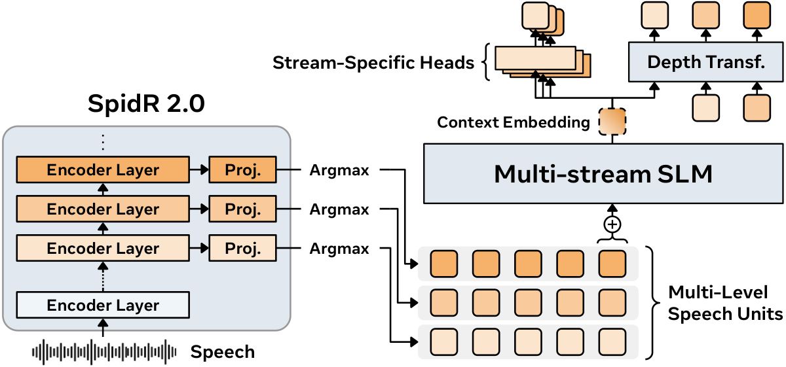

# GSLM2: cross-stream deduplication and speech-unit transition scoring

<!-- source-sha256: 5ab8ce37c3b3aadad488495535e4ecda1ab9dc939871212b55de7ae8d11e870a -->

[简体中文](README.md)

> **L1 mechanism diagnostic.** The local component consumes externally supplied discrete units and target log probabilities; it does not run a speech model. The full experiment is **too costly and not reproduced (review DONE)**.

## Paper information

| Field | Details |
| --- | --- |
| Paper | [GSLM2: Multi-Stream Speech Representation Learning and Generative Spoken Language Modeling](https://arxiv.org/abs/2611.01143); [fixed v1 full text](https://arxiv.org/html/2611.01143v1) |
| Company / author institutions | First author Yosuke Higuchi, **Meta Superintelligence Labs**. Other affiliations include AMI Labs, Université Paris Dauphine–PSL, Doctolib, and EHESS. |
| First public date | 2026-10-31 17:31:45 UTC (arXiv v1); the [official Meta research directory](https://ai.meta.com/research/publications/gslm2-multi-stream-speech-representation-learning-and-generative-spoken-language-modeling/) dates it November 4, 2026. This is an earlier omission added in the November 7 review, not a new first publication. |
| Author code | [facebookresearch/gslm2](https://github.com/facebookresearch/gslm2/tree/a8c129c84093c78972d5c6b34bed4925cd5d33c2) releases training/evaluation code and checkpoint links under the authors' stated CC BY-NC 4.0. The local implementation follows the paper independently; no code was copied or weights downloaded. |
| Local adapter / key | `gslm2`; `adapter: null`, not integrated into Evolve. |
| Local code | `src/auto_research/multimodal/gslm2.py` |

## Original paper summary

### Motivation and method

A single-stream spoken language model usually quantizes one encoder layer, potentially missing phonetic and semantic information in other layers. GSLM2's SpidR 2.0 trains units at multiple speech-encoder layers using differentiable prediction heads. On the language side, it aligns units across layers at each audio frame and retains positions where any stream changes. Averaged stream embeddings feed a shared temporal Transformer. Each stream-specific head scores the next unit of its stream using the previous multi-stream history. A separate generation head predicts the streams within a time step in order, so later streams can depend on earlier ones at the current step. Training combines a single-stream loss, transition-level self-distillation, and multi-stream generative loss; none is in the local slice.

<!-- paper-figure:start -->
### Key original-paper figure

[](https://arxiv.org/html/2611.01143v1#S1.F1)

The left architecture panel of Figure 1 from the [fixed v1 paper](https://arxiv.org/html/2611.01143v1#S1.F1) is the original author PNG, not a redrawing. Copyright belongs to the original authors; the code license is distinct from the figure's publication provenance. [Asset source and SHA256](assets/provenance.json).
<!-- paper-figure:end -->

### Core equations

In Section 2.2, let $z_{l,t}$ denote the unit of stream $l$ at the aligned audio frame $t$. The kept frames are (one-based, as in the paper):

$$
R=\{1\}\cup\{t>1:\exists\,l,\ z_{l,t}\ne z_{l,t-1}\}.
$$

Let $\mathbf q_u$ be a retained tuple. In Appendix C.1.6, paired discrimination uses each stream's own transition positions $C_l$, including its first unit. Average the stream-specific head's target log probabilities over those positions first, then give every stream equal weight:

$$
C_l=\{1\}\cup\{u>1:q_{l,u}\ne q_{l,u-1}\},\qquad
s(\mathbf q)=\frac{1}{|\mathcal J|}\sum_{l\in\mathcal J}\frac{1}{|C_l|}
\sum_{u\in C_l}\log p_l^{\rm ms}(q_{l,u}\mid\mathbf q_{<u}).
$$

When another stream changes, an unchanged unit remains in the tuple context but does not count in its own transition average. Independently deduplicating then concatenating streams breaks alignment; pooling event counts before averaging changes the weighting. This score is not the depth head's joint generation likelihood.

### Reported offline and online results

In Appendix C.1.6, Table 12, the 6,000-hour, 300M model's default transition scoring gives 76.3% / 67.2% / 78.9% on sWuggy / sBLIMP / tSC, versus 66.7% / 56.3% / 61.7% using the same model's generative head at all retained positions. These are the paper's paired discrimination results, not local data, speech generation quality, or a production A/B test. No production A/B test is reported.

## Local reproduction

### Data protocol and code mapping

`cross_stream_deduplicate` takes time-by-stream discrete IDs and returns zero-based retained indices and tuples. `transition_log_score` takes aligned retained tuples and each stream head's finite, nonpositive target log probabilities. It returns per-stream means and counts plus the equally weighted total. The input probabilities must be computed elsewhere from shared history. The routine computes no model logits, receives no correct-candidate label, and does not run speech encoding, decoding, or a benchmark.

```bash
PYTHONPATH=src python -c 'from auto_research.multimodal.gslm2 import diagnostic; print(diagnostic(42))'
PYTHONPATH=src python -m pytest tests/test_nov07_gslm2.py -q
```

### Results, negative controls, and limits

Small synthetic sequences test union-of-change alignment, an independent per-stream reference, first-unit inclusion, exclusion of repeated scores, and column permutation. A two-stream example has valid counts 1 and 4 and means −4 and −2.5, giving −3.25; averaging all five events would instead give −2.8. Changing only excluded repetition scores must not change the result. These checks measure no real speech, training, task accuracy, or performance. The CPU reference needs no GPU acceptance.

### Cost of the full experiment

In Appendix B.3, Table 9, even the smallest GSLM2 used 32 H200s (90M, 600 audio hours). The largest used 112 H200s (6.5B, 6 million hours, 750,000 steps). Training one SpidR 2.0 encoder used 16 H200s for about 18 hours, while generative evaluation additionally used duration prediction, a vocoder, and transcription. A single A100/A30 or Mac is not a practical match. **Too costly, not reproduced (review DONE).** No weights or audio were downloaded, no model or API calls were made, and no automatic retry is scheduled.
