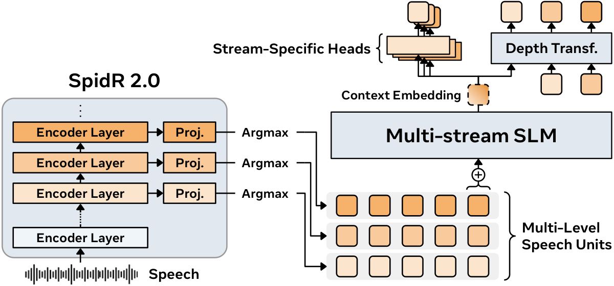

# GSLM2：多层语音单元的联合去重与转移评分

> **L1 机制诊断。** 本地只处理外部给定的离散单元与目标对数概率，不运行语音模型；完整实验**成本过高，不复现（审查 DONE）**。

## 论文信息

| 字段 | 内容 |
| --- | --- |
| 论文链接 | [GSLM2: Multi-Stream Speech Representation Learning and Generative Spoken Language Modeling](https://arxiv.org/abs/2611.01143)；[固定 v1 正文](https://arxiv.org/html/2611.01143v1) |
| 公司/机构 | 一作 Yosuke Higuchi，**Meta Superintelligence Labs**；作者另有 AMI Labs、Université Paris Dauphine–PSL、Doctolib 与 EHESS 署名。 |
| 首次公开日期 | 2026-10-31 17:31:45 UTC（arXiv v1）；[Meta 官方研究目录](https://ai.meta.com/research/publications/gslm2-multi-stream-speech-representation-learning-and-generative-spoken-language-modeling/)标注 2026-11-04，本轮为补漏，不是 11 月 7 日新首发。 |
| 原作者代码 | [facebookresearch/gslm2](https://github.com/facebookresearch/gslm2/tree/a8c129c84093c78972d5c6b34bed4925cd5d33c2) 公开训练/评测源码与权重链接，作者声明 CC BY-NC 4.0；本地独立按论文公式实现，未复制代码或下载权重。 |
| 本地 adapter / 稳定键 | `gslm2`；`adapter: null`，不接入 Evolve。 |
| 本地复现代码 | `src/auto_research/multimodal/gslm2.py` |

## 原始论文总结

### 背景与主要改动

单流口语语言模型通常只量化一个编码器层，可能漏掉其他层的音位和语义信息。GSLM2 的 SpidR 2.0 用可微预测头训练多层语音单元。语言侧先对齐各层在相同音频帧上的单元，再保留任一流变化的位置；各流 embedding 的平均输入共享时序 Transformer。单流输出头只使用过去的多流历史，对本流下个单元打分；生成头另外按顺序生成同一时间位置的多个流，后生成的流可依赖本位置先生成的流。原文训练结合单流损失、转移级自蒸馏与多流生成损失，三项均不在本地切片中。

<!-- paper-figure:start -->
### 原论文关键图

[](https://arxiv.org/html/2611.01143v1#S1.F1)

图片来自[原论文](https://arxiv.org/html/2611.01143v1#S1.F1)固定 v1 Figure 1 左侧架构图，保留作者原始 PNG，未重绘。版权归原作者所有；作者代码许可不替代图的原文出处。[资产出处与 SHA256](assets/provenance.json)。
<!-- paper-figure:end -->

### 核心公式

按 §2.2，设 $z_{l,t}$ 是同一音频帧 $t$ 的第 $l$ 流单元。保留帧集合（原文一基索引）：

$$
R=\{1\}\cup\{t>1:\exists\,l,\ z_{l,t}\ne z_{l,t-1}\}.
$$

保留的多流元组记为 $\mathbf q_u$。按 Appendix C.1.6，成对判别时为各流选择自身转移位点 $C_l$（含第一单元），先逐流对该头的目标 log probability 求均值，再对流等权：

$$
C_l=\{1\}\cup\{u>1:q_{l,u}\ne q_{l,u-1}\},\qquad
s(\mathbf q)=\frac{1}{|\mathcal J|}\sum_{l\in\mathcal J}\frac{1}{|C_l|}
\sum_{u\in C_l}\log p_l^{\rm ms}(q_{l,u}\mid\mathbf q_{<u}).
$$

一个流不变化而其他流变化时，该流的重复单元仍保留在上下文中，但不计入本流转移均值。不能各自去重后直接拼接，也不能把不同流的转移数合在一个分母。该分数不是深度生成头的联合似然。

### 论文离线与线上效果

原文 Appendix C.1.6 Table 12 的 6,000 小时、300M 配置中，默认单流头转移分数在 sWuggy/sBLIMP/tSC 上分别为 76.3% / 67.2% / 78.9%，同一模型改用生成头的全位置分数为 66.7% / 56.3% / 61.7%。这是原文成对判别口径，不是本地数据、语音生成质量或生产线上 A/B；原文未报告生产线上 A/B。

## 本地复现

### 数据协议与代码映射

`cross_stream_deduplicate` 接收时间×流的离散 ID，返回零基保留帧下标和多流元组。`transition_log_score` 接收已对齐的元组与每个流头对其实际单元的有限非正对数概率，返回逐流均值、计数和等权总分。输入概率须来自外部共享历史条件；函数不计算模型 logits，不接收成对样本的正确标签，也不包含语音编码、解码或基准运行。

```bash
PYTHONPATH=src python -c 'from auto_research.multimodal.gslm2 import diagnostic; print(diagnostic(42))'
PYTHONPATH=src python -m pytest tests/test_nov07_gslm2.py -q
```

### 结果、负控与边界

诊断用小型合成离散帧检查变化并集、独立逐流参考、首项计分、重复项屏蔽和列置换。算例中两流的有效计数是 1 和 4，均值是 −4 和 −2.5，最终 −3.25；把五个事件直接平均会得 −2.8。只改被屏蔽的重复项，不应改变结果。这些检查不测真实语音、参数训练、任务准确率或性能；CPU 参考不需要 GPU 验收。

### 高成本完整实验

Appendix B.3 Table 9 最小 GSLM2 仍用 32 张 H200（90M、600 小时）；最大用 112 张 H200（6.5B、600 万小时、75 万步）。SpidR 2.0 单个编码器训练也用 16 张 H200、约 18 小时，生成评测另需时长预测、vocoder 和转写。现有单卡 A100/A30 或 Mac 不适合完整复现。**成本过高，不复现（审查 DONE）**；未下载权重/音频、未调用模型/API、不自动重试。
