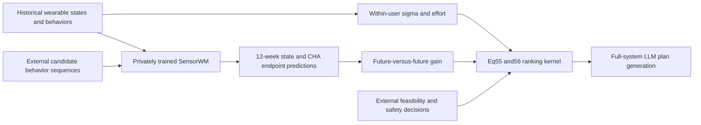
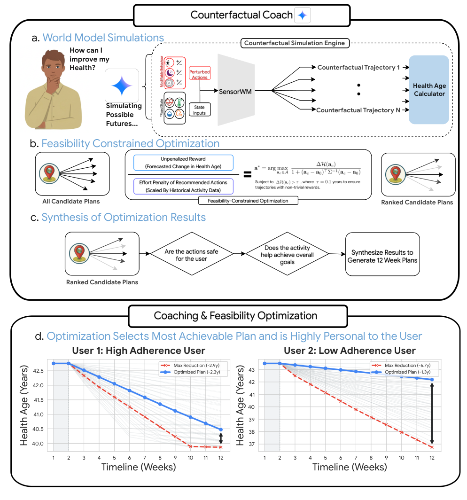

# SensorWM: action-conditioned wearable dynamics and personalized-effort ranking

<!-- source-sha256: 547ec8785646f513290c6ad65a5ed302920716e67f746cce5466396f06ec4111 -->

[简体中文](README.md)

> **L1 CPU arithmetic post-processing, not health prediction, medical advice, or full planning capability.** Local code implements only Eq.55–56. It supplies no private SensorWM, trajectories, 125-candidate grid, clinical feasibility judgment, or LLM health coach.

## Paper information

| Field | Value |
| --- | --- |
| Paper | [arXiv:2611.08568v1](https://arxiv.org/abs/2611.08568v1); [fixed text](https://arxiv.org/html/2611.08568v1). Canonical title: **Personalized health coaching via coachable health age and counterfactual wearable trajectories** |
| Institutions | First author Simon A. Lee: Google Research / University of California, Los Angeles; co-first author Zeinab Esmaeilpour: Google Research |
| Original release | **November 5, 2026, 17:52:57 UTC**. Google's November 11 blog triggered renewed full-text review: a historical gap, not a November 12 first release |
| Authors' code | The paper promises publication-time release in [Google Health's repository](https://github.com/Google-Health/consumer-health-research). Limited directory-entry/README checks at fixed HEAD `3e9d1e4877a54cf81ce8ef34085006952dd19601` did not confirm a dedicated SensorWM/CHA release; this is not a repository-wide exhaustive claim. Its existing `personal_health_agent` concerns [2508.20148](https://arxiv.org/abs/2508.20148), not this paper; public model weights were not confirmed |
| Local adapter/key | `sensorwm-planning`; `adapter=null`; no Evolve integration |
| Local code | `src/auto_research/multimodal/sensorwm_planning.py` |

The abstract page and PDF metadata include “health” in the title. HTML h1 uses the alias **Personalized coaching via coachable health age and counterfactual wearable trajectories**. These identify the same fixed v1, not separate papers.

## Original paper

### Motivation and changes

The paper separates controllable behaviors—steps, main-sleep duration, and cardio-intensity minutes—from physiological outcomes such as RHR and AZM. Coachable Health Age (CHA) maps interpretable wearable signals to an age-equivalent measure. SensorWM predicts action-conditioned future states, a selector ranks behavioral candidates, and an LLM synthesizes a 12-week plan.

SensorWM is not a hand-weighted behavioral rule. A state encoder produces 128-dimensional latents; a state/action-dependent 128-by-128 operator transforms the preceding latent displacement:

$$
z_t=E(s_t),\qquad \widehat F_t=g(\hat z_t,a_t),\qquad
\widehat{\Delta z}_{t+1}=\widehat F_t\widehat{\Delta z}_t,\qquad
\hat z_{t+1}=\hat z_t+\widehat{\Delta z}_{t+1}.
$$

Only the first two observed weeks initialize rollout. Later transitions use free-running predictions, not future observed states. Rollout and path losses constrain latent locations and displacements. The joint encoder uses neither EMA nor stop-gradient targets; SIGReg with 256 random projections discourages representation collapse. A post-hoc linear physiological decoder does not backpropagate into the pretrained world model.

### Architecture and flow



Only the Eq.55–56 ranking kernel exists locally. Physiology, clinical decisions, and plan generation are not an executable local chain.

<!-- paper-figure:start -->
### Key original figure

[](https://arxiv.org/html/2611.08568v1/Figure4_new.png)

Original Figure 4 shows simulation, ranking, and subsequent plan synthesis. The file preserves the official HTML PNG bytes, without redrawing, cropping, or rendering. Source: [fixed paper](https://arxiv.org/html/2611.08568v1#S2.F4). Copyright remains with the authors. Its projected changes and full workflow are not local measurements or an available medical tool.
<!-- paper-figure:end -->

### Equations

The reference anchor is the **12-week future endpoint under unchanged behavior**, CHA_sq, not current observed baseline CHA:

$$
\Delta CHA(c)=CHA_{sq}-CHA_c.
$$

The paper floors within-user action standard deviations at 500 steps, 15 sleep minutes, and 10 cardio minutes. These normalize effort; **they are not medical safety thresholds**.

$$
\tilde\sigma_k=\max(\sigma_k^{user},\sigma_k^{floor}),\qquad
E(c)=\sum_{k\in\{steps,sleep,cardio\}}\left(\frac{c_k-b_k}{\tilde\sigma_k}\right)^2,
$$

$$
score(c)=\frac{CHA_{sq}-CHA_c}{1+E(c)},\qquad CHA_{sq}-CHA_c>0.1.
$$

The threshold is strict. The full paper additionally screens feasibility/safety, groups sleep/movement/combined pathways, and generates plans; local code does not invent missing rules. Google's blog mentions 125 combinations, but fixed text does not specify that grid's exact spacing. A 5-cubed grid is not inferred from the number 125.

### Paper evidence

The authors pretrain on approximately 100,000 participants and evaluate on independent WEAR-ME data, reporting overall forecasting R²=0.664. In blinded paired review of 49 cases, lifestyle coaches preferred counterfactual plans for overall quality in 71.4% and **anticipated long-term adherence** in 71.0% of ratings. Clinician endorsement of exercise-intensity limits was 99.2% versus 97.6%. These are offline retrospective-profile evaluations, not measured user adherence, disease improvement, or production-traffic A/B.

The paper explicitly says action conditioning does not identify causal intervention effects and prospective studies remain needed. It reports failure modes including redundant step increases and overly optimistic projected CHA changes. No local medical metrics are reproduced; successful arithmetic is neither health benefit nor clinical-safety evidence.

## Local component

### Data contract and code

`Actions` fixes three-action order and units. `Candidate` requires a finite external endpoint and boolean `feasible`. `personalized_effort` implements Eq.55; `rank_candidates` applies the future status-quo anchor, strict gain threshold, and Eq.56. Outputs contain only candidate ID, gain, effort, and score—no actions or advice. Ascending ID tie-breaking is a local deterministic convention, not a paper finding.

```bash
PYTHONPATH=src python -c 'from auto_research.multimodal.sensorwm_planning import diagnostic; print(diagnostic(42))'
PYTHONPATH=src python -m pytest tests/test_sensorwm_planning.py -q
```

Diagnostics use explicit fixed arithmetic fixtures, **not model-predicted endpoints**; seeds only shuffle input order. No random CHA pretends to be a forecast, and no gold health outcome scores candidates. CUDA is explicitly rejected; no CUDA model path exists.

### Evidence and limitations

Tests cover sigma floors, future anchors, strict thresholds, external infeasibility, effort-induced ranking reversal, ties, finite/type/duplicate-ID/overflow rejection, and output fields without actions or advice. CPU seeds 42/43/44 passed on frozen source commit `a28efd403e497ad3a482eada2f393fb4c323f845`; see [CPU metrics](metrics/component-cpu-seeds42-44.json). This proves arithmetic execution only, not forecasting, health benefit, or medical validation.

`feasible=True` is an input assertion, not a clinical certificate. Plausible numbers do not prove trained-model provenance. The component neither generates missing predictions nor verifies upstream sources; without real predictions and provenance, only explicitly labeled arithmetic diagnostics are possible. No Evolve integration, automatic retry, or automatic implementation queue is provided.

### Full experiment not reproduced

SensorWM pretraining covers 96,957 people, 2.28 million person-weeks, and 182,797 valid 12-week windows. Individual Fitbit records cannot be shared; WEAR-ME requires approval and All of Us requires a registered research workbench. Full evaluation begins with 2,780 eligible profiles and retains 2,613 evaluable paired plans after quality control, each judged three times by Gemini, plus expert panels and physiological/disease tasks. GPU, batch size, epochs, and total runtime are not disclosed; no single-GPU timing is invented.

Private data, unconfirmed public pretrained weights, and the full training/evaluation dependencies exceed the single-A100/A30-or-Mac scope: **too costly; not reproduced (review DONE)**. No weights, health records, or complete 36 MB PDF were downloaded. No health LLM, training, or cost probe ran. Independent ranking mathematics is retained; cost closure does not block the review watermark.
