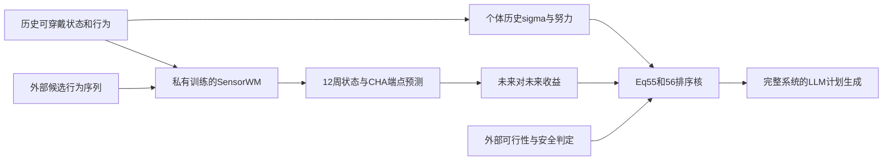
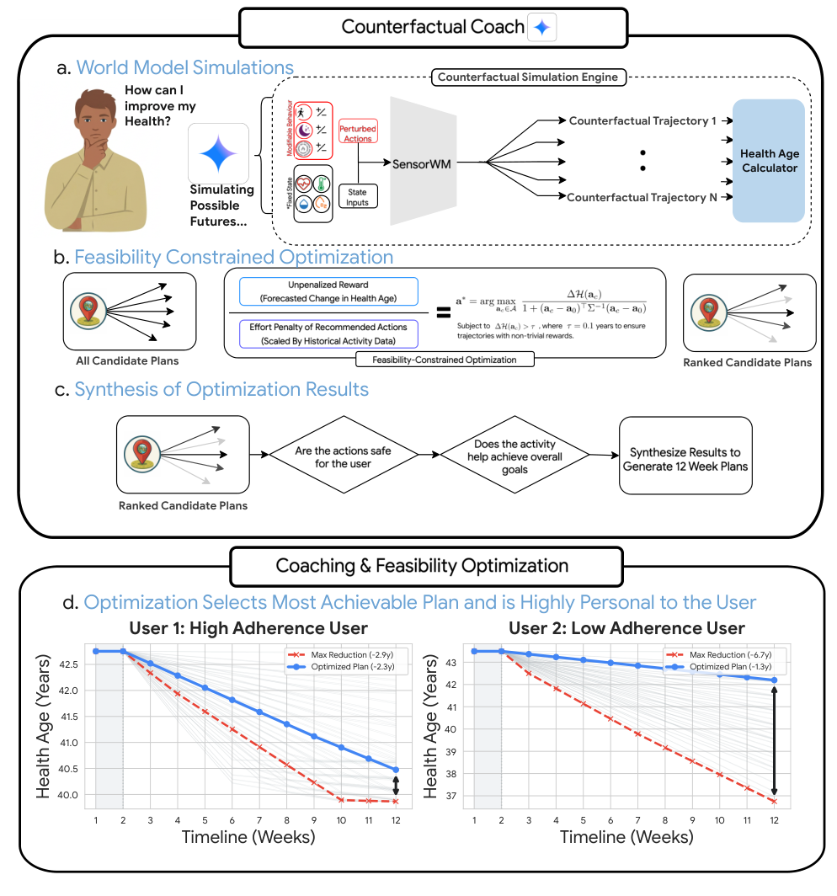

# SensorWM：动作条件可穿戴世界模型与个体努力排序

[English](README-en.md)

> **L1 CPU 数学后处理，不是健康预测、医疗建议或完整规划能力。** 本地只执行论文 Eq.55–56；不提供私有 SensorWM、生成轨迹、125 方案网格、临床可行性判定或 LLM 健康教练。

## 论文信息

| 字段 | 内容 |
| --- | --- |
| 论文 | [arXiv:2611.08568v1](https://arxiv.org/abs/2611.08568v1)，[固定原文](https://arxiv.org/html/2611.08568v1)；规范题名为 **Personalized health coaching via coachable health age and counterfactual wearable trajectories** |
| 公司 / 机构 / 学校 | 一作 Simon A. Lee：Google Research / University of California, Los Angeles；共同一作 Zeinab Esmaeilpour：Google Research |
| 原始发布日期 | **2026-11-05 17:52:57 UTC**；本轮因 Google 11/11 博客重新触发原文核查，是历史补漏，不是 11/12 首发 |
| 原作者开源代码 | 论文称发表时将在 [Google Health 仓库](https://github.com/Google-Health/consumer-health-research) 发布。对固定 HEAD `3e9d1e4877a54cf81ce8ef34085006952dd19601` 的有限目录入口／README 检查未确认本篇 SensorWM/CHA 专属实现已发布，不作全仓穷尽断言。其中已发布的 `personal_health_agent` 对应 [2508.20148](https://arxiv.org/abs/2508.20148)，不是本篇源码，模型权重未确认公开 |
| 本地 adapter / key | `sensorwm-planning`；`adapter=null`；未接入 Evolve |
| 本地代码 | `src/auto_research/multimodal/sensorwm_planning.py` |

arXiv 摘要页与 PDF metadata 的题名含 `health`；HTML h1 显示不含该词的别名 **Personalized coaching via coachable health age and counterfactual wearable trajectories**，两者是同一固定 v1，不另建论文身份。

## 原始论文总结

### 背景与主要改动

论文把可修改的可穿戴行为与生理状态分开：每日步数、主要睡眠时长、cardio-intensity minutes 作为动作；RHR、AZM 等作为预测结果，而不是可以直接指令改变的行为。Coachable Health Age（CHA）将可解释的可穿戴信号映射到年龄等价量，SensorWM 预测给定行为序列的未来状态，再对候选行为方案排序，最后交给 LLM 生成 12 周计划。

SensorWM 的中心模型不是一个对行为加权的规则。它以编码器得到 128 维潜状态，预测当前状态和动作决定的 128×128 线性算子，递推变换**此前潜位移**：

$$
z_t=E(s_t),\qquad \widehat F_t=g(\hat z_t,a_t),\qquad
\widehat{\Delta z}_{t+1}=\widehat F_t\widehat{\Delta z}_t,\qquad
\hat z_{t+1}=\hat z_t+\widehat{\Delta z}_{t+1}.
$$

训练只用最初两周观察初始化，此后以预测状态 free-running 递推，不能每步喂入真实未来状态。Rollout loss 匹配潜位置，path loss 匹配位移；联合编码器目标不使用 EMA 或 stop-gradient，用 256 个随机投影的 SIGReg 抑制表征坍缩。线性生理解码器在预训练后独立拟合，不回传到世界模型。

### 架构与流程



图中只有 Eq.55–56 排序核在本地实现。生理模型、临床判定与计划生成不是可调用本地链路。

<!-- paper-figure:start -->
### 原论文关键图

[](https://arxiv.org/html/2611.08568v1/Figure4_new.png)

原文 Figure 4 展示轨迹模拟、候选排序和后续计划合成；这里直接保存官方 HTML 原始 PNG，无重画、裁剪或工具渲染。图片来自[原论文](https://arxiv.org/html/2611.08568v1#S2.F4)，版权归原作者所有。原图右下的预测变化与完整流程不代表本地测量或可用医疗工具。
<!-- paper-figure:end -->

### 核心公式

以保持既有行为的 **12 周未来端点** `CHA_sq` 为锚，不是当前观测的 baseline CHA。对候选 c：

$$
\Delta CHA(c)=CHA_{sq}-CHA_c.
$$

各动作的历史个体标准差使用论文的数值下限：500 步、15 睡眠分钟、10 cardio 分钟。它们是努力归一化常数，**不是医疗安全阈值**。

$$
\tilde\sigma_k=\max(\sigma_k^{user},\sigma_k^{floor}),\qquad
E(c)=\sum_{k\in\{steps,sleep,cardio\}}\left(\frac{c_k-b_k}{\tilde\sigma_k}\right)^2,
$$

$$
score(c)=\frac{CHA_{sq}-CHA_c}{1+E(c)},\qquad
CHA_{sq}-CHA_c>0.1.
$$

严格大于 0.1 才纳入，不把等于阈值的候选算通过。论文后续还执行可行性／安全筛查、按睡眠／运动／组合整理路径及 LLM 合成；本地不推断这些缺失判据。Google 博客称完整系统比较 125 个组合，但固定原文未给出 125 网格的精确步长，本地不据 125 猜测 5³ 网格。

### 论文离线与线上效果

作者用约 10 万人的预训练队列与独立 WEAR-ME 评估，报告总体轨迹预测 R²=0.664。在 49 个病例的盲态配对专家评审中，生活方式教练对反事实计划的整体质量偏好率为 71.4%，对**预期长期依从性**的偏好率为 71.0%；临床强度限制被认可的评级比例为 99.2% 对 97.6%。这些是回顾性画像上的离线计划评审，不是用户真实依从性、疾病改善或线上随机流量 A/B。

论文明确：动作条件关联不识别因果干预效果，仍需前瞻性研究；讨论也记录了冗余增加步数、部分 12 周 CHA 改变过度乐观等失败。本地未复测这些医疗指标，不能将数学排序成功解读为健康收益或临床安全保证。

## 本地复现

### 数据协议与代码映射

`Actions` 明确三动作顺序与单位；`Candidate` 强制外部有限预测端点和布尔 `feasible`；`personalized_effort` 执行 Eq.55；`rank_candidates` 只使用未来 status-quo 锚、严格收益门槛和 Eq.56 排序。只输出候选 ID、gain、effort、score，不输出目标动作或建议。排序持平时按 ID 升序是本地可复现约定，非论文算法新增结论。

```bash
PYTHONPATH=src python -c 'from auto_research.multimodal.sensorwm_planning import diagnostic; print(diagnostic(42))'
PYTHONPATH=src python -m pytest tests/test_sensorwm_planning.py -q
```

诊断输入是明示的固定数学夹具，端点**不是模型预测**，seed 仅扰动候选输入顺序。没有随机生成 CHA 当作模型输出，也没有用 gold 健康结局给候选打分。`device="cuda"` 显式拒绝；模块无 CUDA 模型路径。

### 结果、负控与边界

单元测试覆盖个体 sigma 下限、未来对未来锚、严格阈值、外部不可行候选、努力引起的排序反转、持平顺序、有限数／类型／重复 ID／溢出拒绝，以及返回字段不含动作或建议。冻结提交 `a28efd403e497ad3a482eada2f393fb4c323f845` 的 CPU 42/43/44 机制检查已通过，见 [CPU 指标](metrics/component-cpu-seeds42-44.json)。这只证明数学合同执行，不是模型预测、健康收益或医疗验证。

外部 `feasible=True` 只是输入声明，不能证明临床安全；一个数值看似合理也不能证明来自已训练 SensorWM。组件不提供生成缺失预测的路径，也不验证上游来源，缺少真实预测与来源时只能做明示算术诊断。无 Evolve、自动重试或自动实现队列。

### 高成本完整实验

SensorWM 预训练包含 96,957 人、2.28 million person-weeks、182,797 个有效 12 周窗；Fitbit 个体记录因隐私限制不可公开，WEAR-ME 需审批，All of Us 需注册研究工作台。完整系统还有 2,780 个符合纳入条件的画像，质量控制后为 2,613 组成对计划、每组 3 次 Gemini 评审，另有专家配对研究及多任务生理／疾病预测。原文未披露 GPU、batch、epoch 或总时长，不能编造单卡卡时。

在单张 A100/A30 或 Mac 的本轮预算下，私有数据／未确认公开的预训练权重与完整训练评估依赖使其**成本过高，不复现（审查 DONE）**。未下载权重、健康数据或完整 36 MB PDF，未调用健康 LLM、未运行训练或成本探针。只保留可独立核对的排序数学，完整高成本处置不阻塞审查水位。
