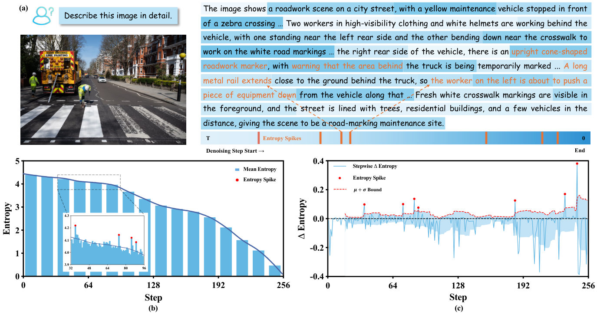

# StepRefine: soft-token refinement at entropy spikes

<!-- source-sha256: 80543e75766c9cefbe3a05b8ad997abccbf84c25b7055c735f10e77791d13c42 -->

[简体中文](README.md)

> **L1 CPU equation component.** No multimodal diffusion backbone is included; these checks cannot establish reduced hallucination on real image-question tasks.

## Paper information

| Field | Value |
| --- | --- |
| Paper | [arXiv:2611.12901v1](https://arxiv.org/abs/2611.12901v1); [fixed text](https://arxiv.org/html/2611.12901v1) |
| Institution | First author Zhongxing Xu: Monash University; collaborators at Cornell, UC Santa Cruz, Northeastern, and the University of Minnesota |
| Original release | Explicit arXiv v1 timestamp: October 14, 2026, 07:52:29 UTC. Newly announced on November 11; the 2611 identifier is not treated as proof of a November first release |
| Authors' source code | The [author project](https://mdlm-steprefine.github.io/) is currently inaccessible; fixed text has no code-repository link. An open implementation was not confirmed |
| Local adapter/key | steprefine; adapter is null; no Evolve integration |
| Local code | src/auto_research/multimodal/steprefine.py |

## Original paper

### Motivation and changes

Average masked-token entropy generally decreases during multimodal diffusion, but can rise sharply at a few steps. StepRefine switches from hard tokens to probability-weighted embeddings at these spikes, retaining competing semantics during further contextual computation. Consecutive-distribution stability determines when to return to discrete decoding, rather than adding a fixed number of forwards everywhere.

### Key original figure

Original Figure 1, retained as the official image bytes; copyright remains with its authors. The statistics and model outputs are the paper's experiments.

### Equations

In decreasing denoising time, the current entropy change is H_t−H_{t+1}. Trigger only when it exceeds the mean plus standard deviation of the preceding w changes. Soft inputs and termination are:

$$
e_{t,k}^{i}=\sum_v p_{t,k-1}^{i}(v)e(v),\qquad
\overline{D}^{(k)}=\operatorname{mean}_{i\in M_t}
D_{KL}(p_{t,k}^{i}\Vert p_{t,k-1}^{i})<\epsilon.
$$

KL runs from the new distribution to the old one. After k additional forwards, the next index must be t−1−k, not t−1: the paper compares methods under a fixed total forward budget.

~~~mermaid
flowchart LR
  A[Masked mean-entropy change] --> B{Above historical-window bound}
  B -->|Yes| C[Probability distribution times embedding table]
  C --> D[Actual model forward]
  D --> E{New-to-old KL stable}
  E -->|No| C
  E -->|Yes| F[Discrete commit and charge extra forwards]
~~~

### Paper results

The authors compare four 7B/8B multimodal diffusion models on general question answering, hallucination, mathematics, and science, including POPE, MMHalu, MathVista, and MMK12. They report hallucination and quality/budget ablations, not production A/B. Local checks neither aggregate heterogeneous tasks into one improvement nor execute or verify those model results.

## Local component

### Inputs and code

spike accepts a completed historical change window, never future denoising steps. mask_entropy averages only masked positions; soft_embeddings preserves unmasked inputs. refinement_kl and next_denoising_index implement the stop and budget equations. Window warm-up, actual model forwards, images, commitment, and remasking remain the caller's responsibility; the model loop in the diagram is not implemented locally.

    PYTHONPATH=src python -c 'from auto_research.multimodal.steprefine import diagnostic; print(diagnostic(42))'

### Evidence and limitations

[Three-seed CPU metrics](metrics/component-cpu-seeds42-44.json) check strict spike thresholds, weighted embeddings, unmasked invariance, KL direction, and budget charging. Synthetic probabilities are not model outputs or a hallucination benchmark. The module rejects CUDA and makes no CUDA-backbone or GPU-performance claim.

### Full experiment not reproduced

The paper evaluates LLaDA-V/O, LaViDa-L 8B, and Dream-VL 7B with 256 generated tokens and 256 total denoising forwards across models, datasets, and ablations. The full image-by-model matrix involves extensive iterative inference beyond a short single-device budget. **Too costly; not reproduced (review DONE).** No checkpoints or image datasets were downloaded, and no cheap proxy is substituted for the defining model.
