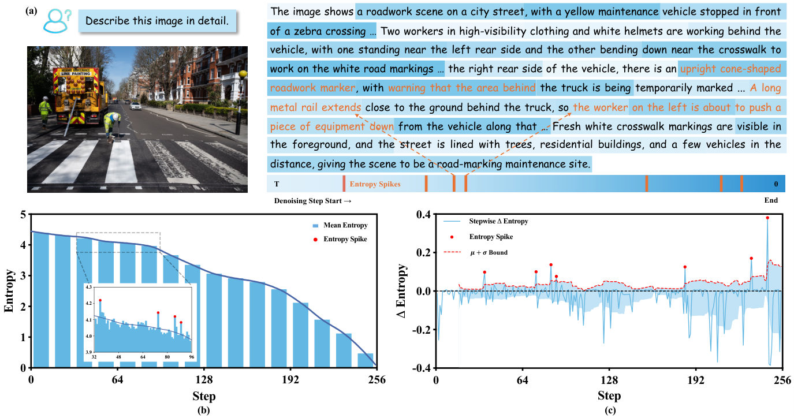

# StepRefine：在熵尖峰时细化软 token 表示

[English](README-en.md)

> **L1 CPU 公式组件**：不包含多模态扩散模型；不能据此声称降低真实图像问答幻觉。

## 论文信息

| 字段 | 内容 |
| --- | --- |
| 论文链接 | [arXiv:2611.12901v1](https://arxiv.org/abs/2611.12901v1)；[固定全文](https://arxiv.org/html/2611.12901v1) |
| 公司 / 机构 | 一作 Zhongxing Xu：Monash University；合作者来自 Cornell、UC Santa Cruz、Northeastern、University of Minnesota |
| 首次公开日期 | arXiv v1 明确为 2026-10-14 07:52:29 UTC；11 月 11 日出现于新公告，不按编号中的 2611 伪记为 11 月首发 |
| 原作者开源代码 | [作者项目](https://mdlm-steprefine.github.io/)当前无法取得内容；固定全文无代码仓库链接，未确认开源 |
| 本地 adapter / key | `steprefine`；adapter 为 null，未接入 Evolve |
| 本地复现代码 | src/auto_research/multimodal/steprefine.py |

## 原始论文总结

### 背景与主要改动

多模态扩散解码的 mask 平均熵总体下降，但局部可能突然上升。StepRefine 只在这些步骤从硬 token 切换到概率加权 embedding，让多种候选语义继续参与上下文计算，再根据连续分布的稳定程度决定何时返回离散解码。它不是给所有步骤都加固定次数前向。

<!-- paper-figure:start -->
### 原论文关键图

图来自原论文 Figure 1，版权归原作者；保留官方图片原字节。图中统计与模型输出属于作者实验。
图片来自[原论文](https://arxiv.org/html/2611.12901v1/Figure1.png)，版权归原作者所有；图中完整系统或实验结果不等于本地组件结果。

<!-- paper-figure:end -->

### 核心公式

以倒数去噪时间定义当前熵变化为 H_t−H_{t+1}；只有它大于前面 w 次变化的均值加标准差时才触发。软输入和停止条件为：

$$
e_{t,k}^{i}=\sum_v p_{t,k-1}^{i}(v)e(v),\qquad
\overline{D}^{(k)}=\operatorname{mean}_{i\in M_t}
D_{KL}(p_{t,k}^{i}\Vert p_{t,k-1}^{i})<\epsilon.
$$

KL 方向是“新分布到旧分布”。额外用了 k 次前向后，下一去噪索引必须变成 t−1−k，而不是 t−1；论文是在同一总前向预算下比较。

~~~mermaid
flowchart LR
  A[mask 平均熵变化] --> B{超过历史窗口上界}
  B -->|是| C[概率分布乘 embedding 表]
  C --> D[真实模型再次前向]
  D --> E{新到旧 KL 稳定}
  E -->|否| C
  E -->|是| F[离散提交并扣除额外预算]
~~~

### 论文离线与线上效果

作者在四个 7B/8B 多模态扩散模型上比较通用问答、幻觉、数学与科学任务，包含 POPE、MMHalu、MathVista、MMK12 等。原文报告幻觉改善及其质量/预算消融；没有生产线上 A/B。本地不汇总异构任务为统一提升，不执行或验证这些模型结果。

## 本地复现

### 数据协议与代码映射

spike 接收已完成的历史变化窗口，不偷偷读取未来去噪步骤；mask_entropy 只平均有效 mask 位置；soft_embeddings 保持非 mask 位置不变；refinement_kl 和 next_denoising_index 分别实现停止式与预算式。窗口预热、真实模型前向、视觉输入、token 提交与 remasking 留给调用者；图中的模型闭环未在本地实现。

    PYTHONPATH=src python -c 'from auto_research.multimodal.steprefine import diagnostic; print(diagnostic(42))'

### 结果与复现边界

[三种子 CPU 指标](metrics/component-cpu-seeds42-44.json)检查严格尖峰阈值、概率加权 embedding、非 mask 不变性、KL 方向和前向预算扣减。合成概率不是模型输出，不是幻觉 benchmark。模块明确拒绝 CUDA，没有 CUDA backbone 或 GPU 性能声明。

### 高成本完整实验

原文对 LLaDA-V/O、LaViDa-L 8B、Dream-VL 7B 使用生成长度 256、总去噪前向 256，并覆盖多模型、多数据集与消融。完整矩阵会包含大量逐图迭代推理，超出单卡短时预算。**成本过高，不复现（审查 DONE）**；不下载权重或图片集，也不以便宜代理代替核心模型。
