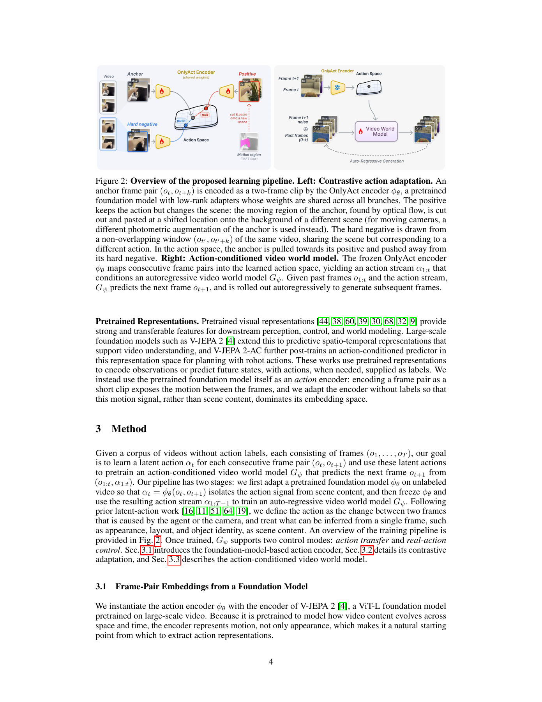
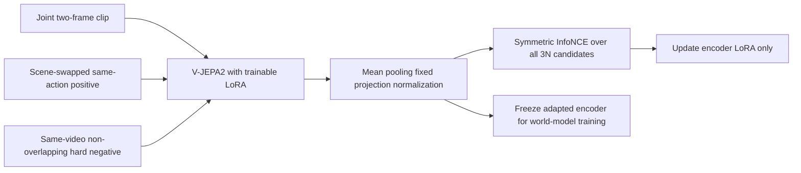

# OnlyAct: separate action and scene in V-JEPA 2 representations

<!-- source-sha256: 214fb33fd33c2b7016404e5dff6503028bd489ee0355cc899011cf4331be4726 -->

[简体中文](README.md)

> **L1 contrastive-loss/input-contract component, not a V-JEPA 2 action encoder or world model.** The code executes the exact candidate loss, fixed projection, and hard-negative contract. It does not invent scene-swapped video, optical flow, or action capability.

## Paper information

| Field | Value |
| --- | --- |
| Paper | [arXiv:2611.14420v1](https://arxiv.org/abs/2611.14420v1); [fixed text](https://arxiv.org/html/2611.14420v1) |
| Institution | First author Runjia Li: University of Oxford |
| Original publication | **November 10, 2026, 17:59:19 UTC**; November 11 announcement, recovered in this same-announcement review |
| Authors' source code | [Author repository](https://github.com/runjiali-rl/onlyact), Apache-2.0; `onlyact/training/loss.py` checked at commit `fd5a1bf8139f24dffcafdcfb8f2fbe3be1abe010`; [project](https://runjiali-rl.github.io/onlyact/) |
| Local adapter/key | `onlyact`; `adapter=null`; no Evolve integration |
| Local code | `src/auto_research/multimodal/onlyact.py` |

## Original paper

### Motivation and changes

Reconstruction bottlenecks can discard action detail when narrow and leak appearance when wide. OnlyAct instead adapts pretrained V-JEPA 2 ViT-L. Both frames enter one clip: tubelets jointly observe them from the first layer, rather than differencing independently encoded frames. Tokens are mean-pooled, projected by a fixed random map to 640 dimensions, and normalized.

Contrastive adaptation combines same-action, scene-swapped positives with hard negatives from disjoint windows of the same video. For static cameras, RAFT identifies moving pixels, which are jointly translated onto another scene. With camera motion, the background movement is part of the action, so positives use a different photometric augmentation shared across the two frames. Without action labels, disjoint same-video windows are not proof of different action classes.

<!-- paper-figure:start -->
### Key original figure

[](https://arxiv.org/pdf/2611.14420v1#page=4)

The complete PDF page 4 retains Figure 2 and its caption without changes. Copyright remains with the authors. The video world model shown on the right is not executed locally.

<!-- paper-figure:end -->

### Equations and flow

For jointly encoded tokens and fixed random projection P:

$$
\alpha=\frac{P\bar h}{\|P\bar h\|_2},\qquad \bar h=N^{-1}\sum_n h_n.
$$

The candidate bank contains all anchors, positives, and hard negatives in the actual microbatch, totaling 3N. The symmetric objective is:

$$
\ell(u,v)=-\log\frac{\exp(u^\top v/\tau)}{\sum_{z\in\mathcal Z\setminus\{u\}}\exp(u^\top z/\tau)},\qquad
\mathcal L=\frac1{2N}\sum_i[\ell(\alpha_i,\alpha_i^+)+\ell(\alpha_i^+,\alpha_i)].
$$

The denominator excludes only the query itself; it includes its positive, its own hard negative, and all other candidates. Gradient accumulation does not enlarge this bank. With the paper's microbatch of two, each query has one positive and four negatives, not sixteen groups of negatives from the effective batch size.



### Paper results

The authors evaluate action expressiveness, scene invariance, and action-conditioned generation. Their repository/paper reports mean linear-probe R²=0.490 across 13 datasets, best on 11, and world-model action transfer into new scenes. These are full-model results, not local loss diagnostics. Scene-leakage decoding proxies are not proof of causal action identification. No production A/B is reported.

## Local component

### Data contract and code

`pooled_action` accepts externally **jointly encoded two-frame** tokens, then pools, applies a frozen projection, and normalizes; it supplies no substitute V-JEPA model. `bank_contract` defines the exact candidates/positive indices, and `contrastive_loss` performs InfoNCE and backward computation. `PairWindow` uses half-open frame intervals to require same-video, non-overlapping hard negatives. It generates no video, computes no flow, and cannot certify action semantics.

```bash
PYTHONPATH=src python -c 'from auto_research.multimodal.onlyact import diagnostic; print(diagnostic(42, device="cpu"))'
PYTHONPATH=src python -m pytest tests/test_nov12_foundation_components.py -q
```

### Evidence and limitations

CPU seeds 42/43/44 compare the full 3N denominator with an independent itemwise reference, verify bidirectional symmetry, positive inclusion and hard-negative gradients, and check a frozen projection while input tokens receive gradients. Negative-window tests reject other videos and overlapping support. CUDA diagnostics at seeds 42/43/44 also passed on a real NVIDIA A100; see the [real-GPU receipt](../../gpu-validations/onlyact-a100-20261112.json) and [three-seed metrics](metrics/component-cuda-seeds42-44.json). Frozen sources and the actual device are bound in the receipt; this verifies only the stated small-tensor L1 work.

Scene swapping, RAFT, a pretrained encoder, LoRA updates, action probes, whitening, and AdaWorld are not executed. Synthetic unit-vector losses do not establish action/scene disentanglement. No Evolve operator or capability-promotion evidence is supplied.

### Full experiment not reproduced

The authors report a roughly 300M-parameter V-JEPA 2 ViT-L with 7.1M LoRA parameters, 168K frame-pair samples from nine sources, and 10K updates: about 1.5 GPU-hours on one RTX 4090. Each AdaWorld model adds 20K steps on 19,946 clips and roughly five GPU-hours. The study also trains representation baselines and runs 13-dataset probes, leakage decoders, and video rollouts, plus RAFT preprocessing and multi-source video preparation. **These are author-environment measurements, not predicted local A100 runtimes.** The full matrix exceeds this short budget: **too costly; not reproduced (review DONE)**. No weights/videos were downloaded, no trial training was attempted, and automatic retry is disabled.
