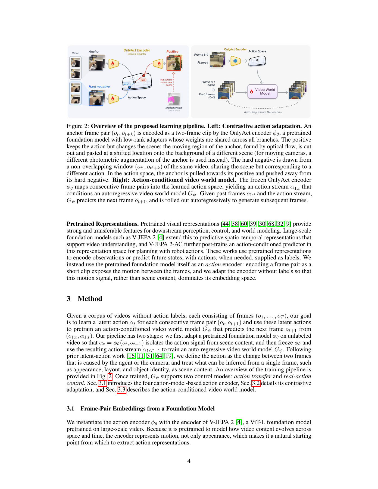
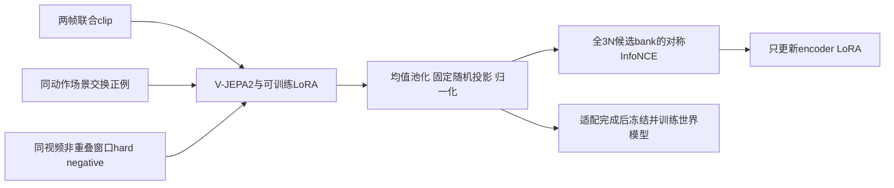

# OnlyAct：从 V-JEPA 2 表征中分离动作与场景

> **L1 对比损失／输入合同组件，不是 V-JEPA 2 动作编码器或世界模型复现。** 本地执行全候选损失、固定投影和 hard-negative 合同，不伪造场景交换视频、光流或真实动作能力。

## 论文信息

| 字段 | 内容 |
| --- | --- |
| 论文 | [arXiv:2611.14420v1](https://arxiv.org/abs/2611.14420v1)，[固定原文](https://arxiv.org/html/2611.14420v1) |
| 公司 / 机构 / 学校 | 一作 Runjia Li：University of Oxford |
| 原始发布日期 | **2026-11-10 17:59:19 UTC**；11/11 公告，本轮为同公告补漏 |
| 原作者开源代码 | [作者仓库](https://github.com/runjiali-rl/onlyact)，Apache-2.0；核对提交 `fd5a1bf8139f24dffcafdcfb8f2fbe3be1abe010` 的 `onlyact/training/loss.py`；[项目页](https://runjiali-rl.github.io/onlyact/) |
| 本地 adapter / key | `onlyact`；`adapter=null`；未接入 Evolve |
| 本地代码 | `src/auto_research/multimodal/onlyact.py` |

## 原始论文总结

### 背景与主要改动

无标签 latent-action 方法常用重建瓶颈排除场景，但过窄会丢动作细节，过宽又会泄漏外观。OnlyAct 从已预训练的 V-JEPA 2 ViT-L 出发：两帧作为同一 clip 输入，tubelet 从第一层联合观察两帧，而不是先单帧编码再求差；均值池化、固定随机投影至 640 维并归一化。

它用场景交换的同动作正例，以及同一视频不同时间窗的 hard negative 做对比适配。静态相机用 RAFT 光流提取移动区域，原像素共同平移并粘到另一场景；移动相机不能抹去背景运动，退回跨两帧一致的光度增强。负例通常动作不同，但无动作标签，不能把“同视频不同窗”说成已证实动作类别不同。

### 原论文关键图

[](https://arxiv.org/pdf/2611.14420v1#page=4)

图片来自[原论文](https://arxiv.org/pdf/2611.14420v1#page=4)，版权归原作者所有。PDF 第 4 页完整渲染，含 Figure 2 与说明，未改动内容。右侧视频世界模型不是本地已执行链路。

### 架构与流程



### 核心公式

联合编码器输出 patch token (h_n)，固定随机矩阵 (P) 不训练：

$$
\alpha=\frac{P\bar h}{\|P\bar h\|_2},\qquad \bar h=N^{-1}\sum_n h_n.
$$

候选 bank 为一个实际 microbatch 中的全部 anchor、positive、hard negative，共 (3N) 个。对每对 anchor／positive 双向取损失：

$$
\ell(u,v)=-\log\frac{\exp(u^\top v/\tau)}{\sum_{z\in\mathcal Z\setminus\{u\}}\exp(u^\top z/\tau)},\quad
\mathcal L=\frac1{2N}\sum_i[\ell(\alpha_i,\alpha_i^+)+\ell(\alpha_i^+,\alpha_i)].
$$

分母只排除 query 自身，**包含正例、自己的 hard negative 和其他全部候选**。梯度累积不扩大同次 bank；论文 microbatch=2 时每 query 是 1 正例和 4 负例，而不是把 effective batch16 当成16组负例。

### 论文离线与线上效果

作者在动作可表达性、场景不变性、动作条件视频生成三个维度评估。仓库／论文报告 13 数据集的线性 probe 平均 (R^2=0.490)，其中 11 个最佳，并用世界模型检验跨场景动作迁移；这些是作者完整模型实验，不是本地 loss 诊断。场景泄漏的解码 proxy 也不能等价为真实因果动作识别；未报告生产 A/B。

## 本地复现

### 数据协议与代码映射

`pooled_action` 只处理外部 **两帧联合编码** token 的池化、冻结投影和归一化，不含任何假 V-JEPA。`bank_contract` 定义精确候选与正例索引；`contrastive_loss` 执行对称 InfoNCE 并实际反传。`PairWindow` 用半开帧区间约束 hard negative 同视频且不重叠；它不生成视频、不计算光流，也不保证不同动作语义。

```bash
PYTHONPATH=src python -c 'from auto_research.multimodal.onlyact import diagnostic; print(diagnostic(42, device="cpu"))'
PYTHONPATH=src python -m pytest tests/test_nov12_foundation_components.py -q
```

### 结果、负控与边界

CPU 42/43/44 小张量检查全 (3N) 候选与独立逐项分母一致、双向对称、正例仍在分母、hard-negative 梯度非零、固定随机投影无梯度而输入 token 有梯度；负例合同拒绝另一视频及重叠窗口。真实 NVIDIA A100 的 CUDA 42/43/44 诊断也已通过，见 [真实 GPU 回执](../../gpu-validations/onlyact-a100-20261112.json) 与 [三 seed 指标](metrics/component-cuda-seeds42-44.json)。回执绑定冻结源码和实际设备，只证明上述小张量 L1 运算执行。

未执行场景交换、RAFT、预训练编码器、LoRA 更新、动作 probe、whitening 或 AdaWorld。合成单位向量的 loss 不证明动作与场景已解耦，不提供 Evolve 算子或能力晋级证据。

### 高成本完整实验

作者报告 V-JEPA2 ViT-L 约 300M 参数、7.1M LoRA，9 数据源 168K frame-pair 样本、10K updates，单 RTX4090 约 1.5 GPU 小时；每个 AdaWorld 世界模型再训练 20K steps，19,946 clips、约 5 GPU 小时，另有多个动作表示基线、13 数据集 probe、泄漏解码及视频 rollout。预计算 RAFT 与多源视频准备也是成本。**这些是作者环境测量，不是本地 A100 预测耗时**。完整矩阵明显超出本轮短预算，成本过高，不复现（审查 DONE）；未下载权重或视频、未试训、不自动重试。
