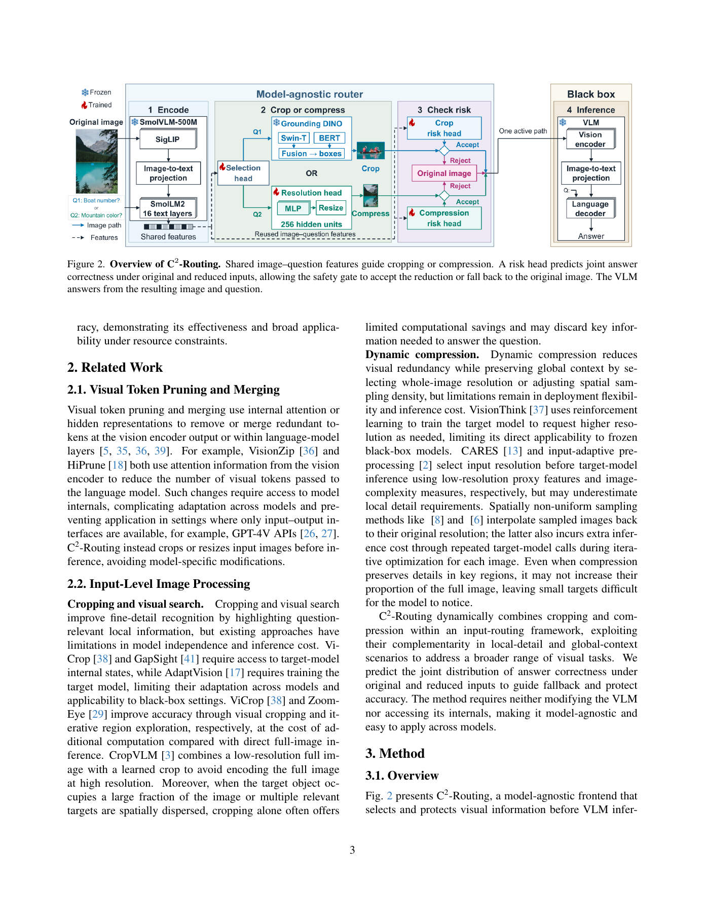
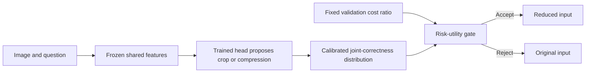

# C²-Routing: joint-correctness risk gating for cropping and compression

<!-- source-sha256: 82f974b798414331f7a5e9a955b3687441f2bdc560dfbe5c9a34e3d64a0ba542 -->

[简体中文](README.md)

> **L1 CPU policy kernel, not a trained visual router.** Only joint-correctness risk and validation-cost utility are implemented. No SmolVLM, Grounding DINO, risk classifier, or real VQA result is supplied.

## Paper information

| Field | Value |
| --- | --- |
| Paper | [arXiv:2611.14469v1](https://arxiv.org/abs/2611.14469v1); [fixed text](https://arxiv.org/html/2611.14469v1) |
| Institution | First author Guorui Lu: Leiden University |
| Original publication | **November 10, 2026, 18:32:28 UTC**; November 11 announcement, recovered in this same-announcement gap review |
| Authors' source code | No method repository found in fixed v1 or author links. The open VLM dependencies are not a release of this method |
| Local adapter/key | `c2-routing`; `adapter=null`; no Evolve integration |
| Local code | `src/auto_research/multimodal/c2_routing.py` |

## Original paper

### Motivation and changes

Cropping magnifies local text or small objects; whole-image compression better preserves global relationships and distributed evidence. C²-Routing extracts shared image-question features with frozen SmolVLM-500M and learns the choice. Grounding DINO-tiny locates the crop; the compression branch selects a 256/512 visual-token budget.

The safety gate predicts joint correctness for original and reduced inputs, not just whether reduction fails. Fallback cannot fix shared failure, and can lose a reduction-induced benefit. The risk model must distinguish those cases.

<!-- paper-figure:start -->
### Key original figure

[](https://arxiv.org/pdf/2611.14469v1#page=3)

The full PDF page 3 includes Figure 2 and its caption without content changes. Copyright remains with the authors. The learned heads and VLM in the figure are not local implementations.

<!-- paper-figure:end -->

### Equations and flow

Joint states follow the order of original/reduced correctness: 11=(1,1), H=(1,0), B=(0,1), and 00=(0,0). Expected reduction-induced accuracy loss is:

$$
r_a=p_H^a-p_B^a=\mathbb E[Y^F-Y^a\mid z^a].
$$

This is not the reduced-input error rate p_H+p_00. Validation costs use an equal-dataset mean of within-dataset FLOP-sum ratios:

$$
\bar\rho_a=\frac1D\sum_d\frac{\sum_{i\in V_d}T_i^a}{\sum_{i\in V_d}T_i^F}.
$$

With original cost normalized to one, accept an externally proposed R, C256, or C512 only if:

$$
\hat r_a\leq\lambda(1-\bar\rho_a).
$$

Calibration, cost ratios, and thresholds are frozen on validation. Test answers are not consulted when selecting an action.



### Paper results

Three VLMs and 18 datasets are split approximately 4:2:4 with image/document and cross-source grouping. Router training and validation configuration selection use four seeds. Relative to an already capped 1,024-token original-image baseline, the authors report mean FLOPs reduction of 36.53%, visual-token reduction of 42.36%, and a 0.77% relative task-score decrease. This is an accuracy-efficiency tradeoff, not an accuracy gain. No production A/B is reported, and none of those results is locally reproduced.

## Local component

### Data contract and code

`reduction_risk` computes four-state risk. `validation_cost_ratio` accepts explicitly labeled validation FLOPs and dataset IDs. Immutable `SafetyPolicy` uses frozen ratios and externally calibrated probabilities to accept a proposal or fall back to F. The CPU-only module rejects CUDA instead of presenting policy arithmetic as a GPU visual model.

```bash
PYTHONPATH=src python -c 'from auto_research.multimodal.c2_routing import diagnostic; print(diagnostic(42))'
PYTHONPATH=src python -m pytest tests/test_nov12_foundation_components.py -q
```

### Evidence and limitations

Seeds 42/43/44 use synthetic probabilities to verify H−B against expected correctness loss, benefit credit, shared-failure handling, inclusive thresholds, and dataset-macro costs. Tests distinguish per-example ratio means and pooled-sum ratios, and reject test-data fitting.

[Three-seed CPU metrics](metrics/component-cpu-seeds42-44.json) are L1 evidence only. Callers must supply genuinely calibrated predictions and validation costs; a split label is no substitute for provenance. Selection, resolution, and risk heads are not trained. No localization, model inference, or real-image VQA runs; no black-box routing benefit or Evolve promotion is claimed.

### Full experiment not reproduced

The full pool contains 206,996 questions. Three frozen 3B/7B/8B VLMs generate offline answers for original, cropped, and compressed inputs before training/calibrating heads and evaluating the 18-dataset, multi-seed/configuration/baseline matrix. Although the authors use RTX 3090 GPUs, fitting one model does not make this entire matrix cheap. It exceeds the short single-device scope: **too costly; not reproduced (review DONE)**. No weights/images were downloaded or cost probes launched; no automatic retry is scheduled.
