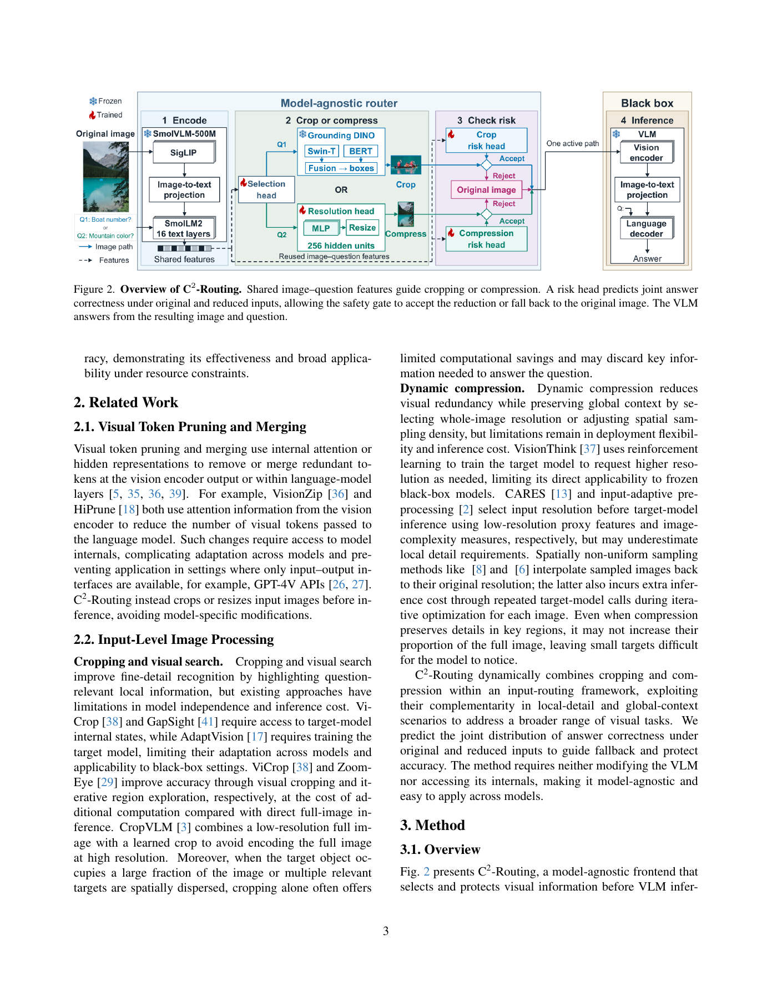
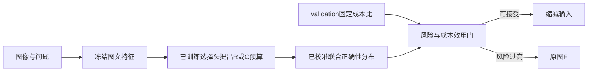

# C²-Routing：裁剪／压缩的联合正确性风险门控

> **L1 CPU 策略算子，不是已训练视觉路由器。** 本地实现联合正确性风险和 validation 成本效用判据，不提供 SmolVLM、Grounding DINO、风险分类器或真实 VQA 结果。

## 论文信息

| 字段 | 内容 |
| --- | --- |
| 论文 | [arXiv:2611.14469v1](https://arxiv.org/abs/2611.14469v1)，[固定原文](https://arxiv.org/html/2611.14469v1) |
| 公司 / 机构 / 学校 | 一作 Guorui Lu：Leiden University |
| 原始发布日期 | **2026-11-10 18:32:28 UTC**；11/11 公告，本轮为同公告补漏 |
| 原作者开源代码 | 固定 v1 与作者链接未找到方法源码仓库；不得把所用开源 VLM 当成该方法已开源 |
| 本地 adapter / key | `c2-routing`；`adapter=null`；未接入 Evolve |
| 本地代码 | `src/auto_research/multimodal/c2_routing.py` |

## 原始论文总结

### 背景与主要改动

小目标或局部文字适合裁剪放大，全局关系与分布式证据更需要保留整图。C²-Routing 用冻结 SmolVLM-500M 提取共享图文特征，学习裁剪或压缩选择；裁剪由 Grounding DINO-tiny 定位，压缩分支选择 256/512 视觉 token 预算。

安全门不只预测“缩减输入会不会错”，而是联合预测原图与缩减图的正确性。两者都错时回退无济于事，缩减反而改善时回退还会损失收益；风险须将这两种情况区分开。

### 原论文关键图

[](https://arxiv.org/pdf/2611.14469v1#page=3)

图片来自[原论文](https://arxiv.org/pdf/2611.14469v1#page=3)，版权归原作者所有。PDF 第 3 页完整渲染，包含 Figure 2 及原说明，未改动内容。图中的 learned head 和 VLM 未在本地实现。

### 架构与流程



### 核心公式

按 ((Y^F,Y^a)) 定义联合状态顺序：`11=(1,1)`、`H=(1,0)`、`B=(0,1)`、`00=(0,0)`。缩减造成的期望正确率损失为：

$$
r_a=p_H^a-p_B^a=\mathbb E[Y^F-Y^a\mid z^a].
$$

它不是缩减后的错误率 (p_H+p_{00})。validation 成本比先在每个数据集内计算 FLOPs 总和之比，再对数据集等权：

$$
\bar\rho_a=\frac1D\sum_d\frac{\sum_{i\in V_d}T_i^a}{\sum_{i\in V_d}T_i^F}.
$$

原图成本归一为 1，门控接受外部提议 (a\in\{R,C_{256},C_{512}\}) 当且仅当：

$$
\hat r_a\leq\lambda(1-\bar\rho_a).
$$

成本比、校准和阈值在 validation 固定，不在 test 挑选最优动作，也不在推理时读取正确答案。

### 论文离线与线上效果

论文在 3 个 VLM、18 个数据集上，按图像／文档及跨数据源关系分组切分约 4:2:4，重复 4 个训练与 validation 配置选择 seed。与已限制到 1024 视觉 token 的整图基线相比，作者报告平均 FLOPs 降低 36.53%、视觉 token 降低 42.36%，任务分数平均相对降低 0.77%。这是效率—准确性折中，不是准确率提升；未报告生产 A/B。本地没有复测这些数值。

## 本地复现

### 数据协议与代码映射

`reduction_risk` 执行四状态风险；`validation_cost_ratio` 只接收标明 validation 的 FLOPs 与数据集 ID；不可变 `SafetyPolicy` 固定成本比，用外部已校准概率接受提议或回退 `F`。纯 CPU 模块拒绝 `device="cuda"`，避免把策略算子包装成 GPU 视觉模型。

```bash
PYTHONPATH=src python -c 'from auto_research.multimodal.c2_routing import diagnostic; print(diagnostic(42))'
PYTHONPATH=src python -m pytest tests/test_nov12_foundation_components.py -q
```

### 结果、负控与边界

本地 42/43/44 合成概率诊断核对 (H-B) 与正确率差的代数等价、收益抵扣、共享失败不应自动触发回退、等号接受和 dataset-macro 成本比。测试明确区分逐样本比值平均与整体总和比，并拒绝 test 数据拟合。

[CPU 三 seed 指标](metrics/component-cpu-seeds42-44.json) 仅为 L1 机制证据。调用方必须提供真实校准概率及 validation 成本；`split` 标签不是来源审计的替代品。本地未训练选择／分辨率／风险头，未执行裁剪定位、模型前向或真实图像 VQA；不声明黑盒路由收益，不允许 Evolve 晋级。

### 高成本完整实验

完整数据池有 206,996 问题，3 个冻结 3B/7B/8B VLM 为原图、裁剪和压缩版本离线生成答案，再训练与校准路由头并做 18 数据集、多 seed、多个配置与基线的完整矩阵。论文虽使用 RTX 3090，**能装下一模型不等于这套多模型、多输入大矩阵便宜**。对本轮单卡短预算，成本过高，不复现（审查 DONE）；未下载权重、图像或启动探针，不进入自动重试。
