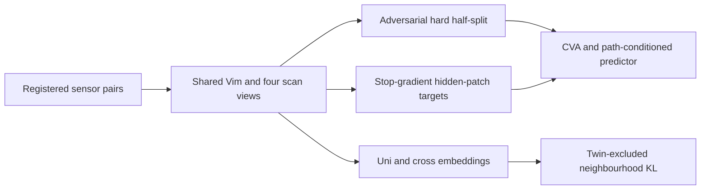
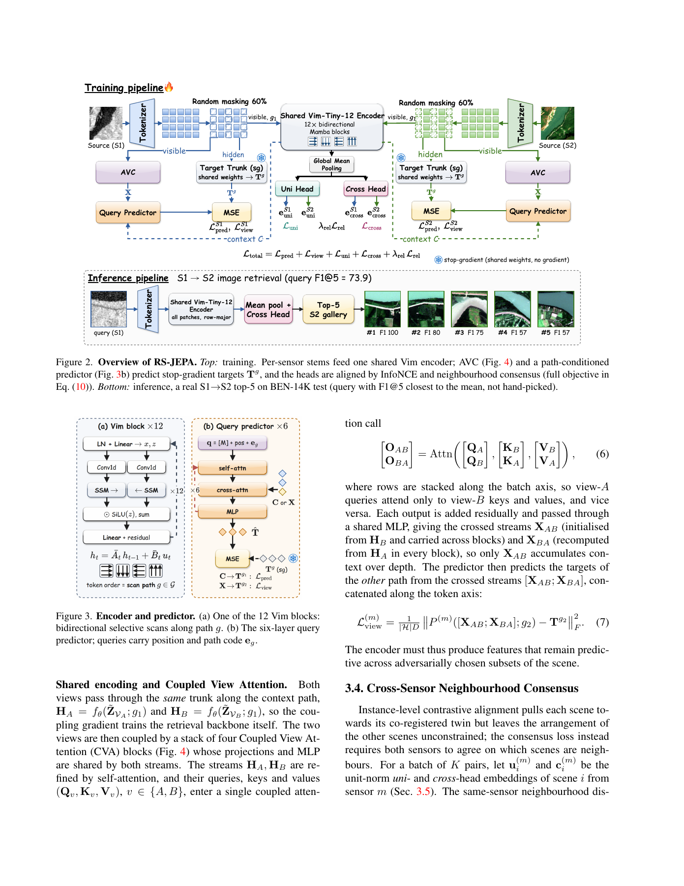

# RS-JEPA: Scan Views, Adversarial Partitions and Cross-Sensor Consensus

<!-- source-sha256: d702dffacafd0a6312ea20282bdd76d09aac77dba416c6a2cfa7f3d527ed482b -->

[简体中文](README.md) · English

> Local coverage is three independent tensor components, not a stand-in Vim backbone, complete model or image-retrieval score. The CUDA path requires a committed A100/A30 validation receipt.

## Paper information

| Field | Details |
| --- | --- |
| Paper | [RS-JEPA](https://arxiv.org/abs/2611.14496); reviewed [v1](https://arxiv.org/html/2611.14496v1) |
| Affiliation | First author Tanishq Rachamalla: Prince Mohammad Bin Fahd University, verified from PDF page 1 superscripts |
| First public release | 2026-11-10, 18:51:05 UTC |
| Authors' code | [RSJEPA](https://github.com/Tanishq251/RSJEPA); no code copied, weights or remote-sensing data downloaded |
| Local adapter | None (`adapter: null`); component key `rs-jepa` |
| Local code | `src/auto_research/multimodal/rs_jepa.py` |

## Original paper summary

### Background and main changes

Order-sensitive Vision Mamba features let different traversals of identical patches define views without pixel editing. An adversarial hard half-split makes hidden-feature prediction harder. Neighbourhood consensus aligns relationships with other scenes, not just registered twins. Targets use stop-gradient features from the shared trunk, not a momentum encoder.



<!-- paper-figure:start -->
### Key figure from the paper

[](https://arxiv.org/pdf/2611.14496v1#page=4)

> Figures 2 and 3, PDF page 4, from the [original paper](https://arxiv.org/pdf/2611.14496v1#page=4), © the original authors. The complete networks shown are outside local coverage.
Image from the [original paper](https://arxiv.org/pdf/2611.14496v1#page=4); copyright belongs to its authors. Full-system or experimental results shown are not local component results.

<!-- paper-figure:end -->

### Core equations

The traversals are row-major, column-major, horizontal row mirror and vertical column mirror, not complete sequence reversal. Equation 5 uses hard membership and $\widetilde z_j=z_j(1+\omega_j-\operatorname{sg}\omega_j)$: the forward value is unchanged, while the scorer receives reversed gradients. Plain top-k slicing cannot replace it.

For $j\ne i$, $Q_m(j|i)\propto\exp(u_i^{m\top}u_j^m/\tau_r)$ and $\bar Q_i=\operatorname{sg}[(Q_1+Q_2)/2]$. $L_{rel}$ sums four KL terms, two within-sensor and two cross-sensor, divided by $4K$. Every distribution excludes the twin; the target is detached.

### Paper results

The authors report F1@5 72.92, 80.35 and 94.43 on BEN-14K, CBRSIR-VS and DSRSID, with about 3.88M retrieval and 14.57M training parameters. Their shared-budget baseline results are not each baseline's best published result. No production A/B test or local image-retrieval replication is reported.

## Local implementation

### Data contract and code mapping

`scan_path()` returns exact permutations. `adversarial_partition()` performs hard grouping, straight-through weighting and gradient reversal. `neighbourhood_consensus()` implements equations 8-9 and rejects singleton batches, zero vectors, non-finite values and mixed devices. Small synthetic tensors replace neither images nor a backbone; no complete JEPA training is claimed.

```bash
PYTHONPATH=src python -c 'from auto_research.multimodal.rs_jepa import diagnostic; print(diagnostic(42, device="cuda"))'
```

### Results, controls and limits

CPU diagnostics 42/43/44 show scorer-gradient reference error below $2\times10^{-15}$, equal disjoint partitions, unchanged token values, near-zero agreeing-distribution loss and sensor-swap invariance. An independent loop checks loss values and detached-target gradients. Unavailable CUDA fails explicitly, never silently falling back. Actual GPU validation is recorded separately at `docs/gpu-validations/rs-jepa-a100-20261111.json`; CPU tests cannot substitute for it. No Vim, full CVA/predictor or retrieval-capability result is included, and no Evolve operator is registered.

On 2026-11-11, seeds 42/43/44 completed real `cuda:0` forward and backward execution on one NVIDIA A100. All eight mechanism checks passed for each seed, with maximum scorer-gradient reference error below $8.89\times10^{-16}$. See the [per-seed mechanism artifact](metrics/component-cuda-seeds42-44.json) and [sanitized GPU receipt](../../gpu-validations/rs-jepa-a100-20261111.json). CPU and CUDA random-number streams differ, so synthetic loss values need not match bit-for-bit. This remains a component validation, not an image-retrieval benchmark.

### High-cost full experiment

The original campaign uses a 12-block Vim, six-layer predictor, four CVA blocks, batch 290 and 100 epochs across three paired datasets, independent repetitions and retrained baselines; DSRSID alone has 56,000 training pairs. The reported setup uses four V100s. The full comparison is **too costly and is not reproduced (review DONE)**. Cheap tensor components still receive separate real-CUDA validation rather than being dismissed solely because the paper uses multiple GPUs.
