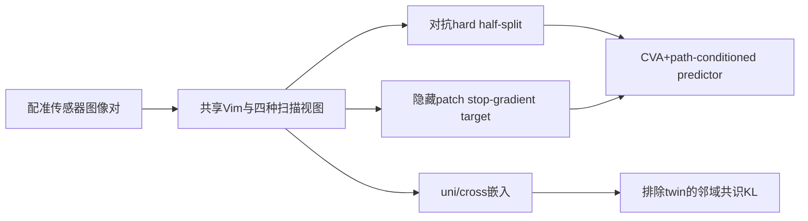
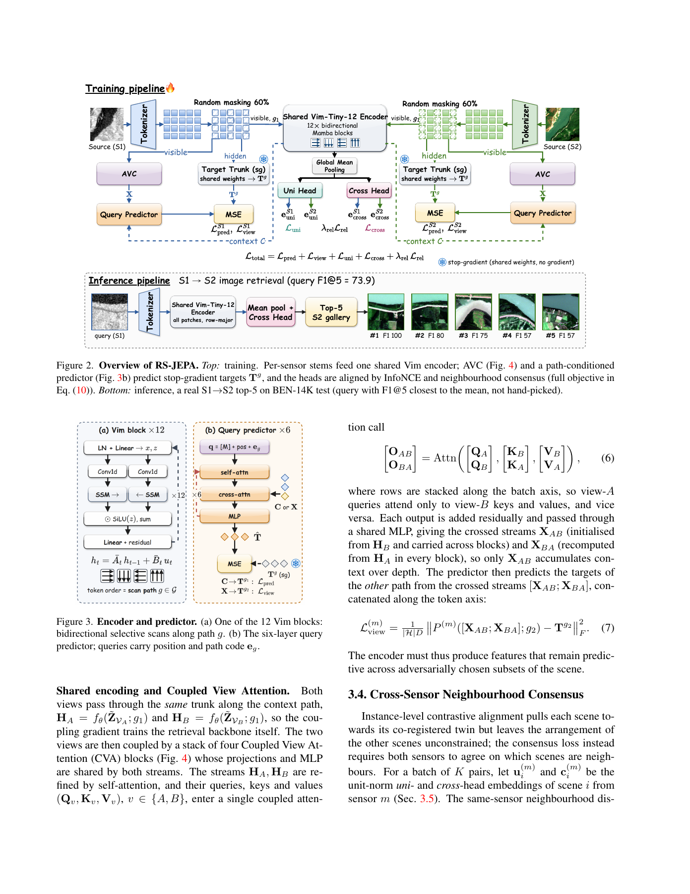

# RS-JEPA：扫描次序视图、对抗划分与跨传感器共识

> 本地交付扫描排列、反梯度划分和邻域损失三个独立 tensor 组件，不含替身 Vim、完整模型或图像检索成绩。CUDA 路径必须由提交的 A100/A30 回执验收。

## 论文信息

| 字段 | 内容 |
| --- | --- |
| 论文链接 | [RS-JEPA](https://arxiv.org/abs/2611.14496)，审查 [v1 原文](https://arxiv.org/html/2611.14496v1) |
| 公司/机构 | 一作 Tanishq Rachamalla：Prince Mohammad Bin Fahd University；PDF 第 1 页作者上标核对 |
| 首次公开日期 | 2026-11-10，18:51:05 UTC |
| 原文开源代码 | [作者 RSJEPA 仓库](https://github.com/Tanishq251/RSJEPA)，未复制实现、下载权重或遥感数据 |
| 本地 Adapter | 无（`adapter: null`）；组件 key：`rs-jepa` |
| 本地复现代码 | `src/auto_research/multimodal/rs_jepa.py` |

## 原始论文总结

### 背景与主要改动

顺序敏感的 Vision Mamba 对相同图像 patch 的不同读取次序产生不同表征，RS-JEPA 据此构造无像素编辑的视图。学习到的 hard half-split 让隐藏特征预测更困难；邻域共识不只拉近配准 twin，还约束两个传感器对其他场景的相似性分布。训练 target 使用同一主干的 stop-gradient，不是另一个 momentum encoder。



<!-- paper-figure:start -->
### 原论文关键图

[](https://arxiv.org/pdf/2611.14496v1#page=4)

> Figure 2 与 Figure 3，PDF 第 4 页。图片来自[原论文](https://arxiv.org/pdf/2611.14496v1#page=4)，版权归原作者所有；本地不包含图中的完整网络。
<!-- paper-figure:end -->

### 核心公式

四路径为 row-major、column-major、行内左右镜像、列内上下镜像；不是简单全序列反转。Eq.5 以 hard top-half 决定成员，$\widetilde z_j=z_j(1+\omega_j-\operatorname{sg}\omega_j)$ 前向等于原 token，scorer 经梯度反转训练，不能用纯 top-k 切片替代。

对 $j\ne i$，$Q_m(j|i)\propto\exp(u_i^{m\top}u_j^m/\tau_r)$；$\bar Q_i=\operatorname{sg}[(Q_1+Q_2)/2]$。$L_{rel}$ 是两个 same-sensor 和两个 cross-sensor 分布对 $\bar Q$ 的四项 KL，除以 $4K$。四分布都排除配准 twin，target 不回传梯度。

### 论文离线与线上效果

作者在 BEN-14K、CBRSIR-VS 和 DSRSID 报告 F1@5 72.92、80.35、94.43，检索网络约 3.88M 参数，训练结构约 14.57M；这是作者统一预算下的结果，不等于各 baseline 原论文最优成绩。未报告生产线上 A/B，本地未复测图像检索能力。

## 本地复现

### 数据协议与代码映射

`scan_path()` 返回精确排列；`adversarial_partition()` 实际执行 hard 分组、直通权重及反梯度；`neighbourhood_consensus()` 执行 Eq.8–9，拒绝单样本、零向量、非有限值和跨设备输入。采用合成小 tensor，不下载图像、checkpoint 或代理 backbone，不声称完整 JEPA 已训练。

```bash
PYTHONPATH=src python -c 'from auto_research.multimodal.rs_jepa import diagnostic; print(diagnostic(42, device="cuda"))'
```

### 结果、负控与边界

CPU 42/43/44 检查反梯度解析参考误差低于 $2\times10^{-15}$、等分/无交集、前向不改 token、相同邻域损失近零和传感器互换不变。独立循环还核对共识损失数值及 detached-target 梯度。`cuda` 不可用时显式失败，不回退 CPU；实际 CUDA 验收单独记录于 `docs/gpu-validations/rs-jepa-a100-20261111.json`，不能把 CPU 单测当作该回执。没有实际 backbone、CVA 全栈、predictor 或遥感检索能力结果，不进入 Evolve。

2026-11-11 已在单张 NVIDIA A100 上完成 seeds 42/43/44 的实际 `cuda:0` 前向与反传，三次均通过全部八项机制检查，scorer 梯度解析参考最大误差为 $8.89\times10^{-16}$ 以下。见[原始逐 seed 机制指标](metrics/component-cuda-seeds42-44.json)及[脱敏 GPU 回执](../../gpu-validations/rs-jepa-a100-20261111.json)。CPU/CUDA 的随机数流不同，不能要求合成 loss 数值逐位相同；本次验收仍不是图像检索 benchmark。

### 高成本完整实验

原实验为 12-block Vim、6 层 predictor、4 CVA，batch 290 训练 100 epoch，三组 paired dataset（仅 DSRSID 就有 56,000 训练对），另有独立重复和重训 baseline，使用四张 V100。完整多数据集比较 **成本过高，不复现（审查 DONE）**；小 tensor 组件廉价，仍须单独做真实 CUDA 验证，不能只因论文用多卡而放弃组件。
