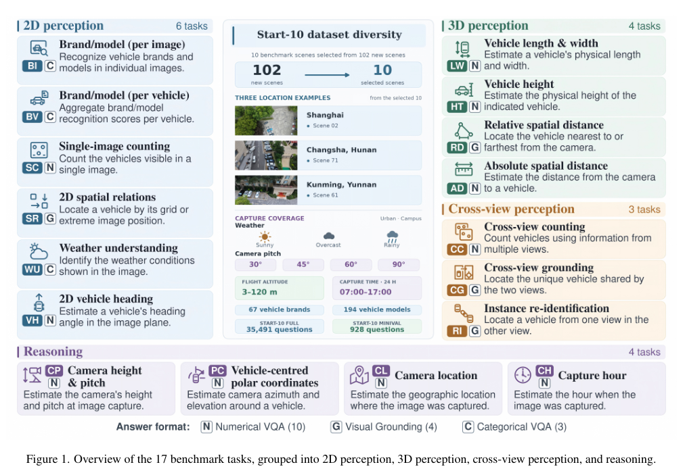

# RSLiveBench-UAV: fresh scenes, answer embargo, and traceable scoring

<!-- source-sha256: fd7ec0c903a2ca99b30f35a323af497cc2c51ae5579795ec96e8fc2440a22908 -->

[简体中文](README.md)

> **L0 protocol and partial scorer.** It replays four-scene FIFO updates, capture windows, answer embargo, and limited deterministic scoring. It acquires no UAV images, does not run the full 17-task benchmark, and reports no VLM capability score.

## Paper information

| Field | Value |
| --- | --- |
| Paper | [arXiv:2611.14953v1](https://arxiv.org/abs/2611.14953v1); [fixed text](https://arxiv.org/html/2611.14953v1) |
| Institution/company | First author Yue Zhou: East China Normal University |
| Original release | November 11, 2026, 02:59:53 UTC (arXiv v1) |
| Authors' code | The paper links the [benchmark site](https://rslivebench.space) and says it will be released. Fixed v1 links no released author scorer/code repository; referenced third-party model repositories are not this paper's code |
| Local adapter/key | rslivebench-uav-protocol; adapter null; no Evolve integration |
| Local code | src/auto_research/multimodal/rslivebench_uav_protocol.py; tests/test_nov18_data_protocols.py |

## Original paper

### Motivation and changes

Aerial spatial questions need cross-view entity association, real geometry and new observations, not just rewritten questions for old images. The authors combine recurring UAV acquisition, entity-centered answer production, four-scene rolling windows and delayed answer release. A new release admits images captured strictly between the preceding and current releases. It retires the earliest admitted scene: 25% of **scenes**, not necessarily 25% of questions or score weight. [Section 3 and scoring appendix](https://arxiv.org/html/2611.14953v1#S3)

### Key original figure

Original Figure 1 and caption, fixed-v1 PDF page 2, not redrawn. Question counts and model results are not local data. [Provenance and SHA256](assets/provenance.json). Copyright remains with the authors.

Image from the [original paper](https://arxiv.org/html/2611.14953v1); copyright belongs to the original authors.

### Equations

$$
R_{v-1}<\tau(I)<R_v,\quad T_{\rm public}(s)\ge\max(T_{\rm retire}(s),T_{\rm first}(s)+4\text{ calendar months}).
$$

Four months means calendar months, not 120 days. Answers remain embargoed until retirement as well. SC count parsing accepts only nonnegative decimal-integer strings. For positive references, it averages ten relative-error thresholds from 5% to 50%, producing a 0–100 score. Zero is a valid prediction; relative error at a zero reference is undefined and explicitly rejected rather than assigned an invented rule.

Aggregation proceeds observation → component → task → capability group, with each of four groups weighted 25%. A returned but unparseable prediction scores zero and stays in the denominator. A question not run is missing, not zero, and suppresses the complete official score.

### Paper results

The authors select Start-10 from 102 scenes and compare 30 models on 35,491 questions across 17 tasks. GPT-6-Astra scores 59.88 overall; the strongest tested embodied model scores 43.29. There is no production A/B. UAV acquisition, human verification and the full model matrix are not local execution records.

## Local component

### Inputs and code

RollingWindow.advance enforces strict capture timestamps and FIFO. disclosure_allowed implements calendar-month embargo. strict_count_mra implements only the SC subscorer, not all box/angle/GPS/category parsers. aggregate_scores hierarchically aggregates a caller-declared four-group inventory, rejects duplicate/unknown IDs and propagates missing predictions as unavailable. Its tiny local inventory is not the official 17-task release.

    PYTHONPATH=src python -c 'from auto_research.multimodal.rslivebench_uav_protocol import diagnostic; print(diagnostic(42, device="cpu"))'

### Controls and limits

Checks cover future captures, reused old imagery, premature answer disclosure, January 31 plus four months, no number extraction from free text, equal group weighting despite unequal question counts, and missing versus unparseable predictions. No model reads answers or plans; constructed examples only validate the protocol.

### Full experiment not reproduced

New UAV acquisition, spatial annotation, human cross-view verification and the 30-model matrix exceed a short single-A100/A30 budget and available data. **High-cost full experiment not reproduced, review DONE.** Unreleased data/scorers are not advertised as integrated; no real flight or large-weight download is initiated.
