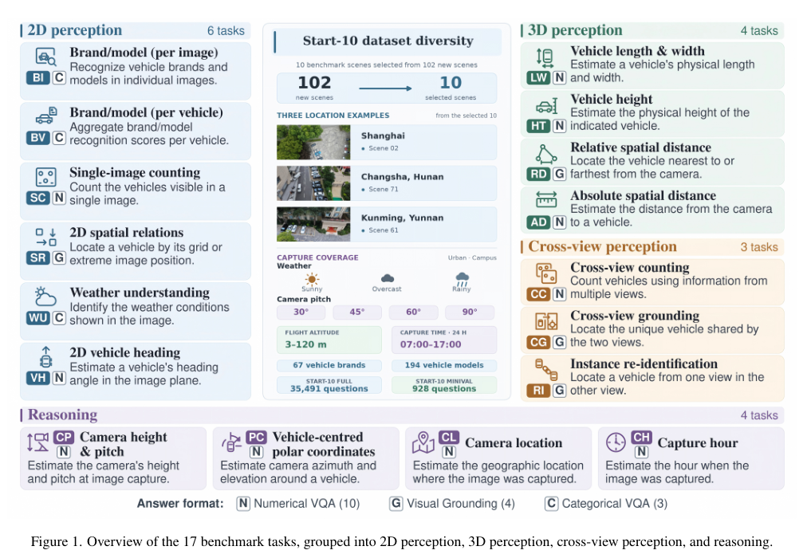

# RSLiveBench-UAV：新鲜场景、答案禁运与可追溯计分

[English](README-en.md)

> **L0 协议/部分 scorer。** 只重放四场景 FIFO、采集时窗、答案禁运和部分确定性计分，不采集无人机图像、不运行完整 17 任务 benchmark，也不提供 VLM 能力分数。

## 论文信息

| 字段 | 内容 |
| --- | --- |
| 论文链接 | [arXiv:2611.14953v1](https://arxiv.org/abs/2611.14953v1)；[固定全文](https://arxiv.org/html/2611.14953v1) |
| 公司 / 机构 | 一作 Yue Zhou：East China Normal University |
| 首次公开日期 | 2026-11-11 02:59:53 UTC（arXiv v1） |
| 原作者开源代码 | 原文给出[benchmark 站点](https://rslivebench.space)并写明将发布；固定 v1 未给出已发布的作者 scorer/代码仓库。引用的第三方模型仓库不是本论文代码 |
| 本地 adapter / key | `rslivebench-uav-protocol`；adapter 为 null，未接入 Evolve |
| 本地复现代码目录 | `src/auto_research/multimodal/rslivebench_uav_protocol.py`；专测 `tests/test_nov18_data_protocols.py` |

## 原始论文总结

### 背景与主要改动

航空空间题需要跨视角实体匹配、真实几何与新观察，不是给旧图片改写问题。作者将持续实地 UAV 采集、实体中心的答案生产、四场景滚动窗口和延迟公开答案组合成持续 benchmark。新版本只接受上一发布与本次发布之间拍摄的图像；每次退役最早入窗场景，更新的是 25% **场景**，不是固定 25% 题目或分数。[§3、附录评分协议](https://arxiv.org/html/2611.14953v1#S3)

<!-- paper-figure:start -->
### 原论文关键图

固定 v1 第 2 页原始 Figure 1 和图注，未重绘。图中题量和模型结果均不属于本地数据。[来源、裁切与 SHA256](assets/provenance.json)。版权归原作者。
<!-- paper-figure:end -->

### 核心公式

$$R_{v-1}<\tau(I)<R_v,\quad T_{\rm public}(s)\ge\max(T_{\rm retire}(s),T_{\rm first}(s)+4\text{ calendar months}).$$

四个月是日历月，不是 120 天；场景未退役不能公开答案。SC 计数仅接受十进制非负整数字符串，对正参考值用十个 5%—50% 相对误差门槛平均，返回 0—100 分。0 是有效预测，零参考的相对误差未定义，组件显式拒绝而非补规则。

最终层次是 observation → component → task → capability group，四组各占 25%。未解析的已返回预测记零并保留分母；未运行的题不是零分，必须使完整官方分数不可用。

### 论文离线与线上效果

作者从 102 场景选取 Start-10，报告 35,491 题、17 任务、30 模型比较，GPT-6-Astra overall 为 59.88，最强所测具身模型为 43.29。没有线上 A/B。完整 UAV 采集、人工核验与模型矩阵均不是本地执行记录。

## 本地复现

### 数据协议与代码映射

`RollingWindow.advance` 验证时间严格不等式与 FIFO；`disclosure_allowed` 实现日历月禁运。`strict_count_mra` 只做 SC 子 scorer，不宣称涵盖框、角度、GPS、类别的完整 parser。`aggregate_scores` 对调用者声明的四组 inventory 做层次聚合，并拒绝重复/未知 ID、将缺预测传成 unavailable。本地小 inventory 不是官方 17 任务发布。

    PYTHONPATH=src python -c 'from auto_research.multimodal.rslivebench_uav_protocol import diagnostic; print(diagnostic(42, device="cpu"))'

### 结果、负控与边界

检查未来采集时间、旧图重入、未退役答案公开、1月31日加四个月、文字回答不自动抽数字、题量不均的组等权，以及缺失与解析失败的区别。没有模型读答案或 plan；构造小例子只验证协议。

### 高成本完整实验

新 UAV 场景获取、空间标注、人工跨视角核验及 30 模型全矩阵超出单 A100/A30 的短预算与可用数据。**成本过高，不复现（审查 DONE）**；未发布的完整数据与 scorer 也不伪装已接入，不启动真实飞行或下载大权重。
