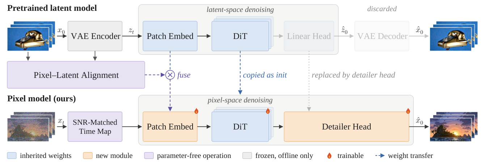

# PixVid: lift a pretrained video DiT back into pixel space

<!-- source-sha256: af14fd84ecf954028202fd5cf61ef0145afa848db73a106afc7f41fd4ff8a8ae -->

[简体中文](README.md)

> **Review only, not implemented.** Full 14B video training/evaluation is too costly; not reproduced (review DONE). An ordinary flow loss or interpolation is not a PixVid reproduction.

## Paper information

| Field | Value |
| --- | --- |
| Paper | [arXiv:2611.17336v1](https://arxiv.org/abs/2611.17336v1); [fixed text](https://arxiv.org/html/2611.17336v1) |
| Institution/company | Yanke Song: Roblox, affiliation marker 1 on the [official project](https://chenshuo20.github.io/PixVid/) |
| Original release | November 12, 2026, 18:59:55 UTC; announced November 13 |
| Authors' code | No verifiable released code/weight links found in fixed v1 or the official project. Its GitHub/Hugging Face labels are not linked, so they do not establish release |
| Local adapter/key | pixvid; adapter null; review_only; no Evolve integration |
| Local code | Not implemented: documentation and original figure only, no generator/trainer/metric artifact |

## Original paper

### Motivation and changes

Pixel video generation avoids VAE latent constraints, but learning large-scale spatiotemporal structure from scratch is expensive. PixVid retains a pretrained latent DiT, fuses an offline pixel–latent linear alignment into patch embedding, calibrates timesteps, and adds a detailer for high-frequency structure. Larger-patch initialization and a new upsampling block control token count. Simply deleting the VAE is not the method. [Sections 2–3](https://arxiv.org/html/2611.17336v1#S2)

### Key original figure

Original fixed-v1 Figure 2 PNG; no redrawing. Authors retain copyright, arXiv perpetual non-exclusive license. The full system has not been run locally. [Provenance](assets/provenance.json).

### Mechanisms and equations

Noised pixels are $x_\sigma=(1-\sigma)x+\sigma\epsilon$. Turning a clean-data prediction into velocity supervision requires the noise-scale weighting, with a denominator clipped at $\sigma_{min}$. Perceptual and temporal detail constraints remain part of the method; a weighted MSE alone is not the complete architecture. Larger patches fuse average-downsampling initialization, while the spatiotemporal detailer uses causal temporal convolutions and history caches. [Section 3](https://arxiv.org/html/2611.17336v1#S3)

### Paper results

Resolution, quality and time comparisons depend on Wan2.1-14B, B200, 50 sampling steps and CFG. The paper reports 53.6GB and 192 seconds per clip at 960×1664 and 21 frames. These are author-environment measurements, not local results or production A/B.

## Local scope and cost decision

This intake checks the method, release time, affiliation, source-release status and cost. **No component, generated video, GPU execution or metric artifact is provided.** It is not an Evolve operator; author figures/videos are not local results.

Approximately 1.3 million training clips, 20k updates, 1.3B/14B ablation matrices and high-resolution sampling exceed a short single-A100/A30/Mac budget. **Too costly; not reproduced (review DONE).** No weights/videos, cost-probing runs or automatic retries are initiated. Fitting one inference in memory does not make the complete campaign cheap.
