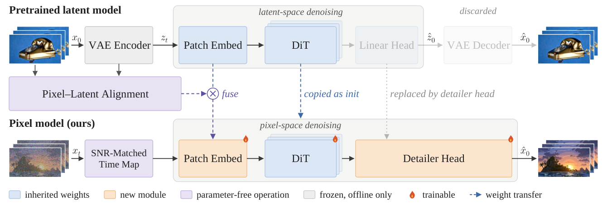

# PixVid：把预训练视频DiT迁移回像素空间

[English](README-en.md)

> **资料收录，未实现**。完整14B视频训练与评测成本过高，不复现（审查 DONE）；普通flow loss或插值不是PixVid复现。

## 论文信息

| 字段 | 内容 |
| --- | --- |
| 论文链接 | [arXiv:2611.17336v1](https://arxiv.org/abs/2611.17336v1)；[固定全文](https://arxiv.org/html/2611.17336v1) |
| 公司 / 机构 | 一作 Yanke Song：Roblox，[官方项目页](https://chenshuo20.github.io/PixVid/)首页机构标记1 |
| 首次公开日期 | 2026-11-12 18:59:55 UTC（v1）；11月13日公告 |
| 原作者开源代码 | 固定v1与官方项目页未找到可核验的已发布源码/权重链接；项目页GitHub/Hugging Face字样没有链接，不当作开源证据 |
| 本地 adapter / key | `pixvid`；adapter 为 null，review_only，未接入 Evolve |
| 本地复现代码目录 | 未实现；仅本文档与原图，无生成器、训练器或指标产物 |

## 原始论文总结

### 背景与主要改动

像素视频生成避免VAE潜空间约束，但直接从零学习大规模时空关系成本很高。PixVid保留预训练latent DiT知识，以离线像素—latent线性对齐融合进patch embedding、校准噪声时间步，再加入detailer处理高频细节。高分辨率patch初始化与新增上采样块控制token数量，不能只把VAE删掉就等同本文。[§2—3](https://arxiv.org/html/2611.17336v1#S2)

<!-- paper-figure:start -->
### 原论文关键图

固定v1 Figure 2原始PNG，无重绘；版权归原作者，arXiv perpetual non-exclusive license。图中完整系统没有在本地运行。[来源与 SHA256](assets/provenance.json)。
图片来自[原论文](https://arxiv.org/html/2611.17336v1)，版权归原作者所有。
<!-- paper-figure:end -->

### 核心机制与公式

噪声像素$x_\sigma=(1-\sigma)x+\sigma\epsilon$；clean-data预测转换为velocity监督时需保留噪声尺度权重，分母在$\sigma_{min}$截断。它还包含感知与时序细节约束，不能只实现一个带权MSE就宣称完整模型。更大patch以融合平均下采样初始化；新增时空detailer含因果时间卷积与历史缓存，维护跨帧一致性。[§3](https://arxiv.org/html/2611.17336v1#S3)

### 论文离线与线上效果

原文比较多分辨率生成质量与时间，依赖Wan2.1-14B、B200、50步采样与CFG。960×1664的21帧设置报告53.6GB、192秒/clip，是作者环境测量，不是本地测量，也不是生产A/B。

## 本地范围与成本决定

本轮仅核对方法、首发时间、机构、代码发布状态与成本。**未实现组件、未生成视频、未运行GPU、没有指标产物**；不放入Evolve，不将原图或作者视频当本地结果。

完整约130万训练clip、20k更新和1.3B/14B多臂矩阵，加上高分辨率采样，超出单A100/A30/Mac短时预算。**成本过高，不复现（审查 DONE）**；不下载权重或视频，不用试跑探测成本，不自动重试，也不因显存勉强能容纳一次推理就将整套研究当低成本。
