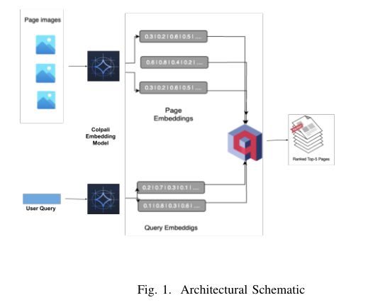

# Multimodal digital-library retrieval: page matching and scoped performance

<!-- source-sha256: 6548730112efd7e7a2ba61319abe6440440a434bc3741f01ad1a6067154a5972 -->

[简体中文](README.md)

> **L0 retrieval/performance readout.** It consumes external vectors, rankings, relevance judgments and timing samples. It is not ColPali inference, Qdrant service, or a production library and does not reproduce the paper's throughput.

## Paper information

| Field | Value |
| --- | --- |
| Paper | [arXiv:2611.17726v1](https://arxiv.org/abs/2611.17726v1); [fixed text](https://arxiv.org/html/2611.17726v1) |
| Institution/company | First author Krishna Priya: Intelligent Systems Engineering, Indiana University, Bloomington, USA |
| Original release | November 13, 2026, 04:16:25 UTC (arXiv v1) |
| Authors' code | Fixed v1 links no accompanying author implementation repository; no separate release was verified as of November 18, 2026. ColPali and Qdrant are dependencies, not proof that the authors' complete experiment is released |
| Local adapter/key | multimodal-library-protocol; adapter null; no Evolve integration |
| Local code | src/auto_research/multimodal/library_retrieval_protocol.py; tests/test_nov18_data_protocols.py |

## Original paper

### Motivation and changes

OCR inverted indexes struggle with conceptual search over diagrams and layouts. The authors render textbook pages, produce multivectors with ColPali/PaliGemma-3B, retrieve through Qdrant, and compare cosine, dot product, Euclidean and Manhattan metrics. HNSW, disk Memmap and binary quantization address indexing cost; this is not a newly trained vision-language architecture. [Sections III–V](https://arxiv.org/html/2611.17726v1#S3)

### Key original figure

Original Figure 1 and caption, fixed-v1 PDF page 6, rendered and cropped without redrawing. [Provenance and SHA256](assets/provenance.json). Copyright remains with the authors.

### Equations

$$s(q,d)=\sum_i\max_j\mathrm{sim}(q_i,d_j).$$

Each query token selects its best page-token match, then scores sum; this is not page-average pooling. Smaller distance is better, so local distance scores are explicitly negated before max. A separate evaluator reads sealed relevance judgments: Precision@5 divides by 5, Recall by all known relevant pages, and AP@5 retains unretrieved relevant pages in its denominator. It is not full-ranking MAP.

Throughput is $\mathrm{QPS}=N/T_{\rm wall}$, not generally $1000/\mathrm{mean\ latency(ms)}$ under concurrency. Database-only preencoded measurements and end-to-end measurements including encoding must remain separate.

### Paper results

Across 75 queries, cosine P@5/Recall@5/F1/AP/MRR are 0.514/0.281/0.353/0.238/0.801. The 14 multi-page and 13 conceptual queries are explicit subsets, not stated to be disjoint. Later discovery of unlabeled relevant pages for 18/75 queries and post-hoc human/GPT-4 verification does not authorize automatic relevance relabeling.

The performance description has **scope conflicts**: Section V-B excludes encoding using preencoded database queries (about 52.13 ms encoding and 220.98 ms retrieval over 4,158 pages). Section V-D says encoding is included, yet Table VII's 0.32 ms single-worker mean / 22,124.94 QPS do not substantiate that end-to-end interpretation. The prose also changes the maximum 100,000 workers to one million. We preserve the reported numbers without endorsing million-user or end-to-end throughput claims. There is no production A/B.

## Local component

### Inputs and code

late_interaction_score only receives token vectors, with no gold argument. retrieval_metrics reads sealed judgments outside the policy and rejects duplicates. subgroup_means supports overlapping query subsets. timing_summary consumes actual external timing samples and requires database_only_preencoded or end_to_end_encoding_and_retrieval scope; it reports mean, P95, P99 and measured-wall-time QPS without inventing a clock.

    PYTHONPATH=src python -c 'from auto_research.multimodal.library_retrieval_protocol import diagnostic; print(diagnostic(42, device="cpu"))'

### Controls and limits

Diagnostics check page-token MaxSim, distance direction, AP differences at equal hit counts, unretrieved relevant pages, duplicate IDs, zero-norm cosine and latency/throughput scope. Toy vectors and timing samples test calculations only; they are neither database stress tests nor model capability measurements. Real page encoding, cross-result top-25 deduplication, later reranking and index deployment are unimplemented.

### Full experiment not reproduced

The full 4,158-page, over-four-million-patch-vector experiment, PaliGemma-3B encoding, separate Qdrant collections and repeated concurrency matrix exceed this short component budget. The authors do not provide the complete textbooks and 75-query manual judgments as an accompanying release. **High-cost full system not reproduced, review DONE.** Only CPU scorer/timing interfaces are delivered; no weights, services or automatic retries.
