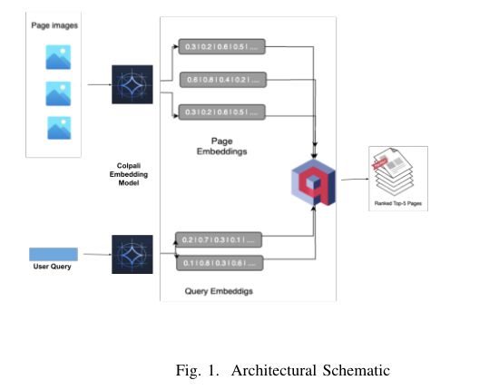

# 多模态数字馆检索：页面匹配与有边界的性能协议

[English](README-en.md)

> **L0 检索/性能读出组件。** 接收外部向量、排名、相关性和计时样本；不是 ColPali 推理、Qdrant 服务或生产数字馆，不宣称复现论文吞吐。

## 论文信息

| 字段 | 内容 |
| --- | --- |
| 论文链接 | [arXiv:2611.17726v1](https://arxiv.org/abs/2611.17726v1)；[固定全文](https://arxiv.org/html/2611.17726v1) |
| 公司 / 机构 | 一作 Krishna Priya：Intelligent Systems Engineering, Indiana University, Bloomington, USA |
| 首次公开日期 | 2026-11-13 04:16:25 UTC（arXiv v1） |
| 原作者开源代码 | 固定 v1 原文未提供配套作者代码仓库，截至 2026-11-18 未核得独立发布；ColPali、Qdrant 是上游依赖，不是作者完整实验的开源证明 |
| 本地 adapter / key | `multimodal-library-protocol`；adapter 为 null，未接入 Evolve |
| 本地复现代码目录 | `src/auto_research/multimodal/library_retrieval_protocol.py`；专测 `tests/test_nov18_data_protocols.py` |

## 原始论文总结

### 背景与主要改动

纯 OCR 倒排索引难以按概念搜索图表与复杂排版。作者把教材页渲染成图像，经 ColPali/PaliGemma-3B 生成多向量，用 Qdrant 检索并比较余弦、点积、欧氏和 Manhattan 距离。HNSW、磁盘 Memmap、binary quantization 服务于索引成本；不是训练新的视觉语言架构。[§III—V](https://arxiv.org/html/2611.17726v1#S3)

<!-- paper-figure:start -->
### 原论文关键图

固定 v1 第 6 页原始 Figure 1 与图注，原图裁切非重绘。[来源、裁切与 SHA256](assets/provenance.json)。版权归原作者。
图片来自[原论文](https://arxiv.org/html/2611.17726v1)，版权归原作者所有。
<!-- paper-figure:end -->

### 核心公式

$$
s(q,d)=\sum_i\max_j\mathrm{sim}(q_i,d_j).
$$

每个 query token 匹配最合适的页面 token，再求和；不是先全页平均。距离越小越好，本地统一取负距离后求 max，明确分数方向。评测在独立 scorer 读取相关性：Precision@5 的分母固定为 5，Recall 分母为全部已知相关页，AP@5 保留这些未检索相关页的分母；不能将其误称为完整排名 MAP。

吞吐 $\mathrm{QPS}=N/T_{\rm wall}$，并发时不等于 $1000/\mathrm{mean\ latency(ms)}$。必须分开数据库预编码查询和含模型编码的端到端测量。

### 论文离线与线上效果

75 条查询中，余弦 P@5/Recall@5/F1/AP/MRR 为 0.514/0.281/0.353/0.238/0.801。14 条 multi-page 和 13 条 conceptual 是显式子集，原文未说明互斥，不能当分区加权。18/75 查询后来发现未标相关页，后验人工/GPT-4 核验不等于自动把新检索项改成正确。

性能部分有**口径冲突**：§V-B 预编码数据库测量排除模型开销（编码约 52.13ms，4,158页检索约220.98ms），§V-D 又称含编码，而 Table VII 的单 worker 平均 0.32ms / 22,124.94 QPS 并不足以支持该端到端解释；正文还把最高100,000 workers写成1million。保留作者数据但不背书百万并发或端到端吞吐；原文没有线上 A/B。

## 本地复现

### 数据协议与代码映射

`late_interaction_score` 只计算调用者提供的 token 向量，无 gold 输入。`retrieval_metrics` 在策略外读取封存相关性，拒绝重复结果；`subgroup_means` 保留可重叠查询子集。`timing_summary` 接收真实外部计时，强制 `database_only_preencoded` 或 `end_to_end_encoding_and_retrieval` 标签，输出均值、P95、P99 与实测 wall-time QPS，不伪造时钟。

    PYTHONPATH=src python -c 'from auto_research.multimodal.library_retrieval_protocol import diagnostic; print(diagnostic(42, device="cpu"))'

### 结果、负控与边界

诊断检查 page-token MaxSim、距离方向、相同命中数但不同顺序的 AP 差别、未检索相关页、重复 ID、零范数余弦与延迟/吞吐口径。样例向量和计时仅用于计算测试，不是数据库压测或模型能力。未实现原文的真实页面编码、top-25跨结果去重、后续重排和索引部署。

### 高成本完整实验

4,158 页、超过400万 patch 向量、PaliGemma-3B 编码、多个独立 Qdrant collection 与重复并发矩阵超出本轮短预算；完整教材与75查询人工判断也未由作者配套开放。**完整系统成本过高，不复现（审查 DONE）**；仅交付可外部接入的 CPU scorer/计时接口，不下载权重、不搭建服务、不自动重跑。
