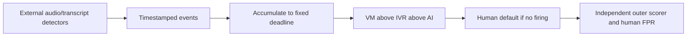
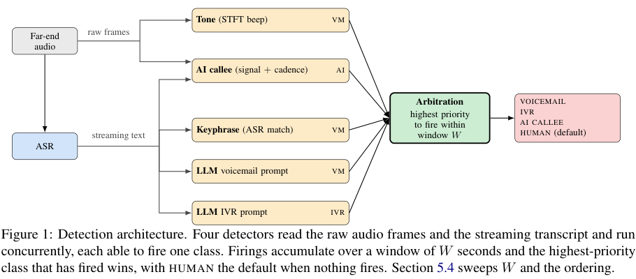

<!-- source-sha256: 6ab965d73f88abc3a347317c728c010f709def3d70a3fd2069b83aa09eb3fd76 -->

# FEND: accumulate evidence to a deadline instead of letting the first detector win

[简体中文](README.md)

> **component_only / L0 voice-detection protocol interface.** Only external detector events and separate labels are processed. Audio, ASR, LLM and AI-cadence classifiers are not implemented. The full private-call campaign is not reproduced due to cost (review DONE).

## Paper information

| Field | Content |
| --- | --- |
| Paper | [FEND: Far-End Detection in Outbound Voice AI Calls](https://arxiv.org/abs/2611.18050v1), [fixed v1](https://arxiv.org/html/2611.18050v1) |
| First-author affiliation | Abhishek Kumar, Observe.AI, India |
| Original publication | **2026-11-13 11:25:42 UTC**, arXiv v1 |
| Author code | No verifiable paper-specific author code found in fixed v1. Cited nexmo-community repositories are not this paper's release |
| Local adapter / key | `fend-protocol`; `adapter=null`, not integrated into Evolve |
| Local code | `src/auto_research/multimodal/fend_protocol.py` |

## Original paper

### Background and main changes

Outbound voice systems distinguish people, voicemail, IVR and another AI. Mistaking a person for automation can terminate a useful call, so AI-detection AUC alone is insufficient. FEND concurrently reads audio, streaming ASR and existing dialogue-model tool events: an STFT beep detector, multilingual keywords, LLM voicemail/IVR tools, and an AI-cadence classifier using first-turn word timings. Reusing an already-running dialogue model does not mean this local interface implements free LLM detection.

Events accumulate through window $W$, default 20 seconds. The final order is **voicemail > IVR > AI > human**, with human only when no detector fires. Later higher-priority evidence can supersede early AI evidence; this is not first-firing termination. The paper sweeps window and ordering on training data, not on public/private test results.

### Architecture and workflow



<!-- paper-figure:start -->
### Original paper figure



Fixed-v1 PDF p.3, Figure 1, including its caption. Left-side detectors and ASR are not local implementations. [Original figure](https://arxiv.org/pdf/2611.18050v1#page=3), copyright belongs to the authors. [Crop and hashes](assets/provenance.json).

Image from the [original paper](https://arxiv.org/html/2611.18050v1); copyright belongs to the original authors.
<!-- paper-figure:end -->

### Core equations

For events $e_j=(t_j,c_j)$ and automated-class priority $\pi$:

$$
\hat c=\arg\max_{c_j:t_j\le W}\pi(c_j),\quad\hat c=human\ \text{if the set is empty}.
$$

The risk denominator contains only true humans:

$$
HFPR=\frac{\#\{i:y_i=human,\hat c_i\ne human\}}{\#\{i:y_i=human\}}.
$$

HFPR is undefined without human examples; it must not be filled with zero. Acoustic candidates first face a cross-human-corpus calibration screen: $g=(median(S)-median(R))/IQR(R)$, admitting only $|g|\le1$. Passing does not imply positive-class discrimination. Local sample quantiles explicitly use linear interpolation and do not reproduce the complete acoustic front end.

### Author results

Public Telephony-AMD has 400 clips, split 119 tuning/281 evaluation. Private 1,000-call data are divided roughly equally, with 501 calls in the held-out table. The private timing subset contains only 67 AI and 62 human calls with at least four timed words, yielding reported AUC 0.952. **Human-versus-rest binary F1** is 0.979 with HFPR 2.9%; this is not four-class weighted F1. Default-order four-class accuracy is 0.938 and AI-class F1 only 0.571. IVR counts are tiny and should not be overgeneralized. Offline evaluation of production data is not randomized online A/B. No calls or models were evaluated locally.

## Local implementation

### Data protocol and code mapping

`DetectorEvent` requires finite nonnegative time, a named detector and an automated class. `arbitrate` sees only events, not gold, audio or answers. Events at $t=W$ are included; later events are counted as ignored. No wall-clock sleep is needed. Detectors require trusted external implementations; hand-supplied events are not automatic detection accuracy.

The outer `evaluate` scores exactly matching call IDs. `acoustic_null_gate` compares external human-only scores, rejecting zero IQR and invalid values. Missing components include keyword matching, STFT, streaming ASR, GPT-4o tool prompts, seven-feature timing logistic regression, sample grouping, and the full train/tune/test pipeline.

```bash
PYTHONPATH=src python -c 'from auto_research.multimodal.fend_protocol import diagnostic; print(diagnostic(42))'
PYTHONPATH=src python -m pytest tests/test_nov18_agent_protocols.py -q
```

### Diagnostics and limits

[CPU protocol metrics](metrics/component-cpu-seeds42-44.json) test event-order invariance, late voicemail superseding early AI, the 20-second boundary, human default and shifted-human null rejection. These are synthetic interface diagnostics, not capability accuracy. Unlike [GSLM2](../2611.01143-gslm2/README.md), FEND targets low-latency call classes and human rejection risk, not multi-stream speech representation learning. Both local slices depend on external model outputs and must not be presented as reproduced speech models.

### High-cost full experiment

The complete pipeline needs private production calls, commercial ASR, existing dialogue-LLM tools and trained timing/acoustic detectors. A single A100/A30 or Mac cannot cheaply recreate these resources. **Full experiment not reproduced due to cost (review DONE).** No audio/weights, calls, ASR API or automatic retry. This CPU interface has no CUDA gate and remains `promotion_eligible=false`, `evolve_integrated=false`.
