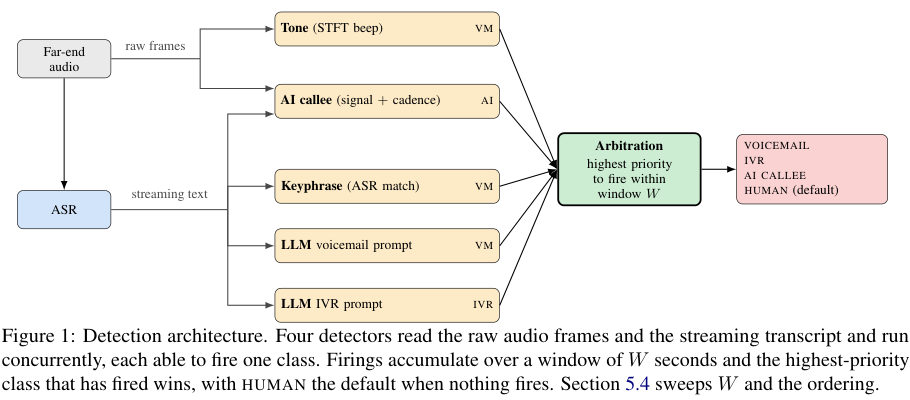

# FEND：在固定期限内累积证据，而不是第一个检测器抢答

[English](README-en.md)

> **component_only／L0语音检测协议接口。** 本地只处理外部检测事件与独立标签，未实现音频／ASR／LLM／AI节奏分类器；完整私有通话实验高成本不复现（审查 DONE）。

## 论文信息

| 字段 | 内容 |
| --- | --- |
| 论文链接 | [FEND: Far-End Detection in Outbound Voice AI Calls](https://arxiv.org/abs/2611.18050v1)，[固定v1正文](https://arxiv.org/html/2611.18050v1) |
| 一作机构 / 公司 / 学校 | Abhishek Kumar，Observe.AI，India |
| 首次公开日期 | **2026-11-13 11:25:42 UTC**（arXiv v1） |
| 原作者代码 | 固定v1未找到可核实本篇作者源码；文中引用的nexmo-community等仓库不属于本篇作者发布 |
| 本地 adapter / key | `fend-protocol`；`adapter=null`，未接入Evolve |
| 本地复现代码 | `src/auto_research/multimodal/fend_protocol.py` |

## 原始论文总结

### 背景与主要改动

外呼语音系统要区分真人、语音信箱、IVR和另一个AI。误把真人当自动系统会切断有效对话，因此不能只优化AI检测AUC。FEND并行读音频、流式ASR和既有对话模型的工具事件：STFT提示音、多语种关键词、LLM voicemail／IVR工具，以及依赖首轮词间时序的AI节奏分类。工具沿用运行中的对话模型，不等于这里已经实现了“零成本LLM检测”。

检测事件累计到窗口$W$，默认20秒。最后按**voicemail > IVR > AI > human**选已触发的最高级；无事件才human。后来的高优先级事件可以覆盖更早的AI提示，不能第一个firing就停止。原文在训练部分扫窗口与优先级，不能拿公开／私有test重新选更好配置。

### 架构与流程


<!-- paper-figure:start -->
### 原论文关键图



固定v1 PDF第3页Figure 1，含原图注；左侧检测器／ASR不是本地实现。[原论文图](https://arxiv.org/pdf/2611.18050v1#page=3)版权归原作者；[裁剪及SHA256](assets/provenance.json)。
图片来自[原论文](https://arxiv.org/html/2611.18050v1)，版权归原作者所有。
<!-- paper-figure:end -->

### 核心公式

令事件$e_j=(t_j,c_j)$，自动类别优先级为$\pi$：

$$
\hat c=\arg\max_{c_j:t_j\le W}\pi(c_j),\quad\hat c=human\ \text{若集合为空}.
$$

关键风险指标只用真实human作为分母：

$$
HFPR=\frac{\#\{i:y_i=human,\hat c_i\ne human\}}{\#\{i:y_i=human\}}.
$$

无真人样本时HFPR未定义，不能填零。原文声学指标先做跨真人语料零假设校准：$g=(median(S)-median(R))/IQR(R)$，$|g|\le1$才保留；通过也不保证正类区分度。本地分位数采用线性插值的明确约定，未声称复现作者全部声学前端。

### 论文离线与线上效果

公开Telephony-AMD共400段，以119调参／281评估；私有1000通话按一半训练／一半评估，固定测试表中501通话。私有AI时序样本实际仅67AI与62human（至少4个带时间词），报告AUC 0.952；**human-versus-rest二元决策**F1为0.979、HFPR为2.9%，不是四类weighted F1。默认优先级下四类accuracy为0.938，AI类F1仅0.571。IVR样本很少，不能过度外推。生产语料离线测试不是随机线上A/B，本地未跑任何通话数据或模型。

## 本地复现

### 数据协议与代码映射

`DetectorEvent`必须有有限非负时间、明确检测器和自动类别；`arbitrate`只接收事件，不接gold、音频或答案。$t=W$被纳入，迟于窗口仅记ignored，不用真实墙钟sleep。检测器需要外部可信实现；手工注入的事件不是自动检测准确率。

`evaluate`在外层用严格同call ID的预测／标签计算HFPR；`acoustic_null_gate`只比较两份外部human分数，并拒绝零IQR与无效值。未实现关键词匹配、STFT、流式ASR、GPT-4o工具prompt、7时序特征逻辑回归、样本分组或完整训练／调参／测试流。

```bash
PYTHONPATH=src python -c 'from auto_research.multimodal.fend_protocol import diagnostic; print(diagnostic(42))'
PYTHONPATH=src python -m pytest tests/test_nov18_agent_protocols.py -q
```

### 结果、负控与边界

[CPU协议指标](metrics/component-cpu-seeds42-44.json)检查乱序事件不变性、后到VM覆盖早AI、20秒边界、human默认及跨human分布漂移拒绝；这些都是合成接口诊断，没有能力accuracy。与[GSLM2](../2611.01143-gslm2/README.md)不同，本篇目标是低延迟通话类别和真人误拒风险，不学习多流语音表示；二者局部CPU输入都依赖外部模型，不能把接口输出称为语音模型复现。

### 高成本完整实验

完整链路依赖私有生产通话、商业ASR、既有对话LLM工具及训练的时序／声学检测器，无法用单卡A100/A30或Mac低成本等价重建。**高成本完整实验不复现（审查 DONE）**；不下载音频或权重，不拨打电话／调用ASR，不自动重试。CPU接口无CUDA验收需求，`promotion_eligible=false`、`evolve_integrated=false`。
