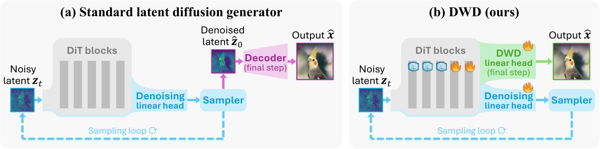

# DWD: separate final pixel readout from denoising

<!-- source-sha256: 1e24935b79acdb628e2bbf36d868874d47245fa4ee5abe5e23f2c3642cab41d5 -->

[简体中文](README.md)

> **Review only, not implemented.** Full experiments are **too costly; not reproduced (review DONE)**. No capability improvement or Evolve promotion is claimed.

## Paper information

| Field | Value |
| --- | --- |
| Paper | [arXiv:2611.22287v1](https://arxiv.org/abs/2611.22287v1); [fixed text](https://arxiv.org/html/2611.22287v1) |
| Institution/company | First author Hansheng Chen: Luma AI |
| Original publication | 2026-11-17T06:40:08Z (arXiv v1); separately observed announcement: 2026-11-18 |
| Authors' code | No released method-specific author source was found in fixed v1 and its author links. Dependency libraries are not counted as the paper code. |
| Local adapter/key | `dwd`; adapter null; no Evolve integration |
| Local source | None; documentation, original figure and learning material only |

## Original paper

### Motivation and changes

DWD adds a parallel linear pixel head to final DiT features. The original denoising head drives sampling; the pixel head runs only at the last nonzero timestep. Separate pixel-quality and trajectory-anchoring objectives avoid forcing both roles through one output. [Reviewed method](https://arxiv.org/html/2611.22287v1#S3): 3.1–3.4, 4.1–4.2.

### Key original figure

The fixed-version author figure/table is not a local result. Scientific content was not redrawn. Copyright remains with the original authors; no open-image license is inferred. [Source, crop and SHA256](assets/provenance.json).

### Equations

$$
\hat x_i=Wh_i+b,\qquad L=L_{pix}+\lambda L_{traj},\quad L_{traj}=\mathbb E\|\hat u-\operatorname{sg}(\hat u_{ref})\|_2^2.
$$

Pixel and trajectory terms sample different timestep distributions, accumulating gradients before one optimizer step. Final pixel readout omits CFG because it no longer advances the trajectory. Treating t0as a conventional decoder degrades quality in the paper.

~~~mermaid
flowchart LR
 Z[Latent noisy input] --> H[Pretrained DiT and adapted suffix]
 H --> U[Denoising head advances trajectory]
 H --> P[Final-step pixel head]
 U --> T[Frozen-reference anchoring]
 P --> Q[Pixel quality objectives]
~~~

### Reported results and evidence

The reported quality/efficiency relies on the full paper configuration, which was not reproduced locally. No production randomized-traffic A/B is reported for this method. Benchmarks, single-device serving measurements, or using Meta/Google models are not production A/B evidence.

## Local implementation

### Protocol and code mapping

Review only: no operator, training, metrics, GPU receipt or Evolve mapping. A generic linear layer and MSE would omit the defining quality adaptation and sampling path, so no shadow reproduction is presented.

There is no local run command, metrics artifact or GPU receipt. Review DONE is not implementation completion, and no automatic reproduction/retry queue is created.

### Same-topic comparison and boundaries

PixVid transfers a latent DiT to pixel-space inputs/generation with a detailer. DWD retains latent sampling and changes final readout. Pixel output does not mean pixel-space sampling. Multiple seeds do not upgrade these mechanism checks into L2/L3 capability evidence.

### High-cost full experiments

SiT0.67B/JiT0.95B/FLUX2klein9B/Wanimage-videomatrix,last4–8blocksfinetuning,LPIPSandStyleGAN-Tobjectives,1024resolutioncampaign; full experiment high cost.

This is a configuration-based cost assessment, not measured local duration. The budget is one A100 or A30, or the local Mac. No multi-GPU capacity, costly probing run, large-resource download or automatic retry is assumed. Full experiments are **too costly; not reproduced (review DONE)** and do not block review closure.
