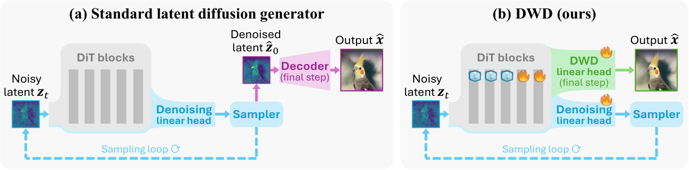

# DWD：将最终像素读出与去噪目标分开

[English](README-en.md)

> **资料收录，未实现**。完整实验**成本过高，不复现（审查 DONE）**；无能力提升或Evolve晋级声明。

## 论文信息

| 字段 | 内容 |
| --- | --- |
| 论文链接 | [arXiv:2611.22287v1](https://arxiv.org/abs/2611.22287v1)；[固定全文](https://arxiv.org/html/2611.22287v1) |
| 公司 / 机构 / 学校 | 一作 Hansheng Chen：Luma AI |
| 首次公开日期 | 2026-11-17T06:40:08Z（arXiv v1）；公告日期另记为 2026-11-18 |
| 原作者开源代码 | 固定v1及原作者链接未找到可核验的已发布方法源码；未找到/未发布，不把依赖库算原作者代码。 |
| 本地 adapter / key | `dwd`；`adapter: null`，未接入Evolve |
| 本地复现代码目录 | 无；仅本文档、原图与学习资料，未实现 |

## 原始论文总结

### 背景与主要改动

DWD在预训练DiT最后隐状态上并联线性pixel head，原denoising head继续驱动采样，只有最后一个非零time step才由pixel head输出图像/视频。通过分离pixel质量目标与trajectory anchoring，避免让同一输出承担冲突目标。 [已核方法位置](https://arxiv.org/html/2611.22287v1#S3)：3.1–3.4, 4.1–4.2。

<!-- paper-figure:start -->
### 原论文关键图

原图/原表来自固定v1，未经科学内容改绘；是作者方法或结果，不是本地测量。[来源、裁切和SHA256](assets/provenance.json)。图片来自[原论文](https://arxiv.org/html/2611.22287v1)，版权归原作者所有。
<!-- paper-figure:end -->

### 核心公式

$$
\hat x_i=Wh_i+b,\qquad L=L_{pix}+\lambda L_{traj},\quad L_{traj}=\mathbb E\|\hat u-\operatorname{sg}(\hat u_{ref})\|_2^2.
$$

pixel与trajectory损失从不同time distributions取样，两次反传后统一optimizer step。末步不用CFG，因为该步读出像素而不推进trajectory；t=0的“当成decoder”模式在原文退化。

~~~mermaid
flowchart LR
 Z[Latent noisy input] --> H[Pretrained DiT and adapted suffix]
 H --> U[Denoising head advances trajectory]
 H --> P[Final-step pixel head]
 U --> T[Frozen-reference anchoring]
 P --> Q[Pixel quality objectives]
~~~

### 论文离线与线上效果

原文以其完整训练/推理与评测配置讨论效果；本地没有复跑该矩阵，不把论文数值写成本地指标。未报告本文方法的生产随机流量线上A/B；benchmark、单卡服务计时或使用Meta/Google模型本身不是A/B证据。具体质量/速度与成本配置须一起阅读。

## 本地复现

### 数据协议与代码映射

仅资料收录，无operator、训练、metrics、GPU receipt或Evolve映射。线性层加MSE不足以兑现像素质量、少数后缀blocks适配与采样路径，不用便宜影子模型充数。

本页没有本地运行命令、指标文件或GPU回执。审查DONE不等于完成实现；不进入自动复现或重试队列。

### 同主题比较与边界

PixVid迁移latent DiT到pixel输入/生成空间并加detailer；DWD保留latent采样，只改变最终读出。输出是像素不意味着整个采样都在pixel空间。 本地结果只支撑上面列明的算子合同，多个seed不将L1升级成公开能力L2/L3。

### 高成本完整实验

原文覆盖SiT约0.67B、JiT约0.95B、FLUX.2 klein9B和视频模型；微调后4—8层并使用LPIPS/StyleGAN-T目标，含1024分辨率和视频矩阵。完整实验成本过高，不拆一个通用线性层假装完成。

以上是配置依据的成本判断，不是本地实测耗时。资源预算为单A100或A30，或本地Mac；不假定多卡、不断扩大或试训证明成本。**成本过高，不复现（审查 DONE）**；不下载大模型/数据，不启动完整矩阵，不自动重试，不阻塞本轮审查闭环。
